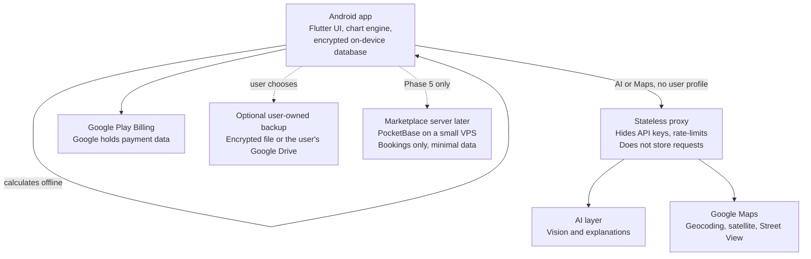
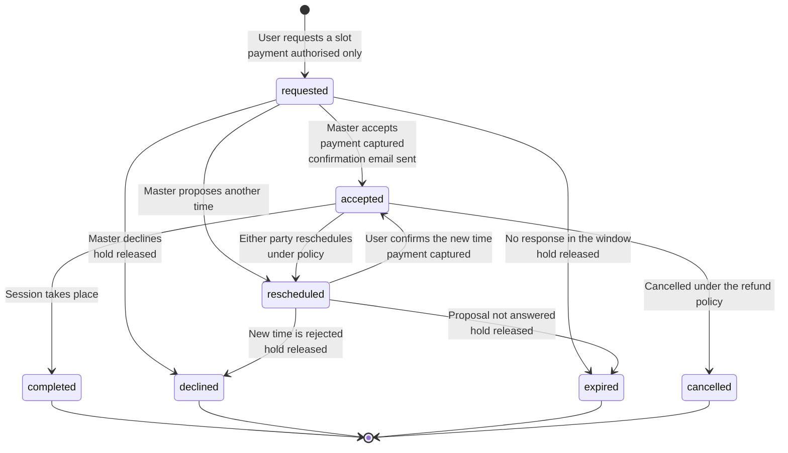

# Ultimate Feng Shui App: Product and Technical Plan

Every feature of a personal feng shui and destiny app, how each one works, the technology behind it, how it makes money, and a phased path to launch on Android.

This document is the developer-ready specification for GitHub user **bhemfine** to build from. Product intent is taken from the agreed plan. Where this document adds user stories, screens, operations, data fields, diagrams and acceptance criteria, those are implementation details to help you build, not a change to the product. Tech stack and vendor choices are **recommendations** unless stated otherwise. Do not treat any price, commission rate, user volume or running cost as decided; those are open and should be tested after launch. The only known fee in this plan is the Google Play developer account fee of **USD 25** (one-time).

**Working title:** Ultimate Feng Shui App (final name is an open decision). The approved UI prototype uses the temporary name **Inkstone**.  
**First market:** Singapore (and Malaysia), English only (Chinese language dropped on 27 Nov 2026).  
**Platform:** Android first, iOS later from the same code.  
**UI source of truth:** the clickable prototype in `fengshui-ui-v3` and **[DESIGN.md](DESIGN.md)** (midnight astrolabe, champagne gold `#bfa577` / `#e3d6b8`, ivory, twinkling starfield).

## Table of contents

1. [Vision](#1-vision)
2. [How the system fits together](#2-how-the-system-fits-together)
3. [Tech stack](#3-tech-stack)
4. [Module 1: Personal profile and chart engine](#4-module-1-personal-profile-and-chart-engine)
5. [Module 2: Home and floor plan analyser](#5-module-2-home-and-floor-plan-analyser)
6. [Module 3: House hunting with Google Maps](#6-module-3-house-hunting-with-google-maps)
7. [Module 4: Relationships and compatibility](#7-module-4-relationships-and-compatibility)
8. [Module 5: Daily, monthly and yearly forecasts](#8-module-5-daily-monthly-and-yearly-forecasts)
9. [Module 6: Ask the Master](#9-module-6-ask-the-master)
10. [Module 7: Palm and face reading](#10-module-7-palm-and-face-reading)
11. [Module 8: Tarot, horoscope and I Ching](#11-module-8-tarot-horoscope-and-i-ching)
12. [Module 9: Crystals, rituals and remedies](#12-module-9-crystals-rituals-and-remedies)
13. [Module 10: Master teleconsulting marketplace](#13-module-10-master-teleconsulting-marketplace)
14. [Where AI is used and where it is not](#14-where-ai-is-used-and-where-it-is-not)
15. [Data model](#15-data-model)
16. [Monetisation](#16-monetisation)
17. [Privacy, safety and Play Store rules](#17-privacy-safety-and-play-store-rules)
18. [Development phases (Android)](#18-development-phases-android)
19. [Feature rollout](#19-feature-rollout)
20. [Risks and open decisions](#20-risks-and-open-decisions)
21. [MVP (Phase 1) build checklist](#21-mvp-phase-1-build-checklist)
22. [Commercial launch readiness](#22-commercial-launch-readiness)

---

## 1. Vision

One app that knows you, your family and your home, and turns classical Chinese metaphysics into clear, personal, daily advice. Feng shui and BaZi are the credible core; palm reading, tarot, horoscopes, crystals and rituals are add-on modules that make it fun and sticky.

> **Core principle:** Charts and rules are calculated by exact code, never guessed by AI. AI only reads photos and explains results in plain language, and every reading cites the rule it is based on.

> **Data principle:** This is a local-first Android app. All personal data stays on the user's phone. The operator does not keep profiles, birth details, charts, floor plans, photos, readings or chats. There is no hosted user database for the core product (no Supabase or similar). Online calls, when needed, go through a small stateless proxy that hides API keys and does not store what was sent.

| | |
| --- | --- |
| **First market** | Singapore and Malaysia, English only (decided 27 Nov 2026) |
| **Platform** | Android first, iOS later from the same code |
| **Users** | Home buyers, renovators, couples, and anyone who checks their luck daily |
| **Default schools** | Flying Stars (Xuan Kong) and Eight Mansions (Ba Zhai) for homes, Four Pillars (BaZi) for people |

---

## 2. How the system fits together

Most of the app runs entirely on the phone, including the chart engine. The app does not talk to AI or Maps with keys in the client. Those calls go through a small **stateless proxy** that keeps API keys safe, rate-limits use, and checks that the caller has a valid Play purchase when the feature is paid. The proxy does not create user accounts, does not log request bodies, and does not store photos, prompts or results.

A separate server is needed only later, for the master marketplace in Module 10, because bookings involve two people.

**Recommended request flow**

1. The user sets up a profile on the phone. Birth details, family, charts, homes, photos and readings are written only to the encrypted on-device database. There is no cloud sign-up for the core app.
2. The chart engine runs on the device. The same inputs always produce the same chart. Results are saved locally so later screens open instantly without recalculating or calling the network.
3. When a feature needs Maps, vision AI, or an AI write-up, the app sends a minimal payload to the proxy: images, coordinates, or already-calculated chart factors. Names and raw birth details are stripped from prompts wherever the feature still works without them. The proxy forwards the call, returns the result, and forgets it.
4. Subscriptions are sold through Google Play Billing. Google holds the payment data. The app verifies the purchase on the device, or asks the proxy to check the Play purchase token without storing a user profile.
5. Backup is optional and user-owned: an encrypted export file the user keeps, or a copy in the user's own Google Drive app folder. The operator cannot read it. Uninstalling the app without a backup deletes the data; the app must warn about this.
6. The master marketplace, when built, is the only service that keeps records, and those records are limited to booking time, master id, an anonymous user handle and a contact email for confirmation, then deleted after a set retention period.

---

## 3. Tech stack

These are recommended choices, not locked decisions. Swap a vendor only if it still meets the "why" column. Do **not** introduce a hosted backend that stores personal data (Supabase, Firebase Auth/Firestore, or a custom user database) for the core app.

| Layer | Choice (recommended) | Why |
| --- | --- | --- |
| Mobile app | Flutter | One codebase for Android and iOS, smooth animations for tarot, compass and the starfield |
| On-device database | SQLite via drift, or Isar | All personal data lives on the phone |
| Encryption | Encrypted database; key in Android Keystore via flutter_secure_storage | Birth details, homes and photos stay unreadable if the file is copied off the device |
| Chart engine | Dart library on the device (plain Dart today: solar terms, BaZi, Kua, Flying Stars). Western natal, when built later, must **not** use Swiss Ephemeris; see Module 8 | Offline charts |
| Knowledge base | Texts bundled in the app, searched on the device (SQLite full-text search; a local vector index is optional) | Lets Ask the Master cite the right classical rule without a cloud database |
| Stateless proxy | A Cloudflare Worker, or a tiny Node service with no database | Hides AI and Maps keys, rate-limits, verifies paid features; does not log or store request contents |
| AI models | A vision-capable large language model, called only through the proxy | Reads palms, floor plans and photos, and writes readings |
| Maps | Google Maps Geocoding, Static Maps, Street View, Places, called only through the proxy | Address lookup, facing and surroundings |
| Payments (app) | Google Play Billing in the app | Subscriptions and one-off digital reports; Google holds card and payment data |
| Local alerts | flutter_local_notifications (or equivalent) | Daily card, clash days and solar terms, with no device-token server |
| Shop catalogue | Bundled in the app, optionally refreshed from a public static file | No user identity is sent to load crystals and cures |
| Optional backup | Encrypted export/import, or the user's own Google Drive app folder | The user owns the copy; the operator never sees it |
| Crash reporting | A crash reporter with personal data stripped | Stability without names, birth dates, addresses, photos or user ids |
| Analytics | None, or anonymous aggregate events with no personal data | See feature use without keeping a profile |

Module 10 (master teleconsulting), built later, adds a small self-hosted server and further recommended vendors, listed in that module: **PocketBase on a small VPS** for bookings, video (Agora, Twilio Video, Daily.co or Stream), payouts (Stripe Connect, so card data never touches the operator), and transactional email (SendGrid, Postmark or Resend). Check Google Play's current policy before taking consultation payments outside Play Billing.

**Recommended supporting practices**

- The core app has no cloud accounts, no `/v1/auth/register` and no personal-data API.
- Proxy routes can use a `/v1/` prefix. They are stateless and accept only the payload needed for that call.
- Secrets (Maps, AI, Play verification, and later Stripe and email) live only on the proxy or the marketplace server, never in the app.
- The chart engine is a versioned Dart library with golden-test charts.
- The proxy and, later, the marketplace each have development, staging and production environments.
- Android Auto Backup of the raw database should be off, or limited to the in-app encrypted backup, so personal data is not copied to a cloud account in the clear.

---

## 4. Module 1: Personal profile and chart engine

> **Status (27 Nov 2026, `830dff7`):** Engine **built** (BaZi, Kua, Flying Stars natal and annual, almanac, Na Yin, Tai Sui / Year Breaker / Three Killings, lucky lists). User-owned profiles **not built** — the app hardcodes the example couple Chua Boon Eng and Chou Jiahui Victoria (`flutter_app/lib/data/household.dart`). Birth “Save” does not persist. Hour pillar is omitted when birth time is unknown. Encrypted database **not built** (SharedPreferences for checklist answers only). Swiss Ephemeris is not in the code (solar terms are plain Dart). Equation of time and Zi Wei Dou Shu are **not built**. Western signs are **not built**.

The foundation. Users enter birth date, time and place for themselves and family members, and every other feature personalises from it. All of this stays on the phone.

| | |
| --- | --- |
| **Outputs** | BaZi Four Pillars, Day Master and element balance, luck pillars by decade, Kua number and four good and four bad directions, Zi Wei Dou Shu chart, Chinese zodiac, Western sun, moon and rising signs |
| **Inputs** | Birth date, exact time (or unknown), birthplace, gender (needed for Kua and luck pillar direction) |
| **AI used** | No for calculation; yes for the plain-language personality summary, via the proxy, from stored chart factors only |

### How it works

1. **Convert birthplace to coordinates and time zone.** A bundled place list can resolve many cities offline. If the user needs a fuller lookup, Geocoding goes through the proxy; the coordinates are saved only on the device. Longitude corrects clock time to true solar time.
2. **Find the solar year and month.** BaZi years start at Li Chun (around 4 February) and months at solar terms, not lunar new year. The on-device engine already computes solar term moments in plain Dart (not Swiss Ephemeris).
3. **Derive the four pillars.** Heavenly Stem and Earthly Branch for year, month, day and hour from the sexagenary cycle.
4. **Score element strength.** Count stems, hidden stems and seasonal strength to rate Wood, Fire, Earth, Metal and Water, and pick favourable elements.
5. **Calculate Kua and Zi Wei.** Kua from birth year and gender; Zi Wei from lunar date and hour using fixed star placement tables.
6. **Save and reuse on the device.** Results are stored in the encrypted local database so every other module reads them instantly with no recalculation and no network.

If birth time is unknown, still calculate year, month and day pillars, Kua and zodiac. Mark hour-dependent results (hour pillar, some Zi Wei palaces, Western rising sign) as unavailable rather than guessing.

### User stories

- As a new user, I want to set up my profile on this phone and enter my birth date, time, place and gender, so that the app can build my personal charts without creating a cloud account.
- As a user, I want to add family members (spouse, child and others) with their own birth details, so that home and compatibility features can include them, still only on this phone.
- As a user, I want to say my birth time is unknown, so that the app still gives me the charts it can and does not invent an hour.
- As a user, I want to see my BaZi pillars, Day Master, element balance, luck pillars, Kua number and good and bad directions, Zi Wei chart, Chinese zodiac, and Western sun, moon and rising signs, so that I understand my profile in one place.
- As a user, I want a short plain-language personality summary that cites the rules used, so that the chart is easy to understand.
- As a user, I want to edit birth details and have charts recalculated on the device, so that a typo does not stick forever.
- As a user, I want an optional encrypted backup I control, and a clear warning that uninstalling without a backup will lose my data.
- As a user, I want to delete all data on this device, so that nothing personal is left on the phone.

### Key screens

- Onboarding: welcome, birth details, and a short backup / data-stays-on-this-phone explanation. No sign-up or social login for the core app.
- Add or edit person: name, relationship to the profile, birth date, birth time or "time unknown", birthplace search, gender.
- Chart overview: Four Pillars, Day Master, element balance, favourable elements.
- Luck pillars by decade.
- Kua number and the four good and four bad directions (compass graphic).
- Zi Wei Dou Shu palace chart.
- Zodiac and Western natal summary (sun, moon, rising).
- Plain-language personality summary, with cited rules.
- Family / people list.
- Settings: language, notifications, optional backup (export file or the user's Google Drive), restore, and "delete all data on this device".

### On-device operations

| Operation | Purpose |
| --- | --- |
| Create or update local profile | Language, notification settings, disclaimer accepted, backup warning seen |
| List / add / edit / delete people | Family members and their birth details, stored only locally |
| Recalculate charts | Run the on-device engine and store results with engine version and calculation time |
| Load stored charts | Later screens read the saved result without recalculating |
| Delete all local data | Wipe the encrypted database and local photos (Play Store data-deletion requirement) |
| Export or import backup | Write or read an encrypted backup file |
| Back up to or restore from the user's Google Drive app folder | Optional; the operator has no access |

### Online calls (stateless proxy)

| Method | Path | Purpose |
| --- | --- | --- |
| `POST` | `/v1/geo/lookup` | Geocode a birthplace to coordinates and time zone. The proxy does not store the query. Skip this call when a bundled place list is enough. |
| `POST` | `/v1/explain/summary` | Generate the AI personality summary from already-calculated chart factors (not from a guessed chart, and without the person's name or raw birth date unless unavoidable). The proxy does not store the prompt or the result. |

### Data entities

- On the device: `profile`, `people`, `charts` (see [Data model](#15-data-model)).
- Chart rows should store engine version and calculation time so results can be recomputed after an engine fix.

### Acceptance criteria

- The same birth date, time, place and gender always produce the same BaZi, Kua, Zi Wei and Western natal results.
- Year and month pillars use solar terms (Li Chun and month terms), not lunar new year.
- Clock time is converted to true solar time using birthplace longitude before the hour pillar is calculated.
- Gender is required before Kua and luck-pillar direction are shown.
- Unknown birth time does not invent an hour pillar; hour-dependent outputs are marked unavailable.
- Charts are saved on the device and later screens load the stored result without recalculating.
- Calculation is done by the on-device chart engine, not by AI. AI is used only for the personality summary, is called through the proxy, must cite the rule or chart factor it is based on, and is not sent the person's name when the summary can be written without it.
- Personal data is not uploaded to a user database. The operator does not keep a copy of the profile.
- Golden tests compare engine output to a set of established known charts before release.

---

## 5. Module 2: Home and floor plan analyser

> **Status (27 Nov 2026, `830dff7`):** Checklist **built** and persisted on the phone. Flying Stars tips **built** (engine). Floor-plan image can be saved from listing import. Home-tab photograph / camera is a **demo stub**. The facing stepper on that screen is labelled example and does not update the current home. “Read my home” opens a stylised 4-room grid, not an overlay on the real plan. No AI room detection, no manual room markup on a photo. `currentHome` is memory-only and resets after a restart. Encrypted plan storage **not built** (plain files in the app folder; Android backup is already off).

Upload a floor plan or photos, set the facing direction, and get a room-by-room plan of what to place, move or fix. Plans, photos and findings are stored only on the phone.

### How it works

1. **Upload the plan.** A photo or PDF of the floor plan, such as an HDB or condo brochure, is stored in the app's private encrypted storage.
2. **Detect rooms.** In Phase 1 the user marks rooms by hand. In Phase 2 a vision model, called through the proxy, labels rooms, doors and windows and returns their outlines; the user corrects anything wrong by dragging. The proxy does not keep the image.
3. **Set facing.** The user picks a facing method (main door, balcony or living-room opening, or block facing), then stands at that opening and the phone compass reads the bearing, or they enter it manually. Tilt and magnetic interference warnings are shown. For HDB the app asks which method to use and does not default to the main door.
4. **Overlay grids.** The on-device engine divides the plan into nine palaces and overlays the Bagua, Eight Mansions sectors and the Flying Stars chart for the building's period and facing.
5. **Match to the household.** Each person's Kua directions, already stored on the device, are compared with bedroom, bed and desk positions.
6. **Generate advice.** Rules produce findings, such as the 2 and 5 sickness stars in the master bedroom this year; an optional AI write-up, from those findings only, goes through the proxy, with a cure such as metal objects or a brass wu lou.

**Phase note:** Phase 1 ships the analyser with **manual** room marking. AI room detection is Phase 2. The facing compass, grid overlay, household match and rule-based findings should work in Phase 1, fully offline after the plan is on the phone.

### User stories

- As a user, I want to upload a floor plan photo or PDF, including a typical HDB or condo brochure, so that I can analyse my home.
- As a user, I want to mark rooms, doors and windows by hand (and later accept or correct AI outlines), so that the overlay matches the real layout.
- As a user, I want to set facing with the phone compass or by typing it, with tilt and magnetic interference warnings, and to choose the facing method, so that the chart uses a reliable direction.
- As a user, I want Bagua, Eight Mansions and Flying Stars overlaid on nine palaces, matched to my household's Kua, so that I know what to place, move or fix in each room.
- As a user, I want a cure shopping list and almanac-backed renovation dates, so that I can act on the findings.
- As a user, I want my floor plan and home address to stay on this phone, not on the operator's servers.

### Key screens

- Home list and add home.
- Floor plan upload (photo or PDF).
- Manual room editor (Phase 1); AI outlines plus drag-to-correct (Phase 2).
- Facing compass, with quality warnings and manual entry.
- Overlay view: nine palaces, Bagua, Eight Mansions, Flying Stars.
- Findings by room and year, with cures and rule citations.
- Cure shopping list.
- Renovation date suggestions.

### On-device operations

| Operation | Purpose |
| --- | --- |
| List / create / update / delete homes | Address, period, completion year and notes, stored locally |
| Save floor plan file | Photo or PDF in the app's private storage |
| Save room outlines | Manual or corrected outlines and labels |
| Save facing | Compass or manual facing, with quality flags |
| Analyse home | Run Flying Stars, Bagua and Eight Mansions, match to household Kua, store findings |
| List findings and cures | Issues and cures by room and year, plus a shopping list |
| Suggest renovation dates | Almanac-backed dates from the on-device engine |

### Online calls (stateless proxy)

| Method | Path | Purpose |
| --- | --- | --- |
| `POST` | `/v1/vision/detect-rooms` | Phase 2: send the floor plan image, return outlines for the user to confirm. The proxy does not store the image. |
| `POST` | `/v1/vision/scan-room-photo` | Scan a room photo for common form problems; same no-store rule. |
| `POST` | `/v1/explain/home-findings` | Optional write-up from already-calculated findings, without the user's name or full address. |

### Data entities

- On the device: `homes`, `rooms`, `home_findings` (see [Data model](#15-data-model)).
- Floor plan and room photos are local files, not object storage on an operator server.

### Home checklist by property type (HDB, condo, landed)

The analyser and the house-hunting score use the same checklist. It applies to HDB flats, condominiums (including executive condominiums) and landed homes. The user first chooses the property type. Checks that apply to every home are listed first. HDB, condo and landed then add their own. Buying-stage and renovation checks follow. Where schools disagree, the rule is tagged and is never hard-coded to one method.

#### All homes

- **Shape and missing corners.** A square or rectangular plan is preferred. An L-shaped or odd layout can leave a Bagua sector missing, for example a missing south-west, which is linked to relationships. A small notch usually does not count; a cut of about a third of a side does. Bay windows, yards and very large balconies often create these cuts. Show what is missing and suggest furniture, lighting or zoning cures, not a structural rebuild.
- **Main door.** Flag a door that faces a neighbour's door, a lift, a rubbish chute or a staircase, and a straight line from the main door to a window, balcony or back door, where qi is said to flow out. Flag two main doors; if both exist, advise using only one. A long, narrow entrance corridor is said to speed qi rather than let it settle.
- **Bathrooms and toilets.** Flag a toilet in the centre of the home or in a person's lucky sector, and a toilet door facing the main door, kitchen or bed. Suggest cures such as keeping the door closed.
- **Kitchen.** Flag a stove facing the main door, a stove next to or directly facing the sink or fridge (a fire and water clash), and the stove's position relative to the household's Kua. Also check for a solid wall behind the hob, not a window; whether the cook can see the kitchen entrance; a stove facing a toilet or bedroom door; and a stove back-to-back with a toilet wall.
- **Bedrooms.** Flag a bed under a beam, a mirror facing the bed, a bed in line with the door, and the best bed and headboard direction for each person. The headboard should rest against a solid wall and should not share a wall with a toilet, a lift shaft or a rubbish chute. Also flag an air-conditioner, ceiling fan, pendant light or storage loft over the bed, sofa or desk.
- **Floor and unit number (popular belief).** The last digit of the floor can be given an element, and numbers such as 4 and 8 are widely used in Singapore buying. Tag this as popular belief and keep it separate from the classical reading.
- **Surroundings.** Flag a corridor-facing door, a T-junction or expressway aimed at the home, nearby hospitals, funeral parlours, temples, substations, police stations or government buildings, and whether the outlook is an open view or a close wall. Add a bright-hall check: open space, a park or water in front of the facing is treated as one of the best external features. From the window, not by leaning out, flag a narrow wind gap between two tall blocks, a neighbour's sharp corner, glare from glass or a pool, and noise from an MRT line or expressway. A very close sea or waterfront is sometimes said not to let qi gather.
- **Lucky spots.** Show the wealth corner and the annual Flying Stars: where to place a desk or plants this year, and which sector to leave alone. The definition of the wealth corner is school-dependent (see Where schools disagree).
- **Completion year and Period 9.** The natal Flying Stars chart needs the building's completion or TOP year as well as the facing. Period 8 runs from Li Chun 2004 to just before Li Chun 2024. Period 9 runs from Li Chun (about 4 February) 2024 to early 2044. A flat completed in 2010 and a new BTO with the same facing therefore get different charts. The year flips at Li Chun, not on 1 January.
- **Exact facing.** Store the bearing in degrees and as one of the 24 Mountains (15° bands). A few degrees can change the whole chart. A reading close to a boundary is flagged as a line facing.
- **The floor above.** In stacked HDB and condo blocks, flag a toilet above the stove, bed or main door, and a bedroom above a kitchen. These are fixed clashes. Check the unit above, or assume the repeating stack layout when that is known.
- **Keep the centre open.** The centre (Tai Chi) should stay open. Flag not only a central toilet but a household shelter, kitchen or heavy storage there. Also flag a standalone structural pillar, sometimes called piercing heart, and a long straight line through the home.
- **Altar and aquarium.** These are common in Singapore homes and deserve their own rules. An altar should sit on a solid, quiet living-room wall, not under a beam or air-conditioner, and should not back onto or face a toilet, kitchen, bedroom, store or household shelter. An aquarium or water feature is usually placed in the living room, often the north, south-east or east; not in a bedroom or kitchen, not under a beam, and not under or next to the altar, which is read as a water–fire clash.

#### HDB

- Many masters read the facing from the living-room window or balcony, not the corridor door. The app asks which method to use and does not default to the main door. If the user is unsure, it shows both. Corner, jumbo and lift-lobby units need their own reading, not a stack-wide assumption.
- The household shelter cannot be moved or structurally altered under HDB rules. If it sits near the centre, advise keeping it tidy. The app must never suggest moving the shelter as a cure. Cures must stay within what HDB allows: no structural changes.
- Bay windows and yards often create missing corners, as above. West-facing living rooms take year-round afternoon heat; mid floors are often preferred over very high, windy ones. These are practical as well as form-school points.
- For resale, the lease commencement date is a close proxy for the Flying Star period. Compare the as-built layout with the original HDB plan: the natal chart stays with the building, but which sectors are lived in can change.

#### Condo

- Read in layers: the site (block and surroundings), the tower facing, the stack, then the unit. Stacks in the same project can face different ways. Also check the main entrance and drop-off.
- The pool and other water features can help one stack and burden another, depending on where they sit on that unit's chart. Flag units over transfer decks, driveway mouths or substations, and sharp corners of other towers that are visible only from that floor, not from the showflat or the ground.

#### Landed

- Check the main gate as well as the front door, the plot shape, the driveway, slopes and support at the back of the house, and the garden and water features. Structural renovation, extensions and moving the door are allowed here, unlike in an HDB flat.
- Flag a staircase directly opposite the main door, where qi is said to rush upstairs, and a front door in a straight line with the back door or a rear window. Also flag a neighbour's roof corner, lamp post, tree, chimney or gate pointing at the door or windows; a Y-junction or inverted-U road; a drain or canal in front, or water at the back; a house lower than the road; a house sandwiched between taller buildings; a master bedroom above a garage; and a fence higher than the house.
- Cul-de-sacs and dead ends are contested: some classical lists treat them as unfavourable; some Singapore agents say to judge turning space and congestion instead. Tag the rule and do not apply a blanket no.
- Assess the centre on each storey. After an extension or addition and alteration, re-read the chart, because additions can disturb the original sectors.

#### Buying stage

- Get the completion or TOP date and the unit facing in writing. Check the URA Master Plan, because a good view can later be built out. Take the compass on site, held level and away from window grilles. Do the check before paying the option or booking fee.
- Align the house chart with the occupants' BaZi or Ming Gua, not only a couple Kua match to the door.

#### Reno tips

- Suggest good start dates from the Module 5 almanac, and sectors not to hack this year. For 2026, avoid starting hacking in the south (Five Yellow and Grand Duke) and the north (Three Killings). Starting works in Hungry Ghost month is commonly avoided. Advise against leaving the main door or kitchen unfinished for a long stretch.
- Do the feng shui check before the interior-design drawings, so door swing, stove, beds and desks are fixed first. If beams appear after hacking, plan a false ceiling then, not after the furniture goes in. Combining two bedrooms can change which room counts as the master, often the largest room, not only where someone sleeps.
- Colours and materials by sector are optional and school-dependent. For HDB, list only cures that HDB rules allow, with no structural changes, and never suggest moving the household shelter.
- **Move-in and house-warming.** Suggest auspicious dates, avoiding clash days with household zodiacs, and a simple checklist of rituals, such as opening windows, lighting the stove, and bringing in rice, salt and red dates, where the user wants them.

#### Where schools disagree

- **Facing of a flat.** Many classical and high-rise practitioners use the balcony or living-room opening, or the block orientation. Others still chart from the main door as the mouth of qi. The app must offer a facing-method setting (main door, balcony or living-room opening, or block) and, for HDB, ask the user rather than default to the main door. If the user is unsure, show both.
- **Resetting the natal period.** Some lineages say a major renovation of the roof, floor and main door can change the period if the works are substantial. Others say ordinary renovation does not change the chart. Do not auto-reset the period; ask, and tag the view.
- **Wealth corner.** Black Hat Sect uses the far-left corner from the main door. Classical practice often uses the south-east, or the Flying Star wealth stars. Let the user pick, or show both, and tag the school.
- **Colours by sector.** Some popular and Flying Star practice uses them; some classical writers say colours are not feng shui. Treat colour advice as optional and school-dependent.

#### Myths vs practice

- "South-facing is always best" and lucky floor or unit numbers, such as 4 versus 8, are widely used in Singapore, but they matter much less than facing, completion year and surroundings. Tag number luck as popular belief.
- Stories about previous owners are not a classical check. Crystals, charms and ornaments do not turn a badly sited house into a good one; selection comes first.

#### Sources

- [Singapore HDB and Condo Feng Shui](https://masterlimfengshui.com/info/learn/singapore-hdb-condo-feng-shui-guide/)
- [Viewing a New Home: Feng Shui Checklist](https://masterlimfengshui.com/info/learn/viewing-new-home-feng-shui-checklist/)
- [HDB Feng Shui Singapore](https://danielsiew.com/blog/feng-shui-hdb-flat-singapore)
- [Resale HDB Feng Shui checklist](https://danielsiew.com/blog/resale-hdb-feng-shui-checklist)
- [Feng Shui for Singapore Condos](https://danielsiew.com/blog/feng-shui-condo-singapore)
- [Feng Shui Renovation 2026](https://danielsiew.com/blog/feng-shui-before-renovation-guide)
- [Feng Shui Floor Plan Layouts Singapore](https://winfredquek.com/insights/feng-shui-floor-plan-guide-singapore)
- [Kitchen and Stove Feng Shui](https://winfredquek.com/insights/feng-shui-kitchen-stove-hdb-condo)
- [20 Fengshui Taboos, Qanvast](https://qanvast.com/sg/articles/20-fengshui-taboos-that-could-bring-negative-qi-and-to-avoid-3265)
- [5 feng shui property misconceptions, 99.co](https://www.99.co/singapore/insider/feng-shui-property-misconceptions-harm-you/)
- [Selecting a BTO with Period 9 Feng Shui](https://imperialharvest.com/blog/selecting-bto-with-auspicious-period-9-feng-shui/)
- [HDB Facing Direction Feng Shui](https://9heavens.com/blogs/news/hdb-facing-direction-feng-shui)
- [BTO Feng Shui: How to Read Your Floor Plan](https://adelinapang.com/bto-feng-shui-singapore-how-to-read-floor-plan/)
- [Feng Shui for New Home Singapore](https://eastchenconsultancy.com/feng-shui-for-new-home-singapore-checklist-before-you-move-in/)
- [Feng Shui for Landed Property in Singapore](https://eastchenconsultancy.com/feng-shui-for-landed-property-in-singapore-maximising-wealth-and-health-sectors/)
- [Feng Shui for Renovation in Singapore](https://eastchenconsultancy.com/feng-shui-for-renovation-in-singapore-dos-and-donts-during-hacking-works/)
- [Feng Shui and Landed Homes in Singapore](https://christopherng.com.sg/blog/feng-shui-and-landed-homes-in-singapore-should-buyers-really-consider-it)
- [The Entrance, Geomancy.Net](https://www.geomancy.sg/resources/fst/fst-shapes-entrance.htm)
- [Beginner's Guide to Property Feng Shui, Propwise](https://www.propwise.sg/the-beginners-guide-to-property-fengshui/)
- [Exterior Sha Qi Singapore](https://www.fengshuidahouse.com/exterior-sha-qi-singapore-part-1/)
- [Auspicious Setting of God Altar, Master Tham](https://www.mastertham.com.sg/auspicious-setting-of-god-altar-for-overall-wellbeing-in-fengshui-perspective)
- [Chinese Altar Singapore](https://www.moonfengshui.com.sg/post/chinese-altar-singapore-feng-shui-placement)
- [Aquarium Feng Shui Placement Guide](https://gensou.sg/aquarium-feng-shui-placement-guide/)
- [HDB renovation guidelines, building works](https://www.hdb.gov.sg/cs/infoweb/residential/living-in-an-hdb-flat/renovation/guidelines/building-works)

### Acceptance criteria

- Users can upload a photo or PDF floor plan, including typical HDB or condo brochure plans, stored only on the device.
- Users can mark rooms manually (Phase 1) and later accept or drag-correct AI outlines (Phase 2).
- Facing can be set from the compass or typed in. Tilt and magnetic interference warnings are shown.
- The plan is divided into nine palaces; Bagua, Eight Mansions and Flying Stars (for the building's period and facing) are overlaid.
- Household Kua directions are matched to bedroom, bed and desk positions.
- A cure shopping list states what to get and where to put it.
- Renovation dates are taken from the Module 5 almanac, not invented by AI.
- Annual and monthly star refresh can trigger a **local** notification when a bad star moves into a key room.
- The operator does not keep floor plans, addresses or findings. Vision calls go through the proxy and are not logged or stored.
- The app captures the property type (HDB, condo or landed) and the completion or TOP year. Period 8 versus Period 9 is taken from Li Chun 2024: Period 9 starts at Li Chun (about 4 February) 2024.
- Facing is stored as a bearing in degrees and as one of the 24 Mountains (15° bands). Line facings near a boundary are flagged.
- A facing-method setting offers main door, balcony or living-room opening, or block facing. For HDB the default is to ask the user; if they are unsure, both results are shown.
- Floor-above stack checks flag a toilet above the stove, bed or main door, and a bedroom above a kitchen, when the layout of the unit above is known or is assumed from a repeating stack.
- Rules are tagged by school (classical, Black Hat, or popular belief). Contested rules are not hard-coded to one method.
- HDB cures stay within HDB renovation rules: no structural changes, and the app never suggests moving or altering the household shelter.

---

## 6. Module 3: House hunting with Google Maps

> **Status (27 Nov 2026):** Core house-check **built** without Google Maps: quick check, compass direction calculator, map bearing (OneMap / OSM / Esri tiles + Nominatim search), and listing import from PropertyGuru, 99.co and the HDB Flat Portal (the human still picks facing). The current home (facing, address, floor) **persists** on the phone. Floor-plan photos can be taken or picked, with a 3×3 grid (facing at the bottom). Floor-element note **built** (popular He Tu last-digit belief, labelled as such). Licensed or self-hosted map tiles and geocoding are **required before a commercial launch** — the public OSM tile server, public Nominatim, and Esri World Imagery are not licensed for production apps. OneMap search already needs a token. Compass, map and WebView are untested on a real phone (`docs/phone_test_checklist.md`). Listing-page import may conflict with those sites’ terms; get legal advice before a public paid release.

Drop a pin or paste a listing address and get a feng shui score for the home and for each household member. Shortlists and reports are saved on the phone. Maps and Street View go through the proxy.

### How it works

1. **Locate.** The Geocoding API, via the proxy, turns the address into coordinates; the user picks the block and unit.
2. **Find facing.** Building footprint and satellite imagery suggest the facing; the user confirms it with the compass on site.
3. **Scan surroundings.** Places API finds hospitals, temples, cemeteries, petrol stations, substations and water within set distances. Road geometry checks for T-junctions or roads aimed at the door. These lookups go through the proxy.
4. **Read the view.** Street View and satellite images are passed to a vision model, via the proxy, to spot sharp corners, tall buildings in front, open space and hills behind. The proxy does not keep the images.
5. **Score the home.** The on-device engine builds the Flying Stars chart for its period, facing and completion year, plus Eight Mansions fit for each spouse's Kua.
6. **Report.** A score, who it suits, what can be cured, and a side-by-side comparison of shortlisted homes, all stored locally.

> **Singapore specifics to build in:** HDB and condo unit floors and their element, block facing from the unit number stack, MRT lines and expressways, and the move-in date picker.

Facing suggested from imagery is a hint only; the user should confirm it on site. The detailed home checklist for HDB, condo and landed homes, including where schools disagree, is in [Home checklist by property type](#home-checklist-by-property-type-hdb-condo-landed) under Module 2.

### Listing link import: PropertyGuru, 99.co and HDB Flat Portal (Phase 1, on the phone)

Paste a listing link in the House tab or the quick check, or share it to Inkstone from the site's app (Android share of a text link). The app fills in what the listing shows; the user checks every field and **always picks the facing themselves**.

- **Links understood.** PropertyGuru `/listing/hdb-for-sale-<block>-<street>-<id>`, `/listing/for-sale-<project>-<id>`, `/listing/for-rent-…` and the short `/l/<id>` link (redirects are followed). 99.co `/singapore/<sale|rent>/property/<slug>-<hdb|condo|landed…>-<id>`. HDB Flat Portal `homes.hdb.gov.sg/home/resale/<id>`.
- **Step 1, link only (offline, never blocked).** Site, listing id, sale or rent, HDB/condo/landed hint, block and street (or project name) from the slug. A short PropertyGuru link carries only the id until the page is read.
- **Step 2, page read on the phone.** A plain HTTPS fetch from the phone (no proxy) parses JSON-LD (skipping the site's own Organization block, e.g. 99.co's office postal code), `__NEXT_DATA__`, og: tags and the 99.co label/value rows. If the site returns a bot check (Cloudflare 403 "Just a moment", typical for PropertyGuru) or the page is a JavaScript app (HDB Flat Portal), the app opens the page in a small visible WebView on the phone, reads the visible text, then clears cookies, cache and storage. If that is also blocked, it says so plainly and keeps only the link data; the user types the rest. It never pretends.
- **Fields.** Address, postal code, block, street, project, property type, floor (exact storey from `#12-34`, the HDB storey range, or "High/Mid/Low"), unit, completion or TOP year (HDB: worked out from the remaining lease and marked approximate), latitude and longitude, floor plan image URLs, and the listing's own facing words as a **hint only**.
- **Map.** Missing coordinates (and a missing postal code) come from the Nominatim address search. The map bearing screen opens centred on the block, with the listing's facing shown only as a hint.
- **Floor plan.** Shown only when the user asks, downloaded only when they tap "Save as my home plan", kept in the app's private folder (backup off) and shown on Add your floor plan, where it can be confirmed, replaced or removed. HDB Flat Portal has no per-flat plan the app can fetch, so the user is asked to upload a photo or screenshot (Android photo picker, no storage permission).
- **Privacy.** Agent and seller names, phone numbers, prices and descriptions are never stored; the description is scanned in memory only for the postal code, unit, floor words and facing hint. Nothing is logged. Only what the user saves (the floor plan) is kept.
- **Pre-fill.** "Use in quick check" fills the property type, TOP year, address, postal code, floor and unit. The facing is never pre-filled. (The floor-element note from the Singapore specifics above is now shown, labelled as popular belief, not classical Flying Stars.)

### Your year, lucky lists and year afflictions (v4, offline)

- **Zodiac year with three elements.** Year stem element (what most calculators name, e.g. 庚午 = Metal Horse), the animal's fixed branch element (Horse = Fire) and the Na Yin (庚午 = 路旁土 Roadside Earth), with a one-line explainer that all three are right. Uses the Li Chun solar year.
- **Tai Sui status** for any year: 本命 (own year), 自刑, 冲, 刑, 害, 破 (offend) and 六合, 三合 (harmony). **Year afflictions**: Tai Sui direction (year branch), Year Breaker (opposite), Three Killings (申子辰 S, 寅午戌 N, 亥卯未 W, 巳酉丑 E), plus the annual 5 and 2 stars. Shown on the home result, quick check result, floor reading and home checklist (reno tips).
- **Your year screen** (`/yearly`, also linked from Today and BaZi): forecast text, dos, avoids, lucky months and Tai Sui note from the bundled `content/forecast_templates.json` (written 2026 and 2027; 2028–2035 in progress). Any other year gets a rule-based guide so the screen is never blank.
- **Lucky / unlucky lists, rule-based**: favourable and clashing elements from the BaZi (heuristic), colours by element, He Tu numbers (Water 1/6, Fire 2/7, Wood 3/8, Metal 4/9, Earth 5/0), Kua directions minus the year's afflicted sectors, and crystals / rituals from `content/crystals.json` and `content/rituals.json` by element and tag. The method is stated on screen. Hour-based items are shown as unavailable when the birth time is unknown.
- **Engine everywhere**: Today, Month, Year, BaZi and compatibility call the engine for the example couple; the floor reading and HDB plan compute Flying Stars for the home's period and facing (last quick check, kept in memory only; otherwise a labelled example).

### Quick check: home facing and Kua for one or two people (Phase 1, offline)

A fast way to answer "does this HDB flat or house suit me and my partner?" before any maps or AI features. It runs fully on the phone and stores nothing beyond the local profiles. The fuller checks for HDB, condo and landed homes, including layout, surroundings, buying-stage questions and renovation tips, are in [Home checklist by property type](#home-checklist-by-property-type-hdb-condo-landed) in Module 2.

**Step 1: property type, completion year and facing.** The app asks for the property type (HDB, condo or landed) and the completion or TOP year. For an HDB resale flat, the lease commencement date is close enough. The engine uses that year to set the Flying Star period: Period 8 if the building was completed from Li Chun 2004 to just before Li Chun 2024; Period 9 from Li Chun (about 4 February) 2024 onwards. The year flips at Li Chun, not on 1 January.

It then asks which facing method to use: the main door, the balcony or living-room opening, or the block facing. For HDB it does not default to the main door; it asks the user, and if they are unsure it shows both. Then it asks: "Do you know which way this opening faces?"

- **Yes, I know it.** Pick one of the eight directions (N, NE, E, SE, S, SW, W, NW) or type the degrees.
- **No, work it out for me.** Open the direction calculator (below).

**Step 2: direction calculator.** Gives a bearing in degrees, then converts it to a direction.

- **Compass at the opening.** Stand inside at the chosen opening looking out, hold the phone flat and tap to read the bearing. The magnetic reading is converted to true north (Singapore's declination is near zero, but it is still applied). Tilt and magnetic interference warnings are shown, and the user is asked to take three readings, which are averaged.
- **Map bearing (online, optional).** Search a postal code or block, drop a pin on the door or opening, then tap a point the way it looks out. The initial great-circle bearing is calculated on the phone and shown with the 8 directions, the 24 Mountains and the line-facing flag; the map stays north-up. Phase 1 is keyless and needs no location permission: OneMap basemap tiles, OpenStreetMap tiles and an Esri World Imagery satellite layer (each with attribution), and address search through OpenStreetMap Nominatim (search on submit only, at most one request a second, app user agent). OneMap's search API now needs a registered token, so it is not called from the phone. Tiles and search are the only network calls, and nothing is stored or logged. Later, search (OneMap with its token, then Google Geocoding and Street View) moves behind the stateless proxy, and a licensed or self-hosted tile source replaces the free OSM and Esri tiles before a large public launch.
- **Degrees to direction.** 337.5° to 22.5° is N, then every 45° (NE 22.5° to 67.5°, E 67.5° to 112.5°, and so on). The 24 Mountains sub-direction (15° each) is also stored for Flying Stars. A bearing within 3° of a boundary is flagged as a "line" facing and the user is asked to re-check.
- The facing is the direction the opening looks **out** towards, not the direction a person faces when walking in.

**Step 3: Kua calculator.** Uses birth date and gender from each saved profile, or a quick entry that is not saved.

- Use the **solar year**: anyone born before the start of spring (Li Chun, about 4 February; exact date and time from the solar-term table) counts as the previous year.
- Let `r = year mod 9`.
  - Male: `k = (11 - r) mod 9`, and `0` becomes `9`.
  - Female: `k = (r + 4) mod 9`, and `0` becomes `9`.
  - Kua 5 becomes **2** for males and **8** for females.
- Example checks:
  - Female born 12 Mar 1992 gives Kua 7.
  - Example couple: Chua Boon Eng, male, 26 Jun 1990, gives Kua 1 (East). Chou Jiahui Victoria, female, 28 Oct 1991, gives Kua 6 (West). They share no good direction.
  - Male born 1992 gives 8.
  - Male born 2000 gives 9.
  - Female born 2 Feb 1990 counts as solar year 1989 and gives Kua 4. (A female born after Li Chun 1990 gives Kua 8.)
- East group is 1, 3, 4 and 9. West group is 2, 6, 7 and 8.
- Four good directions (Sheng Qi, Tian Yi, Yan Nian, Fu Wei):

| Kua | Good directions |
| --- | --- |
| 1 | SE, E, S, N |
| 2 | NE, W, NW, SW |
| 3 | S, N, SE, E |
| 4 | N, S, E, SE |
| 6 | W, NE, SW, NW |
| 7 | NW, SW, NE, W |
| 8 | SW, NW, W, NE |
| 9 | E, SE, N, S |

The other four directions are the bad ones (Huo Hai, Wu Gui, Liu Sha, Jue Ming).

**Step 4: match the home to the people.**

| Result | Meaning shown |
| --- | --- |
| Facing is good for both | Strong fit for the couple |
| Good for one only | Suits that person; the app suggests bed and desk directions and cures for the other |
| Bad for both | Weak fit; show cures and suggest checking other units |

The app also shows which of the four good directions it is, for example "Sheng Qi, wealth" or "Tian Yi, health". In Phase 2 this result feeds into the full Flying Stars and surroundings score.

**Acceptance criteria for the quick check**

- The app asks for property type and the completion or TOP year, then about facing, before offering the calculator. Both facing paths end with a saved bearing and direction. Period 8 versus Period 9 is taken from Li Chun 2024.
- The user picks the facing method (main door, balcony or living-room opening, or block). For HDB the app asks and does not default to the main door; if the user is unsure, both results are shown.
- Facing is stored to the 24 Mountains (15° bands).
- The Kua engine passes the example checks above, plus a test set of at least 20 birthdays (including Li Chun boundary days and births before 1950 and after 2030) matched against established calculators.
- Compass readings show tilt and interference warnings, and line facings are flagged.
- A couple result is shown for one or two people without needing a saved account. Quick-entry birthdates are not stored unless the user saves the profile.

### User stories

- As a home buyer, I want to paste an address or drop a pin and pick the block and unit, so that I can score a listing before I view it.
- As a buyer, I want a suggested facing from the building footprint and satellite view, and a way to confirm it with the compass on site, so that the chart is not based on a guessed door.
- As a buyer, I want nearby hospitals, temples, cemeteries, petrol stations, substations, water, T-junctions and roads aimed at the door flagged, so that I can see external sha qi.
- As a buyer, I want Street View and satellite analysis of sharp corners, tall buildings in front, and open space or hills behind, so that form school is included.
- As a couple, I want a score for the home and a fit for each spouse's Kua, so that we know who benefits and what can be cured.
- As a buyer, I want to compare shortlisted homes side by side, so that I can choose more clearly.
- As a Singapore buyer, I want unit floor element, block facing from the stack, and nearby MRT lines or expressways included, so that the report matches local housing.
- As a buyer, I want a pre-purchase report and a move-in date picker, so that I can act on the result.
- As a buyer, I want shortlisted addresses and reports to stay on this phone.

### Key screens

- New listing: address search, map pin, block and unit picker.
- Facing suggestion and on-site confirm.
- Surroundings and view-analysis findings.
- Home score and per-person Kua fit.
- Side-by-side comparison.
- Pre-purchase report and move-in date picker.

### On-device operations

| Operation | Purpose |
| --- | --- |
| Save / list / open listings | Shortlisted homes and their latest scores, stored locally |
| Confirm facing | Manual or compass facing for a listing |
| Score listing | Flying Stars and Eight Mansions scores for the household, on the device |
| Compare listings | Side-by-side comparison of selected local listing ids |
| Build pre-purchase report | Report generated and saved on the device |
| Suggest move-in dates | Almanac-backed dates from the on-device engine |

### Online calls (stateless proxy)

| Method | Path | Purpose |
| --- | --- | --- |
| `POST` | `/v1/maps/locate` | Geocode an address or pin; return candidates for block and unit |
| `POST` | `/v1/maps/facing/suggest` | Suggest facing from footprint and satellite imagery |
| `POST` | `/v1/maps/surroundings` | Query Places and road geometry for external features |
| `POST` | `/v1/maps/view-analysis` | Fetch Street View or satellite images and run the vision model |

The proxy does not store addresses, coordinates or images. The app does not embed Maps or AI keys.

### Data entities

- On the device: `listings`, plus reuse of `homes`, `home_findings`, `people`, `charts` and local `purchases` for paid reports (see [Data model](#15-data-model)).

### Acceptance criteria

- An address or dropped pin is geocoded; the user can pick block and unit.
- Suggested facing is shown as a suggestion and can be confirmed or overwritten on site.
- Surroundings scan covers hospitals, temples, cemeteries, petrol stations, substations and water within configured distances, plus T-junctions or roads aimed at the door.
- Street View and satellite images are analysed for sharp corners, tall buildings in front, open space and hills behind.
- The home score uses the Flying Stars chart for period, facing and completion year, and Eight Mansions fit for each spouse's (and other household members') Kua, all calculated on the device.
- The report states the score, who it suits, and what can be cured, and is saved locally.
- Two or more shortlisted homes can be compared side by side.
- Singapore logic includes HDB and condo unit floors and their element, block facing from the unit number stack, MRT lines and expressways, and a move-in date picker.
- The app does not call Google Maps APIs directly; the stateless proxy does, and does not keep the lookups.

---

## 7. Module 4: Relationships and compatibility

> **Status (27 Nov 2026, `830dff7`):** Engine-based Kua and zodiac comparison **built** for the example couple only. No general couple picker, no Zi Wei marriage palace, no Western synastry. “Share result” is a snack stub. The screen is marked example.

| | |
| --- | --- |
| **Who** | Partner, crush, spouse, business partner, boss, child, or a friend |
| **Methods** | Day Master interaction, branch clashes and combinations, spouse palace, zodiac harmony, Zi Wei marriage palace, Western synastry |
| **AI used** | No for scores; yes for the write-up from those scores, via the proxy |

Both people are entered as local profiles. Charts come from the Module 1 engine on the device. Reports are saved only on the phone.

### User stories

- As a user, I want to pick two people (existing profiles or a new person) and a relationship type, so that I can see whether we suit each other for that kind of relationship.
- As a couple, I want overall fit, area scores, strengths, friction, communication tips and favourable years, so that the report is useful and not fatalistic.
- As a single, I want peach blossom timing and the months when romance luck is strongest, based on my own chart.

### Key screens

- Pick two people (existing profiles or a new person).
- Relationship type selector (partner, crush, spouse, business partner, boss, child, friend).
- Compatibility report: overall fit, area scores, strengths, friction, communication tips, favourable years.
- Peach blossom / romance luck calendar for singles.
- Saved reports list.

### On-device operations

| Operation | Purpose |
| --- | --- |
| Score two people | Run the rule engine on the two stored charts and save a report locally |
| List or open reports | Saved compatibility reports |
| Peach blossom calendar | Timing and stronger romance months for one local person |

### Online calls (stateless proxy)

| Method | Path | Purpose |
| --- | --- | --- |
| `POST` | `/v1/explain/compatibility` | Generate the AI write-up from already-calculated scores, without names or birth dates. The proxy does not store the report. |

### Data entities

- On the device: `compatibility_reports`, reusing `people`, `charts` and `readings` (see [Data model](#15-data-model)).

### Acceptance criteria

- Both charts are produced by the profile engine; the compatibility module does not invent pillars.
- Rule scores are calculated on the device for day master interaction, branch clashes and combinations, spouse palace, zodiac harmony, Zi Wei marriage palace and Western synastry.
- The report includes overall fit, strengths, friction points, communication tips, and good years to marry or have children where the method supports it.
- The AI write-up is generated from those scores, cites the methods used, and avoids fatalistic wording such as "you are doomed".
- Singles can see peach blossom timing and months of stronger romance luck.
- Relationship type is stored locally so business, family and romance readings stay distinct.
- Reports are not uploaded to an operator database.

---

## 8. Module 5: Daily, monthly and yearly forecasts

> **Status (27 Nov 2026):** Today, Month and Your Year **built** and offline (almanac + bundled templates + lucky colours, numbers and items). Written yearly prose ships for **2026 and 2027** (12 animals); a rule-based guide covers any other year so the screen is never blank. Written packs for 2028–2035 are in progress (Opus 5.5, build time only). Daily local notifications are **built** (opt-in, inexact, generic text, Asia/Singapore). Auspicious-date finder is only the monthly almanac calendar, not a dedicated date picker.

- Daily card: lucky colour, direction and hours, a short theme, and things good to do or avoid
- Monthly outlook: how the month's pillar interacts with your chart for career, money, health and love
- Yearly outlook: the year's pillar, your luck pillar, Tai Sui clashes and the Flying Stars for your home
- Auspicious date finder for weddings, moving, signing, launches, surgery and haircuts
- Local notifications for clash days and important solar terms

### How it works

1. **Load the day.** The on-device engine calculates the day's stem, branch, Twelve Officers and 28 Mansions from the Tong Shu almanac rules.
2. **Compare to you.** Checks clashes, combinations and favourable elements against your BaZi, already stored on the phone.
3. **Pick do and avoid.** Almanac activity tables filtered by your personal score.
4. **Write it up.** Rule outputs are produced on the device once a day (on first open, or by a local scheduler) and saved locally so the card opens instantly. An optional AI write-up is requested through the proxy from those rule outputs only, then cached on the device. There is no nightly server job and no per-user batch on a backend.

### User stories

- As a daily user, I want a card with lucky colour, direction and hours, a short theme, and things that are good to do or avoid, personalised to my chart, not a generic zodiac horoscope, and available offline.
- As a user, I want monthly and yearly outlooks covering career, money, health and love, plus Tai Sui and my home's Flying Stars for the year, so that I can plan ahead.
- As a user, I want to search auspicious dates for weddings, moving, signing, launches, surgery and haircuts, filtered by my chart.
- As a user, I want notifications on clash days and important solar terms, so that I can be careful or prepared without opening the app.

### Key screens

- Home / today: daily card.
- Monthly outlook.
- Yearly outlook (optional PDF export is a paid one-off report, produced on the device).
- Auspicious date finder: activity type, date range, results with reasons.
- Notification settings for clash days and solar terms.

### On-device operations

| Operation | Purpose |
| --- | --- |
| Build or load today's card | Calculate and store the daily card locally; reopen from storage |
| Build monthly outlook | Month pillar versus the user's chart |
| Build yearly outlook | Year pillar, luck pillar, Tai Sui, and Flying Stars when a home is linked |
| Search auspicious dates | Activity type and date range, filtered by the local chart |
| Schedule local notifications | Clash days and solar terms, with no cloud device token |
| Update notification settings | Stored in the local profile |

### Online calls (stateless proxy)

| Method | Path | Purpose |
| --- | --- | --- |
| `POST` | `/v1/explain/forecast` | Optional prose for a daily, monthly or yearly outlook, from already-calculated rule outputs, without the person's name. Cached locally afterwards. |

### Data entities

- On the device: `readings` (daily, monthly, yearly), plus bundled almanac lookup data and local notification settings (see [Data model](#15-data-model)).

### Acceptance criteria

- The daily card is based on the day's stem and branch, Twelve Officers and 28 Mansions, then filtered by the user's BaZi (clashes, combinations, favourable elements), all on the device.
- The card shows lucky colour, direction and hours, a short theme, and do / avoid items.
- Cards are generated on the device once a day and open instantly from local storage, not by calling AI on each open.
- Monthly outlook explains how the month's pillar interacts with the user's chart for career, money, health and love.
- Yearly outlook includes the year's pillar, the user's luck pillar, Tai Sui clashes, and Flying Stars for the linked home.
- The date finder supports weddings, moving, signing, launches, surgery and haircuts.
- Notifications for clash days and important solar terms are scheduled on the device. The core app does not register push tokens with an operator server.
- Almanac and clash logic are rule-based. AI only writes the prose, cites the rule, and is called through the proxy.

---

## 9. Module 6: Ask the Master

> **Status (27 Nov 2026, `830dff7`):** **Not built.** Only a row on the prototype paywall.

A chat that knows your charts, your home and your family. Ask anything, like whether to take a job offer, which month to launch, or where to put a fish tank. Conversations are stored on the phone. The model is called through the proxy with a stripped context pack.

### How it works

1. **Gather context on the device.** Your stored charts, home analysis and today's almanac are attached to the question. Names and raw birth dates are omitted where the answer can still be given from chart factors and findings.
2. **Look up rules on the device.** The question is matched against the bundled knowledge base of classical texts and rule sets, such as the GitHub skill repos and public-domain classics, using on-device search.
3. **Answer with sources.** The app sends the question, the retrieved passages and the calculated context to the proxy. The AI answers only from that material and names the rule it used. The proxy does not store the chat.
4. **Stay safe.** Health, legal and investment questions get guidance plus a note to see a professional.

Use reference skill repos only in line with their licences. Some have no stated licence; those may be studied but should not be copied into a commercial app without permission. Prefer public-domain classics and MIT-licensed material.

### User stories

- As a user, I want to ask a free-form question and have the chat already know my charts, home and family, so that I do not have to re-enter context.
- As a user, I want answers grounded in calculated data and retrieved rules, with the rule named, so that I can trust the advice more than a generic chatbot.
- As a user, I want a clear note to see a professional when I ask about health, legal or investment matters.
- As a user, I want my questions and answers to stay on this phone.

### Key screens

- Chat list and new chat.
- Conversation view with source or rule citations under answers.
- Context chips (which person, which home, today's almanac).
- Safety disclaimer on sensitive topics.
- Usage or remaining-question indicator if the free tier is limited (exact limit is an open pricing decision).

### On-device operations

| Operation | Purpose |
| --- | --- |
| List / start / delete chats | Conversations stored locally, optionally scoped to a person and home |
| Retrieve rules | Search the bundled knowledge base |
| Save messages and citations | After the proxy returns an answer |

### Online calls (stateless proxy)

| Method | Path | Purpose |
| --- | --- | --- |
| `POST` | `/v1/explain/ask` | Send the question, retrieved rules and calculated context (no name or raw birth details if avoidable); return an answer with sources. The proxy does not store the conversation. |

Paid-tier access can be checked by sending a Play purchase token with the request. The proxy verifies the token and does not keep a user account.

### Data entities

- On the device: `chats`, `chat_messages`, plus bundled `knowledge_documents` (see [Data model](#15-data-model)).

### Acceptance criteria

- Each question is answered with the user's stored charts, home analysis and today's almanac attached as context, assembled on the device.
- The app searches the local knowledge base and the model must name the rule or text used.
- The model must not invent chart values; it only explains calculated results and retrieved rules.
- Health, legal and investment questions include guidance plus a note to see a professional.
- Conversation history is stored on the device and can be reopened or deleted. It is not kept by the operator.
- Free versus unlimited access follows the user's plan (unlimited Ask the Master is a premium feature in the monetisation table). Do not hard-code a price.

---

## 10. Module 7: Palm and face reading

> **Status (27 Nov 2026, `830dff7`):** Palm is a **demo** — hardcoded Heart / Head / Life lines that never change; camera is a stub. Face reading is **not built**.

| | |
| --- | --- |
| **Palm** | Photo of the dominant hand; a vision model traces heart, head, life and fate lines, mounts and hand shape, then rule tables interpret them |
| **Face** | Selfie; face landmarks map the twelve palaces and three zones of Chinese face reading |
| **Capture guide** | On-screen outline, lighting check and retake prompts for a usable photo |
| **Privacy** | The photo is sent through the proxy, processed, and not kept by the operator. On the phone it is deleted after processing unless the user chooses to save it locally. |

### User stories

- As a user, I want to photograph my dominant hand with an on-screen outline and lighting check, so that the reading is based on a usable photo.
- As a user, I want the heart, head, life and fate lines, mounts and hand shape traced and interpreted from rule tables, so that the result is consistent.
- As a user, I want to take a selfie for Chinese face reading (twelve palaces and three zones), so that I can see a mian xiang reading.
- As a user, I want my photo deleted after processing unless I choose to save it on this phone, and I do not want the operator to keep it.

### Key screens

- Palm capture guide (outline, lighting, retake).
- Palm overlay and reading (lines, mounts, shape, write-up).
- Face capture guide.
- Face palace overlay and reading.
- Save-photo confirmation (off by default; saves on the device only).
- Saved readings journal.

### On-device operations

| Operation | Purpose |
| --- | --- |
| Apply rule tables | Interpret traced lines, mounts, shape or face palaces, on the device where possible |
| Save or list readings | Journal of palm and face readings, stored locally |
| Save photo (opt-in) | Keep the source photo in the app's private storage |
| Delete a reading | Remove the reading and any saved photo from the device |
| Delete the working photo | Default path after processing |

### Online calls (stateless proxy)

| Method | Path | Purpose |
| --- | --- | --- |
| `POST` | `/v1/vision/palm` | Upload a palm photo, run vision tracing, return landmarks for local rule tables (and an optional write-up). The proxy does not store the photo. |
| `POST` | `/v1/vision/face` | Upload a selfie, map landmarks to palaces and zones, return the same way. |

### Data entities

- On the device: `readings` of type `palm` or `face`, plus optional local photo files (see [Data model](#15-data-model)).

### Acceptance criteria

- Capture UI shows an outline, checks lighting, and prompts a retake when the photo is not usable.
- Palm readings trace heart, head, life and fate lines, mounts and hand shape, then interpret them with rule tables, not free invention.
- Face readings map landmarks to the twelve palaces and three zones of Chinese face reading.
- Photos are processed and then deleted on the device by default unless the user opts in to save them locally. The operator and the proxy do not keep the photo.
- AI is used to see the image, through the proxy; interpretation is grounded in rule tables and cites them.
- Birth data and any saved biometric photos are encrypted on the device.

---

## 11. Module 8: Tarot, horoscope and I Ching

> **Status (27 Nov 2026, after the tarot build):** Tarot is **built** as an offline reader. The app loads all 78 cards from `content/tarot/readings.json` (bundled in `flutter_app/assets/content/tarot/`). The user types a question, picks a one-card or three-card spread (past/present/future, or situation/action/outcome), and shuffles. Draws use `Random.secure()` with 50/50 reversals and no duplicate cards. A keyword/phrase classifier (`classifier.json`, English plus common Singlish and pinyin) runs **on the phone** and picks a topic (love, career, money, health, family, general) plus yes/no and timing flags. The reading is composed from pre-written texts and spread phrases — no network call, and the question never leaves the device. Card fronts are typography only; licensed card art is still a follow-up. I Ching, Western natal, transits and synastry are **not built**. Swiss Ephemeris will not be used (see the Western natal licence note below).

- Tarot: full 78-card deck, daily card, three-card and Celtic Cross spreads, animated shuffle, and a saved reading journal
- Western astrology (later): natal chart, daily and monthly transits, and synastry, calculated on the device with a **permissively licensed** method (not Swiss Ephemeris; see below)
- I Ching: virtual three-coin toss producing a hexagram and changing lines, with the classic text and a modern explanation
- Card draws and coin tosses use a proper random generator **on the device**; AI only writes the interpretation

The free tier includes one tarot draw a day (see Monetisation). Do not hard-code a paid price.

### User stories

- As a user, I want to draw a daily tarot card, a three-card spread or a Celtic Cross from a full 78-card deck, with an animated shuffle, and save the reading in a journal on this phone.
- As a user, I want a Western natal chart plus daily and monthly transits, and synastry with another person, calculated on the device with a permissively licensed ephemeris (not Swiss Ephemeris).
- As a user, I want a three-coin I Ching toss that shows the hexagram, changing lines, the classic text and a modern explanation.

### Key screens

- Tarot home: daily card, spread picker, shuffle animation, card meanings, journal.
- Western natal chart wheel and aspect list (reuses birth data from Module 1).
- Transits: daily and monthly.
- Synastry (can link from Module 4).
- I Ching: toss animation, hexagram, changing lines, classic text, modern explanation.
- Reading journal.

### On-device operations

| Operation | Purpose |
| --- | --- |
| Draw tarot | Proper random generator for a chosen spread; store the draw locally |
| List or open the journal | Saved tarot, astrology and I Ching readings |
| Calculate natal / transits / synastry | Permissively licensed ephemeris on the device, or compact tables pre-computed at build time, from stored birth data (not Swiss Ephemeris) |
| Cast I Ching | Three-coin toss; store hexagram and changing lines; show classic text |

### Online calls (stateless proxy)

| Method | Path | Purpose |
| --- | --- | --- |
| `POST` | `/v1/explain/reading` | Write the AI interpretation of an already drawn spread, a transit set, or an I Ching cast, without inventing the result. The proxy does not store the journal. |

### Data entities

- On the device: `readings` of types `tarot`, `western_natal`, `transit`, `synastry`, `iching` (see [Data model](#15-data-model)).

### Acceptance criteria

- Tarot uses a full 78-card deck and supports daily card, three-card and Celtic Cross spreads, with a shuffle animation and a journal, matching the motion notes in [DESIGN.md](DESIGN.md) as closely as practical.
- Western natal, transits and synastry are calculated on the device from stored birth data, using the permissively licensed method below — never Swiss Ephemeris.
- I Ching uses a virtual three-coin toss, then shows hexagram, changing lines, classic text and a modern explanation.
- All draws and tosses use a proper cryptographic or well-seeded random generator **on the device**. AI must not choose the cards or coins.
- AI only writes interpretations of the already generated result, through the proxy.

- The journal stays on the phone.

### Western natal licence (later; decided 27 Nov 2026)

Western natal, transits and synastry are **not built yet**. This note is the agreed approach when they are.

**Do not use Swiss Ephemeris.** The library is dual-licensed: GNU Affero GPL (AGPL) or Astrodienst's paid Professional Licence. AGPL is not avoided by making the natal chart free, or by putting it behind a premium paywall, or by calling it an add-on. If any part of this closed-source app links to or ships Swiss Ephemeris, the AGPL can require the **whole app's** source to be published under AGPL. That is incompatible with the current product. The paid alternative, checked on 27 Nov 2026, is **CHF 700 for a six-year licence** covering an unlimited number of the licensee's projects, then renewal or you must stop using it. The official price list is [https://www.astro.com/swisseph/swephprice_e.htm](https://www.astro.com/swisseph/swephprice_e.htm). The contract (Professional License, edition September 2026, update 9 Nov 2026) is [https://www.astro.com/swisseph/secont_e_2609.pdf](https://www.astro.com/swisseph/secont_e_2609.pdf), signed and emailed to order@astro.com. Checkout converts CHF to local currency (the order form showed about **USD 834 / EUR 760** on 27 Nov 2026; the exact dollar amount moves with the exchange rate). Software is downloaded from [https://github.com/aloistr/swisseph](https://github.com/aloistr/swisseph). Inkstone will not take this path.

**Chosen method (permissive, no AGPL, no paid Swiss licence):** pre-compute compact planetary and lunar position tables at **build time** from NASA/JPL Development Ephemeris kernels **DE421** or **DE440**, using **Skyfield**, then ship only those tables and a small Dart interpolator in the app.

Licences, checked 27 Nov 2026:

| Source | What it is | Licence | Proof |
| --- | --- | --- | --- |
| NASA/JPL DE421 and DE440 (NAIF SPK kernels) | Planetary and lunar ephemeris data | **Public domain** (US government work). JPL Solar System Dynamics: no permission needed to use or publish; cite the source; no NASA/JPL endorsement is implied | [https://ssd.jpl.nasa.gov/faq.html](https://ssd.jpl.nasa.gov/faq.html) (“The data provided on this site are considered public domain.”). Kernels: [https://naif.jpl.nasa.gov/pub/naif/generic_kernels/spk/planets/](https://naif.jpl.nasa.gov/pub/naif/generic_kernels/spk/planets/) |
| Skyfield (Python) | Library used only at build time to read the kernels and write tables | **MIT** | [https://github.com/skyfielders/python-skyfield/blob/master/LICENSE](https://github.com/skyfielders/python-skyfield/blob/master/LICENSE) (PyPI also lists MIT) |
| Dart interpolator and chart logic | Our own code in the app | Same as the rest of the app | Do not copy source from Swiss Ephemeris, including its Moshier fallback, which is AGPL |

A second, on-device option is to implement **VSOP87** (planets) and a published lunar series such as **ELP** in original Dart from the official coefficient files. The VSOP87 files from IMCCE / Bureau des Longitudes ([https://ftp.imcce.fr/pub/ephem/planets/vsop87/](https://ftp.imcce.fr/pub/ephem/planets/vsop87/), Bretagnon & Francou 1988) are distributed as scientific data with attribution, but the README does **not** state a standard OSI licence, so they are not the first choice. If used, keep official files unmodified, attribute the authors, write our own evaluator, and do not copy Swiss Ephemeris or Moshier code.

**Accuracy.** Sign-level and degree-level positions are fine for a Western natal chart and transits. The **Ascendant and houses** need a known **birth time and birth place** (latitude and longitude). If the time is unknown, show the Sun and other time-insensitive points only, and do not invent a rising sign.

---

## 12. Module 9: Crystals, rituals and remedies

> **Status (27 Nov 2026, `830dff7`):** 40 crystal and 30 ritual profiles are bundled and **used** as Your Year recommendations. There is no crystal or ritual browser. The shop is a **demo** (five fake items; Buy only shows a snack).

Crystal picks, rituals and a shop catalogue live in the app. Recommendations are computed on the device from the user's element balance, the year's stars and a stated goal. Purchase is always optional.

### User stories

- As a user, I want crystal recommendations based on my missing elements, the year's stars and a goal I choose, with placement and cleansing guidance.
- As a user, I want rituals and remedies (salt water cures, cleansing baths, incense and oil blends, new and full moon rituals) matched to my element.
- As a user, I want a clear warning on anything I might drink or put on my skin, and no medical claims.
- As a user, I want a link to buy a recommended item if I choose, without being forced to buy.

### Key screens

- Goal picker and recommendation list.
- Crystal detail: why it was picked, placement, cleansing.
- Ritual detail, with safety warnings where needed.
- Shop catalogue and item detail with a buy link.
- Master prescriptions (Module 10) can point at the same catalogue and are also saved on the device.

### On-device operations

| Operation | Purpose |
| --- | --- |
| Recommend crystals | From local element balance, annual stars and a stated goal |
| List matched rituals | Salt water, baths, incense, oils, moon rituals |
| Browse the catalogue | Bundled shop items (affiliate or own stock) |
| Open a buy link | Affiliate or shop URL; purchase is optional |

### Online calls

A public, non-personal catalogue refresh (static JSON) is optional. Do not send a user identity to load the shop. Affiliate networks can track a click on their side; the operator should not log a personal shop history. Checkout for own-stock items can be added later. Master prescriptions in Module 10 reuse the same catalogue.

### Data entities

- Bundled or locally cached `products`; on-device `recommendations` as `readings` or a small local table (see [Data model](#15-data-model)).

### Acceptance criteria

- Crystal picks are based on the user's missing elements, the year's stars and the chosen goal, and include placement and cleansing guidance.
- Rituals include salt water cures, cleansing baths, incense and essential oil blends, and new and full moon rituals matched to the user's element.
- Anything to drink or apply to skin shows a clear warning. There are no medical claims.
- Each recommendation can link to an affiliate store or your own product. Purchase is optional.
- Prescriptions issued by masters (Module 10) can point at the same product catalogue, and are stored on the user's phone.

---

## 13. Module 10: Master teleconsulting marketplace

> **Status (27 Nov 2026, `830dff7`):** **Demo only.** Sample masters, fake prices, booking, calendar, confirmation email and prescription are example snacks. No payments, no video, no server.

Works like a teledoctor app. Users book verified feng shui and BaZi masters for video, voice or chat consultations, and masters can prescribe remedies like talismans, crystals and ritual kits that the user is free to buy or skip. The master sees the user's charts and home analysis only when the user chooses to share them for that session.

This module is the **only** part of the product that needs a server, and it should be built later (feature Phase 5). Until then, a few masters can be booked by hand. The server must stay small and must not become a second home for the user's personal profile.

**Minimal data on the server.** Store only what a booking needs: the session time, the master id, an anonymous user handle, and a contact email for the confirmation. Do not copy the user's birth details, family list, full charts, floor plans or reading journal onto the server as a matter of course. Session context is uploaded only when the user taps share, kept only for that booking, and deleted with the booking at the end of a set retention period. After that period, booking rows are deleted or reduced to non-identifying aggregates needed for a master's payout records.

### How it works

1. **Master onboarding.** Masters apply with their lineage, years of practice, specialities, languages, sample readings and ID. Your team vets them, and they get a verified badge. Master application and payout data is a necessary exception: it belongs to the master as a business user of the marketplace, is tightly restricted, and is not mixed with end-user charts.
2. **Profile and pricing.** Each master sets prices per session type (15, 30 or 60 minutes, a home audit, a date selection) and their weekly availability.
3. **Discovery.** Users browse by speciality, such as home, business, marriage or baby naming, plus language, price and rating. The app also suggests a master when a reading flags a serious issue (the suggestion can be made on the device from bundled master directory data, or from the marketplace server without sending the user's chart).
4. **Booking request.** The user picks a slot from the master's calendar, adds a short note on their concern, gives a contact email for this booking, and pays. The payment is only authorised, not charged yet. The user is represented by an anonymous handle, not a full account profile.
5. **Master accepts or declines.** The master gets an email (and a notification in the master app or dashboard), reviews the request and any context the user has chosen to share, and accepts, declines or proposes another time. Requests not answered within a set window, such as 24 hours, expire automatically.
6. **Confirmation.** Once accepted, the payment is captured and the user gets a confirmation email and a notification with the date, time, master, joining link and an add-to-calendar file. The phone can also schedule its own local reminders. If declined or expired, the hold is released and the app suggests similar masters.
7. **Reminders.** Email reminders go to both sides 24 hours and 15 minutes before the session, with reschedule and cancellation links that follow the refund policy. The user's app should also set local notifications when the booking is accepted, so a user device token does not have to be stored.
8. **Context sharing.** With one tap the user may share their BaZi, Kua, floor plan and Flying Stars chart with the master before the call. If they do not share, the session still goes ahead. Shared context is for that booking only and is deleted with it.
9. **The session.** In-app video and voice, with screen sharing so the master can mark up the floor plan live. Instant chat questions can be sold per message or per minute. Live markup can be sent back to the user's phone and stored there; the server copy is dropped after the session or at the end of retention.
10. **Prescription.** After the call the master issues a remedy prescription, listing each item (talisman, crystal, ritual kit, incense, wu lou), why it helps, where to place it and when. It is delivered to the user's phone and saved there, next to the user's home record, like a personal note. It is not medical treatment. The server keeps only what is needed to settle an optional purchase, then deletes it under the same retention rule.
11. **Optional purchase.** Each prescribed item has a Buy button from the app shop or the master's own store. Nothing is added to a cart automatically and the user can ignore any item; the master earns a commission on what is bought.
12. **Follow-up.** The master adds a session summary, the user leaves a rating, and the app can remind the user, locally, when a remedy should be refreshed or moved, such as at the new year.
13. **Payout.** The app keeps a commission and pays the master out on a set schedule through Stripe Connect. Card data never touches the operator.

Session prices, commission rates, featured-placement fees, payout cadence and the booking retention period are **not** fixed in this plan. Implement them as configurable values.

### Technology (recommended)

| Part | Technology |
| --- | --- |
| Marketplace server | PocketBase on a small VPS (recommended), or a similarly small self-hosted stack. This avoids a metered hosted backend for user profiles. The server holds booking records only, not a copy of the app's personal database. |
| Video and voice calls | Agora, Twilio Video, Daily.co or Stream |
| Booking calendar | Own scheduling tables with time zone handling and reminders |
| Payments and payouts | Stripe Connect, which supports Singapore, splits commission automatically, and keeps card data with Stripe |
| Master web dashboard | A simple web portal for schedule, earnings, and only the context a user has shared for a given booking |
| Reviews and trust | Verified-booking reviews, response rate and repeat-client rate on each profile |
| Booking states | Requested, accepted, declined, expired, rescheduled, completed and cancelled, each triggering the right notice |
| Payment hold | Stripe authorise on request and capture on accept, so declined bookings are never charged |
| Emails | Transactional email through SendGrid, Postmark or Resend, with branded templates and calendar invites, sent to the contact email for that booking |
| Prescriptions | A short-lived server record plus a copy saved on the user's device |
| User notifications | Confirmation and reminders by email; local notifications on the phone. Avoid storing end-user push tokens if email and local alerts are enough. |

### Booking states

Each state change must send the matching email notices (and update the user's app so it can set or cancel local reminders):

| New state | What happens |
| --- | --- |
| `requested` | Master receives an email (and a dashboard or master-app alert) to review the request and any shared context |
| `accepted` | Payment is captured. User receives a confirmation email with date, time, master name, joining link, and an add-to-calendar file (.ics). The app schedules local reminders. |
| `declined` | Payment hold is released. User is notified and shown similar masters |
| `expired` | Payment hold is released after the unanswered window (recommended default: 24 hours; make this configurable). User is notified and shown similar masters |
| `rescheduled` | Both sides are notified of the proposed or confirmed new time |
| `completed` | Master can write a prescription and summary; user can rate the session; copies land on the user's phone |
| `cancelled` | Refund or capture follows the published refund policy; both sides are notified |

Reminders (email to both sides) go out 24 hours and 15 minutes before an accepted session, and include reschedule and cancellation links. The user's phone should also fire local notifications at those times.

### Marketplace earnings (product rules, not prices)

- Commission per session, plus featured placement that masters pay for
- Commission on prescribed remedies the user chooses to buy
- Subscribers get a discount or a free short consult each year
- Packages bundle a pre-purchase house check report with a master's review
- Masters can sell their own courses or yearly outlook talks to app users

Rates and package prices are open decisions. Store them as configuration, not hard-coded constants.

> **Watch for:** Google Play lets apps take payment for real-world services like live human consultations outside Play Billing, which avoids Play's cut, but check the current policy when building. Also set clear rules for refunds, no-shows, master conduct and no guaranteed-outcome promises. Prescriptions should never be framed as medical treatment, and masters must not pressure users to buy, so prices are shown upfront and purchase is always optional.

### User stories

- As a master, I want to apply with lineage, years of practice, specialities, languages, sample readings and ID, so that I can be vetted and receive a verified badge.
- As a verified master, I want to set prices for session types (15, 30 or 60 minutes, a home audit, a date selection) and my weekly availability, so that users can request slots I can actually take.
- As a user, I want to browse masters by speciality (home, business, marriage or baby naming), language, price and rating, and be suggested a master when a reading flags a serious issue.
- As a user, I want to request a slot, give a contact email for this booking, and have payment only authorised until the master accepts, so that I am not charged if the request is declined or expires.
- As a master, I want to accept, decline or propose another time, and have unanswered requests expire after a set window such as 24 hours.
- As a user, I want a confirmation email and a calendar file once the booking is accepted, and reminders 24 hours and 15 minutes before the session.
- As a user, I want to choose whether to share my charts and floor plan for this session, and to have that context deleted afterwards.
- As a user, I want an in-app video or voice session, with screen sharing and live floor-plan markup.
- As a master, I want to issue an optional remedy prescription the user can buy or skip, without anything being added to a cart automatically.
- As a user, I want to keep the prescription on my phone, leave a rating after a completed session, and not have my birth details stored on the marketplace server.

### Key screens

**User app**

- Master discovery and filters.
- Master profile: session types, prices, ratings, trust stats.
- Booking request (slot, concern note, contact email, payment authorisation, optional context share).
- Booking pending, accepted (confirmation) and declined or expired (similar masters).
- In-session video or voice, screen share, live markup.
- Prescription and optional Buy buttons.
- Review after a completed booking.

**Master dashboard or master app**

- Application and verified badge status.
- Schedule, availability and session pricing.
- Incoming requests, with any shared context.
- Session tools, prescription editor, summary.
- Earnings and payout history.

**Admin**

- Application queue, ID review, approve or reject, verified badge control, conduct flags.
- Retention and deletion jobs for booking data.

### Marketplace API endpoints

These endpoints live on the marketplace server, not on the stateless AI/Maps proxy, and only in this later phase.

| Method | Path | Purpose |
| --- | --- | --- |
| `POST` | `/v1/masters/applications` | Submit a master application (lineage, practice years, specialities, languages, samples, ID upload) |
| `GET` | `/v1/admin/masters/applications` | List applications for vetting (admin) |
| `POST` | `/v1/admin/masters/applications/{applicationId}/decide` | Approve (verified badge) or reject (admin) |
| `GET` | `/v1/masters` | Discover masters with filters (speciality, language, price, rating) |
| `GET` | `/v1/masters/{masterId}` | Public profile, session types, ratings and trust stats |
| `GET` | `/v1/masters/{masterId}/availability` | Bookable slots in the user's time zone |
| `PATCH` | `/v1/masters/me` | Master updates profile and session pricing |
| `PUT` | `/v1/masters/me/availability` | Master sets weekly availability |
| `GET` | `/v1/masters/suggestions` | Optional directory query; do not require the user's chart to be uploaded |
| `POST` | `/v1/bookings` | Create a booking in `requested` with anonymous handle and contact email; authorise (do not capture) payment |
| `GET` | `/v1/bookings` | List the caller's bookings (by handle or master login) |
| `GET` | `/v1/bookings/{bookingId}` | Get booking state, slot, joining details |
| `POST` | `/v1/bookings/{bookingId}/accept` | Master accepts; capture payment; send confirmation email and .ics |
| `POST` | `/v1/bookings/{bookingId}/decline` | Master declines; release hold; notify and suggest similar masters |
| `POST` | `/v1/bookings/{bookingId}/propose-time` | Master proposes another time; state becomes `rescheduled` until confirmed |
| `POST` | `/v1/bookings/{bookingId}/reschedule` | Confirm a new time, or reschedule an accepted booking under policy |
| `POST` | `/v1/bookings/{bookingId}/cancel` | Cancel under the refund policy |
| `POST` | `/v1/bookings/{bookingId}/complete` | Mark the session completed |
| `POST` | `/v1/internal/jobs/expire-bookings` | Expire unanswered requests and release holds |
| `POST` | `/v1/internal/jobs/session-reminders` | Send 24-hour and 15-minute reminder emails |
| `POST` | `/v1/internal/jobs/purge-expired-data` | Delete bookings, shared context, contact emails and prescriptions past the retention period |
| `POST` | `/v1/bookings/{bookingId}/share-context` | User consent to share BaZi, Kua, floor plan and Flying Stars for this booking only |
| `POST` | `/v1/bookings/{bookingId}/call-token` | Issue a video or voice room token |
| `POST` | `/v1/bookings/{bookingId}/markup` | Relay live floor-plan markup; persist the copy on the user's device |
| `POST` | `/v1/prescriptions` | Master issues a prescription; deliver a copy to the user's device |
| `GET` | `/v1/prescriptions/{prescriptionId}` | Get prescription items, notes and purchase status, while the record still exists |
| `POST` | `/v1/prescriptions/{prescriptionId}/items/{itemId}/purchase` | Optional buy of one item (app shop or master store); nothing is auto-added |
| `POST` | `/v1/bookings/{bookingId}/summary` | Master writes the session summary; a copy is sent to the user's device |
| `POST` | `/v1/bookings/{bookingId}/reviews` | User rates a verified completed booking |
| `GET` | `/v1/masters/me/earnings` | Master earnings and payout history |
| `POST` | `/v1/internal/jobs/payouts` | Run the scheduled master payout |

Chat-per-message or per-minute billing, if enabled, should use separate chat-session endpoints under the same booking or a lightweight chat thread, with prices configured rather than hard-coded. Do not keep that chat history on the server longer than the booking retention period; the user may keep a copy on the phone.

### Confirmation email (accepted bookings)

Send a branded transactional email to the **contact email given for that booking** when a booking becomes `accepted`. Include at least:

- Session date and time, with time zone (for Singapore users, show Asia/Singapore)
- Master name
- Session type and duration
- In-app or deep-link joining link
- An add-to-calendar file (.ics)
- Links to reschedule or cancel, following the refund policy

Also update the user's app so it can show confirmation and schedule local reminders. Email the master a confirmation of the accepted slot. Use the same email provider for decline, expiry, reschedule, cancellation and reminder messages.

### Data entities

- On the marketplace server: `masters`, `master_applications`, `master_availability`, `bookings` (minimal fields), short-lived `shared_context`, `prescriptions`, `prescription_items`, `reviews`, `payouts` (see [Data model](#15-data-model)).
- On the user's device: a local copy of their bookings, shared-context flag, prescriptions and reviews.

### Acceptance criteria

- A master cannot appear as bookable until an admin has vetted the application and granted a verified badge.
- Users can filter by speciality, language, price and rating, and can receive a suggestion when a reading flags a serious issue.
- Booking a slot authorises payment only. The charge is captured only on accept. Declined and expired requests never charge the user.
- Masters can accept, decline or propose another time. Unanswered requests expire after a configurable window (example from the plan: 24 hours).
- On accept, the user gets a confirmation email with date, time, master, joining link and an .ics calendar file.
- On decline or expiry, the hold is released and similar masters are suggested.
- Reminders go to both sides by email 24 hours and 15 minutes before the session, with reschedule and cancellation links that follow the refund policy. The user's app also sets local reminders.
- Booking state is one of: `requested`, `accepted`, `declined`, `expired`, `rescheduled`, `completed`, `cancelled`. Each change sends the correct notice.
- Charts and home analysis are visible to the master only after the user consents to share, and only for that booking.
- Sessions support in-app video and voice, screen sharing, and live floor-plan markup.
- After the session, the master can issue a prescription (talisman, crystal, ritual kit, incense, wu lou) with reason, placement and timing, saved to the user's phone.
- Each prescribed item has its own Buy button. Nothing is added to a cart automatically. The user can buy none, some or all items. The master can earn a commission on purchased items.
- Prescriptions are not framed as medical treatment. Masters must not pressure users to buy. Prices are shown upfront.
- The user can leave a rating only for a verified completed booking. Profiles show verified-booking reviews, response rate and repeat-client rate.
- The app can remind the user, locally, when a remedy should be refreshed or moved, such as at the new year.
- Masters are paid out on a set schedule via Stripe Connect (recommended), after the app's commission. Card data never touches the operator.
- The marketplace server does not keep a copy of the user's full personal database. Bookings store an anonymous handle and a contact email, and those records plus shared context are deleted after a set retention period.
- Refund, no-show, conduct and no-guaranteed-outcome rules are documented in-app. Recheck Google Play policy before collecting consultation payments outside Play Billing.

---

## 14. Where AI is used and where it is not

**Plain code on the device, no AI**

- BaZi, Kua, Zi Wei and zodiac charts
- Flying Stars and Bagua grids
- Almanac good and bad days
- Compatibility scores
- Tarot draws and I Ching tosses

**AI needed, always through the stateless proxy**

- Reading palms, faces and photos
- Detecting rooms on floor plans
- Judging surroundings from Street View
- Writing personal readings
- Ask the Master chat

Keeping the core in code makes results consistent, testable and free to run offline, and keeps AI spend tied to features people pay for. The proxy must not log or store prompts, images or completions. Strip names and raw birth details from prompts wherever the write-up can be produced from chart factors, scores or findings alone.

---

## 15. Data model

Personal data lives in an encrypted database **on the device**. The marketplace server, added later, has its own small set of tables and must not become a replica of the phone database. Types below are recommended (Dart / SQL equivalents). Use UUID primary keys unless you have a reason not to.

There is no cloud `users` account table for the core app, and no pgvector database.

### A. On the device

Encrypt the database (SQLCipher with drift, or Isar encryption). Keep the key in the Android Keystore via flutter_secure_storage. Photos and floor plans sit in the app's private storage and should be encrypted as well. Android Auto Backup of the raw files should be disabled in favour of the in-app encrypted backup.

#### `profile`

Local settings for this installation. One row (or a small settings store). No email is required until the user books a master.

| Column | Type (recommended) | Notes |
| --- | --- | --- |
| `id` | uuid | Primary key |
| `display_name` | text | Optional, local only |
| `plan` | text | Cached entitlement, e.g. `free` or `premium`; do not store a price here |
| `language` | text | e.g. `en`, `zh` |
| `notification_settings` | jsonb | Daily card, clash days, solar terms, booking alerts |
| `backup_warning_seen` | boolean | User has been told that uninstall without backup loses data |
| `last_backup_at` | timestamptz | Nullable |
| `created_at` | timestamptz | |
| `updated_at` | timestamptz | |

#### `people`

Birth details for the user and family, on this phone only.

| Column | Type (recommended) | Notes |
| --- | --- | --- |
| `id` | uuid | Primary key |
| `relationship` | text | `self`, `spouse`, `child`, or other |
| `name` | text | |
| `birth_date` | date | Required |
| `birth_time` | time | Null if unknown |
| `birth_time_unknown` | boolean | Hour-dependent results stay unavailable |
| `birthplace_name` | text | |
| `birthplace_lat` | numeric | For true solar time |
| `birthplace_lng` | numeric | |
| `timezone` | text | IANA time zone |
| `gender` | text | Required for Kua and luck pillar direction |
| `created_at` | timestamptz | |
| `updated_at` | timestamptz | |

#### `charts`

Calculated BaZi, Kua, Zi Wei and natal results per person.

| Column | Type (recommended) | Notes |
| --- | --- | --- |
| `id` | uuid | Primary key |
| `person_id` | uuid | |
| `engine_version` | text | So results can be recomputed after a fix |
| `bazi` | jsonb | Year, month, day, hour stems and branches; Day Master |
| `element_balance` | jsonb | Wood, Fire, Earth, Metal, Water scores and favourable elements |
| `luck_pillars` | jsonb | Decade pillars and direction |
| `kua_number` | integer | |
| `kua_group` | text | East or West group, if used |
| `kua_good_directions` | jsonb | Four good directions |
| `kua_bad_directions` | jsonb | Four bad directions |
| `ziwei` | jsonb | Palace and star placement |
| `chinese_zodiac` | text | |
| `western_natal` | jsonb | Sun, moon, rising and full natal if calculated |
| `calculated_at` | timestamptz | |
| `true_solar_time` | time | Stored for audit when birth time is known |

#### `homes`

Address, coordinates, facing, period, floor plan and rooms.

| Column | Type (recommended) | Notes |
| --- | --- | --- |
| `id` | uuid | Primary key |
| `name` | text | |
| `address` | text | |
| `lat` | numeric | |
| `lng` | numeric | |
| `property_type` | text | e.g. HDB, condo, landed |
| `unit_floor` | integer | Singapore floor-element logic |
| `unit_number` | text | For block / stack facing hints |
| `facing_degrees` | numeric | Confirmed facing |
| `facing_source` | text | `compass`, `manual`, or `suggested` |
| `facing_quality` | jsonb | Tilt or magnetic interference flags |
| `period` | integer | Xuan Kong period |
| `completion_year` | integer | |
| `floor_plan_path` | text | Local file path, not an operator object-storage URL |
| `created_at` | timestamptz | |
| `updated_at` | timestamptz | |

Rooms are stored in a child table so outlines can be edited independently:

#### `rooms`

| Column | Type (recommended) | Notes |
| --- | --- | --- |
| `id` | uuid | Primary key |
| `home_id` | uuid | |
| `label` | text | Living room, master bedroom, kitchen, toilet, and so on |
| `outline` | jsonb | Polygon on the floor plan |
| `doors` | jsonb | Optional door segments |
| `windows` | jsonb | Optional window segments |
| `source` | text | `manual` or `detected` |
| `updated_at` | timestamptz | |

#### `home_findings`

Each issue and cure found for a home, by room and year.

| Column | Type (recommended) | Notes |
| --- | --- | --- |
| `id` | uuid | Primary key |
| `home_id` | uuid | |
| `room_id` | uuid | Nullable if the finding is house-wide |
| `year` | integer | Annual star year |
| `month` | integer | Nullable for annual-only findings |
| `category` | text | e.g. flying_star, form, kua_fit, furniture |
| `issue` | text | |
| `stars` | jsonb | e.g. 2 and 5 sickness stars |
| `cure` | text | e.g. metal objects, brass wu lou |
| `rule_cite` | text | Rule the finding is based on |
| `writeup` | text | Optional AI prose, cached locally |
| `created_at` | timestamptz | |

#### `readings`

Daily cards, forecasts, tarot, palm and other results, including the journal.

| Column | Type (recommended) | Notes |
| --- | --- | --- |
| `id` | uuid | Primary key |
| `person_id` | uuid | Subject of the reading, when applicable |
| `type` | text | `daily_card`, `monthly`, `yearly`, `tarot`, `palm`, `face`, `compatibility`, `iching`, `horoscope`, `transit` |
| `title` | text | |
| `content` | jsonb | Structured result (scores, cards, lines, do/avoid, and so on) |
| `writeup` | text | Optional AI prose |
| `rule_cites` | jsonb | Rules or texts cited |
| `photo_path` | text | Only if the user chose to save a palm or face photo, on the device |
| `period_start` | date | For daily, monthly, yearly |
| `period_end` | date | |
| `created_at` | timestamptz | |

Compatibility can also use a dedicated table (below) and still store a `readings` row for the journal.

#### `chats`

Ask the Master conversation history, on the device only.

| Column | Type (recommended) | Notes |
| --- | --- | --- |
| `id` | uuid | Primary key |
| `person_id` | uuid | Optional focus person |
| `home_id` | uuid | Optional focus home |
| `created_at` | timestamptz | |
| `updated_at` | timestamptz | |

#### `chat_messages`

| Column | Type (recommended) | Notes |
| --- | --- | --- |
| `id` | uuid | Primary key |
| `chat_id` | uuid | |
| `role` | text | `user` or `assistant` |
| `body` | text | |
| `citations` | jsonb | Retrieved rules or texts |
| `created_at` | timestamptz | |

#### `purchases`

A local record of Play purchases, used to unlock features and restore buying on the same or a restored backup. Google holds the actual payment data. The operator does not keep a billing profile.

| Column | Type (recommended) | Notes |
| --- | --- | --- |
| `id` | uuid | Primary key |
| `kind` | text | `subscription`, `report`, `shop`, `consult`, `chat` |
| `sku` | text | Play product id |
| `provider` | text | e.g. `play`, or later `stripe` for a consult |
| `provider_ref` | text | Purchase token or entitlement id, kept on the device |
| `status` | text | e.g. `purchased`, `expired`, `refunded`, `authorised`, `captured`, `released`, `failed` |
| `amount_cents` | integer | Store the charged amount when known; do not hard-code catalogue prices in code |
| `currency` | text | |
| `metadata` | jsonb | Linked report, booking or item ids |
| `created_at` | timestamptz | |

#### `listings`

Shortlisted homes for Module 3.

| Column | Type (recommended) | Notes |
| --- | --- | --- |
| `id` | uuid | Primary key |
| `address` | text | |
| `lat`, `lng` | numeric | |
| `block` | text | |
| `unit` | text | |
| `unit_floor` | integer | |
| `facing_degrees` | numeric | |
| `facing_confirmed` | boolean | |
| `completion_year` | integer | |
| `period` | integer | |
| `surroundings` | jsonb | Places and road flags |
| `view_analysis` | jsonb | Street View / satellite findings |
| `score` | jsonb | Overall score and per-person Kua fit |
| `created_at` | timestamptz | |

#### `compatibility_reports`

| Column | Type (recommended) | Notes |
| --- | --- | --- |
| `id` | uuid | Primary key |
| `person_a_id` | uuid | |
| `person_b_id` | uuid | |
| `relationship_type` | text | Partner, crush, spouse, business partner, boss, child, friend |
| `scores` | jsonb | Per-method scores from the rule engine |
| `writeup` | text | AI prose, non-fatalistic, cached locally |
| `created_at` | timestamptz | |

#### Bundled, not personal: `knowledge_documents` and `products`

Classical rules and the shop catalogue ship in the app (assets or a local read-only store). They are not user data and do not live in a cloud vector database.

| `knowledge_documents` column | Type (recommended) | Notes |
| --- | --- | --- |
| `id` | uuid | Primary key |
| `title` | text | |
| `source` | text | Licence and origin |
| `licence` | text | Required before use in a commercial app |
| `body` | text | Search with SQLite FTS, or an optional on-device index |

| `products` column | Type (recommended) | Notes |
| --- | --- | --- |
| `id` | uuid | Primary key |
| `name` | text | |
| `kind` | text | `crystal`, `talisman`, `ritual_kit`, `incense`, `wu_lou`, other |
| `description` | text | No medical claims |
| `safety_warning` | text | Required if ingested or applied to skin |
| `buy_url` | text | Affiliate or own-store link |
| `master_id` | uuid | Nullable; used later for a master's own store item |
| `active` | boolean | |

#### Other useful local tables

| Table | Holds |
| --- | --- |
| `local_bookings` | The user's copy of marketplace bookings and joining details (Phase 5) |
| `local_prescriptions` | Prescriptions and items delivered to the phone (Phase 5) |
| `backup_meta` | Last backup time, method (file or Drive), and integrity hash |

### B. Marketplace server (Phase 5 only)

A small PocketBase (or equivalent) database on a VPS. Hold only booking and master records. Set a configurable retention period, then delete contact emails, shared context, prescriptions and booking notes. Do not add tables that copy `people`, `charts`, `homes` or `readings` from the phone.

#### `masters`

| Column | Type (recommended) | Notes |
| --- | --- | --- |
| `id` | uuid | Primary key |
| `display_name` | text | |
| `lineage` | text | |
| `years_of_practice` | integer | |
| `specialities` | jsonb | Home, business, marriage, baby naming, and so on |
| `languages` | jsonb | |
| `verified` | boolean | Set only after vetting |
| `bio` | text | |
| `session_types` | jsonb | 15 / 30 / 60 minutes, home audit, date selection, and prices set by the master |
| `stripe_account_id` | text | Stripe Connect account |
| `response_rate` | numeric | Shown on the profile |
| `repeat_client_rate` | numeric | Shown on the profile |
| `featured` | boolean | Paid placement; fee is configurable |
| `created_at` | timestamptz | |

Master login credentials are handled by the marketplace server for masters only.

#### `master_applications`

| Column | Type (recommended) | Notes |
| --- | --- | --- |
| `id` | uuid | Primary key |
| `master_id` | uuid | |
| `sample_urls` | jsonb | Sample readings |
| `id_document_path` | text | Restricted storage; not visible to users or other masters |
| `status` | text | `pending`, `approved`, `rejected` |
| `reviewer_notes` | text | |
| `decided_at` | timestamptz | |

ID documents are the master's own data, kept only as long as vetting and legal duties require.

#### `master_availability`

| Column | Type (recommended) | Notes |
| --- | --- | --- |
| `id` | uuid | Primary key |
| `master_id` | uuid | |
| `timezone` | text | |
| `weekly_rules` | jsonb | Weekly hours |
| `exceptions` | jsonb | Days off or extra slots |

#### `bookings`

Minimal booking record. No full user profile and no birth data.

| Column | Type (recommended) | Notes |
| --- | --- | --- |
| `id` | uuid | Primary key |
| `user_handle` | text | Anonymous handle for this installation or booking, not a personal name |
| `contact_email` | text | For confirmation and reminders only; delete with the booking at end of retention |
| `master_id` | uuid | |
| `session_type` | text | |
| `starts_at` | timestamptz | Stored in UTC; display in the user's and master's zones |
| `ends_at` | timestamptz | |
| `status` | text | `requested`, `accepted`, `declined`, `expired`, `rescheduled`, `completed`, `cancelled` |
| `concern_note` | text | Keep short; delete with the booking |
| `context_shared` | boolean | User consent for this booking |
| `payment_ref` | text | Stripe payment or authorisation id, not card data |
| `join_url` | text | Filled on accept |
| `proposed_starts_at` | timestamptz | When a new time is proposed |
| `cancel_reason` | text | |
| `created_at` | timestamptz | |
| `updated_at` | timestamptz | |
| `expires_at` | timestamptz | Request window, e.g. 24 hours after request |
| `delete_after` | timestamptz | Retention deadline |

#### `shared_context`

Optional, booking-scoped, deleted with the booking.

| Column | Type (recommended) | Notes |
| --- | --- | --- |
| `id` | uuid | Primary key |
| `booking_id` | uuid | |
| `payload` | jsonb | Only what the user chose to share (for example a BaZi summary, Kua, floor plan, Flying Stars) |
| `created_at` | timestamptz | |
| `delete_after` | timestamptz | |

#### `prescriptions`

A short-lived server record linking session, master, items and notes. A full copy is sent to the user's device.

| Column | Type (recommended) | Notes |
| --- | --- | --- |
| `id` | uuid | Primary key |
| `booking_id` | uuid | The session |
| `master_id` | uuid | |
| `user_handle` | text | |
| `notes` | text | Session-level notes; not medical treatment |
| `created_at` | timestamptz | |
| `delete_after` | timestamptz | |

#### `prescription_items`

| Column | Type (recommended) | Notes |
| --- | --- | --- |
| `id` | uuid | Primary key |
| `prescription_id` | uuid | |
| `product_id` | uuid | Optional catalogue link |
| `name` | text | Talisman, crystal, ritual kit, incense, wu lou, and so on |
| `reason` | text | Why it helps |
| `placement` | text | Where to place it |
| `timing` | text | When to use or refresh it |
| `purchase_status` | text | `not_bought` (default), `bought`, `skipped` |
| `payment_ref` | text | Set only if the user chooses to buy |

Nothing is inserted into a cart when the prescription is created.

#### `reviews`

| Column | Type (recommended) | Notes |
| --- | --- | --- |
| `id` | uuid | Primary key |
| `booking_id` | uuid | Unique; only completed verified bookings |
| `user_handle` | text | Do not store the user's real name |
| `master_id` | uuid | |
| `rating` | integer | |
| `comment` | text | |
| `created_at` | timestamptz | |

#### `payouts`

| Column | Type (recommended) | Notes |
| --- | --- | --- |
| `id` | uuid | Primary key |
| `master_id` | uuid | |
| `period_start` | date | |
| `period_end` | date | |
| `gross_cents` | integer | |
| `commission_cents` | integer | App share; rate is configurable |
| `net_cents` | integer | |
| `status` | text | |
| `provider_ref` | text | Stripe transfer id |
| `created_at` | timestamptz | |

Payout totals can be kept for accounting after booking details are purged, as long as they no longer identify an end user.

#### Other useful server tables

| Table | Holds |
| --- | --- |
| `email_log` | Transactional emails sent (confirmation, reminders, decline, expiry), purged with or soon after the booking |
| `floor_plan_markups` | Live markup from a session, linked to `booking_id`; drop after the session or at the end of retention |

The stateless AI/Maps proxy has **no tables**.

### Backup and restore

- Export: write an encrypted archive (database plus saved photos and floor plans) that only the user can open, for example with a password they choose.
- Import: restore that archive onto the same or a new phone.
- Optional Drive backup: save the same encrypted archive in the user's own Google Drive **app folder**. The operator cannot read it.
- Warn during onboarding and in Settings that uninstalling or losing the phone without a backup permanently deletes the data.
- "Delete all data on this device" wipes the database and local files. If a marketplace handle and contact email exist, that path should also request deletion of that user's outstanding booking contact data, subject to the retention and legal rules.

---

## 16. Monetisation

| Stream | What is sold |
| --- | --- |
| Free tier | Profile, basic BaZi chart, daily card, one tarot draw a day |
| Premium subscription | Full forecasts, home analyser, compatibility, unlimited Ask the Master, ad-free |
| One-off reports | Pre-purchase house check, couple report, yearly outlook PDF, baby or business name analysis |
| Shop | Crystals and cures through affiliate links or your own stock |
| Master teleconsulting | Video, voice and chat sessions with verified masters; the app takes a commission and sells featured placement |
| Ads | Light ads on the free tier only, without tracking a personal profile |

Price points should be tested after launch. Running costs for the core app come mainly from AI and Maps calls through the proxy, not from a hosted user database. Heavy AI features sit behind the paid tier. The marketplace VPS, when that phase begins, is a later, flat hosting cost rather than a per-user database plan.

Do not hard-code subscription, report, consultation or shop prices in this specification. Implement catalogue prices, commissions, featured-placement fees, subscriber consult discounts and payout schedules as configuration that can be changed without an app release.

Subscriptions and one-off digital reports use Google Play Billing. The app verifies purchases on the device, or the proxy checks a purchase token without storing a user profile. Google holds the payment data. Live human consultations may be payable outside Play Billing if current Play policy still treats them as real-world services; recheck the policy before building, and use Stripe Connect so card data never touches the operator. Shop fulfilment may be affiliate (outbound) or your own checkout, depending on the open decision in [Risks and open decisions](#20-risks-and-open-decisions).

---

## 17. Privacy, safety and Play Store rules

- **Data minimisation and local-first.** The operator does not keep personal data for the core app. Birth details, family, charts, readings, floor plans, photos, chats and settings stay on the user's phone.
- **Encryption on the device.** The local database and saved photos are encrypted. The key is stored in the Android Keystore via flutter_secure_storage.
- **No personal data in transit logs.** The stateless proxy hides API keys and rate-limits, and does not log or store request bodies, prompts, images or results. Strip names and raw birth details from AI prompts where possible.
- **Photos.** Palm, face and floor-plan images are processed and not kept by the operator. On the phone they are deleted after processing unless the user opts in to save them locally.
- **Backup is optional and user-owned.** Encrypted export/import, or the user's own Google Drive app folder. Warn that uninstalling without a backup loses data.
- **In-app deletion.** "Delete all data on this device" is required, in place of a cloud account deletion for the core app. If marketplace bookings exist, offer to request deletion of that contact data too.
- **Clear privacy policy**, published before the closed test, explaining local storage, the proxy, optional backups, and (later) the minimal marketplace records.
- **PDPA (Singapore's Personal Data Protection Act).** Collect only what is needed to calculate charts and score homes. Because that data stays on the device, the operator's holding of personal data is kept to a minimum. Marketplace contact emails and shared context are purpose-limited and deleted after a set retention period. Master ID documents are restricted and used only for vetting.
- **No analytics with personal data.** Do not send names, birth details, addresses, charts, readings or device identifiers tied to a person to an analytics product. If usage metrics are needed, use anonymous, aggregate events that cannot be linked back to a profile, or do without analytics.
- **Crash reporting without PII.** A crash reporter may be used only with personal data stripped: no user ids, names, birth dates, addresses, photos, prompt contents or logs that include them.
- Entertainment and guidance disclaimer on health, money and legal topics.
- No medical, financial or guaranteed-outcome claims in readings or store listing.
- Prescriptions and rituals must not be presented as medical treatment.
- New personal developer accounts must run a closed test with testers before going public.

**Google Play developer account:** a one-time fee of **USD 25**. This is the only fixed cost named in this plan. Sign up near the end of the first version, not at the start of development. See [Development phases](#18-development-phases-android).

**Builder notes**

- Publish a privacy policy URL before the closed test.
- Collect only the birth and location data needed to calculate charts and score homes, and keep it on the device.
- Masters' ID documents are highly restricted and should not be visible to ordinary users or other masters.
- Every sensitive reading screen and the Play Store listing should carry the entertainment and guidance disclaimer.
- Recheck that the proxy has no access logs of payloads, including in the Worker or host's default logging, before launch.

---

## 18. Development phases (Android)

The app is a native Android app built with Flutter, released only on Google Play. These are the engineering steps bhemfine should follow. They loop in small cycles, one working module at a time. Feature rollout (what ships to users, and in what order) is in the next section.

1. **Android project setup.** Install Android Studio, the Android SDK and the Flutter SDK, and create the Flutter project with the Android target only (package name such as `com.<brand>.fengshui`). Set `minSdk` 26 (Android 8.0) and target the latest Android API level that Google Play requires. Create a release signing keystore and keep it backed up safely, because losing it blocks future updates. Set up the GitHub repo structure, unit-test and golden-test harnesses, and an Android emulator. Add a thin stateless proxy project (a Cloudflare Worker or a tiny Node service) with no database, used later for AI and Maps. Do not provision Supabase or any hosted user store. A marketplace server is not needed until feature Phase 5.

2. **Design to code.** Turn the approved prototype in `fengshui-ui-v3` into reusable Flutter widgets that follow **[DESIGN.md](DESIGN.md)**. That means midnight ink (`#0b1026`), champagne gold (`#bfa577` / `#e3d6b8`), ivory text, a twinkling starfield with the odd shooting star, Cormorant SC and Source Serif 4 typography, buttons, cards, and screen transitions. Use Android edge-to-edge layout, the Android back gesture and predictive back, and Material 3 behaviour underneath the custom look. Respect Android's "Remove animations" setting. Check the layout on small (360 dp wide) and large phones.

3. **Core engine.** Build the calculation logic on the device, with no AI: BaZi (Four Pillars), Kua (lucky directions), Flying Stars, the almanac and daily scores, in plain Dart (already in place). Each function gets automated golden tests against known example charts. Publish it as a versioned Dart library. Do not add Swiss Ephemeris.

4. **Android local storage and backup.** Add the encrypted on-device database (SQLite via drift, or Isar) with the key held in the Android Keystore through flutter_secure_storage. Implement people, charts, homes, readings and settings. Add export and import of an encrypted backup file through the Android file picker, an optional backup to the user's own Google Drive app folder, a warning that uninstalling without a backup loses data, and "delete all data on this device". Exclude the raw database from Android Auto Backup in the backup rules.

5. **App screens and Android device features, one module at a time.** Connect the screens to local data, starting with onboarding, profile, today's reading and the manual floor-plan check. Wire in the Android features each module needs. The compass uses the phone's magnetometer and rotation sensor, with a calibration prompt. The camera and photo picker are used for floor plans and palms. Location is requested only when the user taps a Maps check. Daily and clash-day reminders use local notifications with the Android 13+ notification permission. Ask for each permission only at the moment it is needed, and keep working with manual entry if the user says no.

6. **Online AI and Maps via the stateless proxy.** Plug in vision (floor plans, palms, Street View) and AI write-ups only when that feature is in scope. The proxy hides API keys, rate-limits, and verifies Google Play purchases. It must not log or store request contents. Strip names and birth details from prompts where possible. Add Google Play Billing for subscriptions and one-off purchases, including restoring purchases on a new phone.

7. **Testing on real Android phones.** Run automated tests, then test on several physical Android phones (for example a Samsung, a Xiaomi or Oppo, and a Pixel, across Android 10 to the latest). Check chart accuracy, compass facing indoors, floor-plan markup, the daily card, animations and battery use, backup and restore onto a second phone, subscription purchase and restore, permission denials, and data deletion. Build a signed release App Bundle (`.aab`), shrink it with R8, and fix crashes before a store listing.

8. **Closed beta on Google Play.** This is when the Google Play developer account is needed (one-time **USD 25**). Sign up near the end of the first version, not at the start. Upload the `.aab` to the Play Console, fill in the Data safety form (no personal data collected by the operator), content rating and target audience. New personal Play accounts must run a closed test with real testers for a required period before Google lets the app go public, and identity checks can take a few days, so recheck Google's current closed-testing rules when you sign up. Use the test window to gather feedback while later features are built.

9. **Launch on Google Play.** Store listing, phone screenshots from the approved look, a feature graphic, privacy policy URL, entertainment disclaimer, then promote the build to production. Use a staged rollout (for example 10% then 100%).

10. **Maintain and improve.** Monitor crashes and ANRs in Play Console Android vitals (without PII), keep up with Google Play's yearly target API level deadline, release updates, and add later features such as the master marketplace on a small self-hosted PocketBase instance.

Steps 1 to 7 repeat as each feature phase is built. An iOS version is not part of this plan; it is only an optional idea in Phase 6.

---

## 19. Feature rollout

1. **Phase 0: Foundations.** Temporary brand and name (Inkstone is the prototype name; the final name is still an open decision). Design system taken from `fengshui-ui-v3` and [DESIGN.md](DESIGN.md). Chart engine built and tested against known charts. Encrypted local storage and backup warning in place. No Play developer account and no hosted user database yet.

2. **Phase 1: First version.** Local profile and BaZi chart, Kua directions, the quick home-facing and Kua check for one or two people (facing question, direction calculator and Kua calculator), daily card calculated on the device, floor plan analyser with manual room marking, optional encrypted backup, basic subscription through Play Billing, and in-app data deletion. Closed test on Android, which is when the Play developer account should be opened.

3. **Phase 2: Public launch features.** AI room detection and write-ups through the stateless proxy, monthly and yearly forecasts, compatibility, Ask the Master, and local notifications for clash days and solar terms.

4. **Phase 3: House hunting.** Google Maps scoring and Street View analysis through the proxy, home comparison, and a pre-purchase report saved on the device.

5. **Phase 4: Spiritual modules.** Palm and face reading (vision through the proxy, journal on the device), tarot, Western astrology, I Ching, crystals and rituals, and the shop.

6. **Phase 5: Master marketplace.** Recruit and vet a first group of masters. Stand up a small PocketBase instance on a VPS with minimal booking data, Stripe Connect, accept or decline, 24-hour expiry, confirmation email, reminders, optional-purchase prescriptions, and the master dashboard. A soft launch with a few masters can start earlier, booked manually, without this server.

7. **Phase 6: Growth.** Optional iOS version, referral rewards, master courses. **Chinese language is out of scope** (decided 27 Nov 2026: English only).

A recommended detailed checklist for Phase 0 and Phase 1 is in [MVP (Phase 1) build checklist](#21-mvp-phase-1-build-checklist).

---

## 20. Risks and open decisions

### Risks

- Calculation errors destroy trust, so test against established charts
- Schools disagree, so state the method used
- Compass readings indoors can be wrong
- AI costs can climb with heavy free users
- Licences on some reference repos
- Users who uninstall or change phones without a backup will lose their data
- A misconfigured proxy or host access log could capture personal payloads
- The marketplace, if allowed to grow extra tables, could start holding the personal data this plan keeps off the operator's servers

### Decisions for you

- App name and brand style (the prototype look in [DESIGN.md](DESIGN.md) is approved; the name Inkstone is still open)
- **English only** (decided 27 Nov 2026). Chinese language localisation is out of scope.
- Which features are free
- Own crystal products or affiliate only
- Whether to partner with a real master for credibility
- Backup: file export only, or also the user's Google Drive app folder
- When to start the marketplace, and how long to retain booking contact data

The monetisation table already recommends a free-tier set (profile, basic BaZi chart, daily card, one tarot draw a day) and a premium set. Treat that split as a starting recommendation until the "which features are free" decision is confirmed.

**Builder notes on risks**

- Keep a versioned golden-test suite for the chart engine and refuse to ship engine changes that fail it.
- Show the school and method on every home and people reading (default: Flying Stars and Eight Mansions for homes, BaZi for people).
- Surface compass tilt and magnetic interference warnings, and always allow manual facing entry.
- Put heavy AI features behind the paid tier and cache write-ups on the device so the same card is not generated twice.
- Record the licence of every knowledge-base text. Do not copy unlicensed GitHub skill code into the commercial app.
- Make the backup warning hard to miss, and test restore on a second device.
- Audit proxy and host logging before each release. Add a booking-data purge job before the marketplace goes live.

---

## 21. MVP (Phase 1) build checklist

Phase 1, plus the Phase 0 foundations it depends on: a closed-test Android app with a local profile and BaZi chart, Kua directions, daily card, floor plan analyser with **manual** room marking, optional encrypted backup, and basic subscription. Items below are for that scope only. Later phases are listed so work is not pulled forward by accident.

### Phase 0: Foundations

- [ ] Decide or set a temporary app name and apply the approved look from `fengshui-ui-v3` and [DESIGN.md](DESIGN.md) (final name is still an open decision).
- [ ] Write a privacy policy (local-first, no operator-held personal data, optional user-owned backup, entertainment / guidance disclaimer).
- [ ] Design key screens from the prototype: onboarding, add person, chart overview, Kua directions, daily card, floor plan upload, manual room editor, facing compass, findings, settings (backup and delete data), paywall. No cloud sign-up screen.
- [ ] Scaffold the Flutter Android app, the encrypted on-device database, and a skeleton stateless proxy with no datastore.
- [ ] Do **not** provision Supabase, a hosted Postgres, or any user-account backend.
- [x] Build the on-device chart engine in plain Dart: solar terms (Li Chun and month terms), Four Pillars, element strength, Kua. (Swiss Ephemeris was not used and will not be added.)
- [ ] Add golden tests against a set of established known charts; do not ship until they pass.
- [ ] State the method used on chart screens (BaZi for people; Flying Stars and Eight Mansions when the home analyser runs).
- [ ] Do **not** create the Google Play developer account yet. Leave it until the closed test at the end of Phase 1.

### Phase 1: App features

- [ ] Onboarding to a local profile (no cloud registration). In-app "delete all data on this device".
- [ ] Add, edit and list people (birth date, time or unknown, birthplace lookup, gender), stored only on the phone.
- [ ] Calculate and store BaZi Four Pillars, Day Master, element balance, luck pillars, and Kua number with four good and four bad directions, on the device.
- [ ] Chart and Kua screens load stored results without recalculating each time.
- [ ] Unknown birth time does not invent an hour pillar.
- [ ] Daily card: rule-based lucky colour, direction and hours, short theme, and do / avoid, personalised to the user's BaZi from Tong Shu rules (stem, branch, Twelve Officers, 28 Mansions), generated on the device once a day so the card opens instantly offline.
- [ ] Optional AI write-up for the daily card and a short personality summary, each citing the rule used, called through the proxy with chart factors only (no name or raw birth date if avoidable). If AI is not ready for the closed test, ship a template write-up from the same rule outputs.
- [ ] Create a home, save a floor plan photo or PDF **on the device**, mark rooms / doors / windows **manually**, set facing with compass or manual entry, show tilt and interference warnings.
- [ ] Overlay nine palaces, Bagua, Eight Mansions and Flying Stars for the building's period and facing.
- [ ] Match household Kua directions to bedroom, bed and desk positions.
- [ ] Generate rule-based findings and cures (for example, 2 and 5 stars in the master bedroom) and list a simple cure shopping list. AI room detection and photo scan wait until later phases.
- [ ] Encrypted local storage (key in the Android Keystore). Optional encrypted export/import, and a clear warning that uninstalling without a backup loses data. Optional Drive backup can wait if file export is ready.
- [ ] Basic subscription: Google Play Billing, free versus premium entitlements, and a paywall. Verify on the device (or via the proxy without a user profile). Gate premium features agreed for launch; use the monetisation table as the recommended split. Do not hard-code prices.
- [ ] Light in-app disclaimer on health, money and legal topics.
- [ ] PDPA-aware handling: no personal data sent to analytics or crash reports; proxy does not store payloads.

### Closed test (required for new personal Play accounts)

- [ ] Create the Google Play developer account (one-time **USD 25**) near the end of Phase 1, not at the start of Phase 0.
- [ ] Set up a closed test track on Google Play and recruit testers for the required test period before any public listing. Recheck the current closed-testing rules when you sign up.
- [ ] Provide a privacy policy URL and store listing that makes no medical, financial or guaranteed-outcome claims, and that states data stays on the device.
- [ ] Test on physical Android devices: chart accuracy, compass facing, floor plan markup, daily card, backup and restore, purchase and restore of the subscription, delete-all-data, and behaviour after uninstall without a backup.

### Explicitly out of scope for Phase 1

- AI room detection, monthly and yearly forecasts, compatibility, Ask the Master, and notifications (Phase 2).
- Google Maps house scoring, Street View analysis, home comparison, pre-purchase report (Phase 3).
- Palm and face reading, tarot, Western astrology, I Ching, crystals and rituals, shop (Phase 4).
- Master marketplace booking, payments, video calls and dashboard (Phase 5). A soft launch with a few masters can start earlier, booked **manually**, without the marketplace server.
- iOS, referral rewards, master courses (Phase 6). Chinese language is out of scope (decided 27 Nov 2026).

### Definition of done for the closed test

A tester can set up a local profile, enter birth details, see a correct BaZi chart and Kua directions, open today's daily card (including offline), upload a floor plan, mark rooms by hand, set facing, see overlays and household-matched findings, complete or restore a basic subscription, export or restore an encrypted backup, and delete all data on the device. Chart results match the golden-test set. No personal data is stored on an operator server.

---

## 22. Commercial launch readiness

Audit of `main` at commit `830dff7` on 27 Nov 2026 (Asia/Singapore). Later the same day, the 78-card on-device tarot reader (B1 / top-10 item 7) was built; Module 8 and the snapshot table were updated to match. This is a launch checklist for a paid Google Play release, not a change to the product vision above. **The app is not commercially ready.** The offline feng shui engine and house-check flow are the real product. Many other screens are still prototype shells. Shipping them as-is would fail Play policy (misleading features, debug signing, no hosted privacy policy, unlicensed map tiles) and would not be sellable.

Confirm with the product owner before building any item below. Android only. No Supabase. Personal data stays on the phone, and the operator must not keep it. The Claude spend cap remains **USD 80** for the project; any AI writing is done at **build time**, and user questions and charts must not be sent off the device for the core product.

### Snapshot of what is actually in the app

| Area | State | Notes and paths |
| --- | --- | --- |
| Chart engine | Built | BaZi, Kua, Flying Stars, almanac, Na Yin, Tai Sui relations, lucky lists. `engine/lib/` |
| Today / Month / Your Year | Built | Written 2026–2027; rule-based fallback for any year; 2028–2035 written pack in progress |
| Quick check, direction calculator, map bearing, listing import | Built | Facing is never auto-chosen. Map tiles and Nominatim are not licensed for production |
| Home checklist | Built | Persisted in SharedPreferences. `local_store.dart` |
| Compatibility | Partial | Engine result for the example couple only |
| User profiles | Not built | Hardcoded Boon Eng (main) and Victoria (partner) |
| Home facing persistence | Built | SharedPreferences (`current_home.v1`); cleared by Delete my data |
| Floor-plan tab | Built | Gallery and camera; 3×3 overlay with facing at the bottom; stylised grid only if no photo |
| Floor-element note | Built | He Tu last digit, labelled popular belief, on quick check / floor / house check |
| Tarot | Built (offline) | 78 cards, on-device classifier and composed reading; typography fronts, no card art yet |
| Palm / face | Demo / not built | Hardcoded palm; no face reading |
| Ask the Master | Not built | |
| I Ching / Western natal | Not built | When natal is built: use JPL DE421/DE440 tables via Skyfield (MIT) at build time — not Swiss Ephemeris (AGPL) |
| Replacement stars (替卦) | Not built | |
| Crystals / rituals | Partial | Used in Your Year lists; no browser; shop is fake |
| Masters marketplace | Demo | Sample data and snack stubs |
| Paywall / Play Billing | Demo | Subscribe button does not bill. No IAP or ads SDK |
| Notifications | Built | Opt-in daily card, inexact, generic text; time picker on Me |
| Chinese localisation | Out of scope | English only, decided 27 Nov 2026. The language control in Me stays English. |
| Encrypted database and backup | Not built | Android Auto Backup is already off |
| Crash reporting | Built | Local last-20 logs, no PII; Me → Send crash report uses the share sheet |

Routes are in `flutter_app/lib/router.dart`. Bottom nav: Today, Home, Readings, Masters, Me. Version is `0.1.0+1`. `applicationId` is the placeholder `com.inkstone.app`. Release builds are signed with the **debug key** (`flutter_app/android/app/build.gradle.kts`). `targetSdk` is 36 via Flutter 3.50.1; `minSdk` is 26. The launcher icon is byte-identical to the default Flutter template. Direct pub packages are BSD, MIT or Apache — **no AGPL in `pubspec.lock`**.

### (A) Launch blockers — do not ship until these are done

1. **Release signing and final app id.** Choose the final application id before the first Play upload. Create an upload keystore and keep it off the repo. Stop signing release builds with the debug key.
2. **Play Console legal pack.** Drafts in `store/` are not launchable. `privacy_policy.md`, `listing.md`, `data_safety.md` and `disclaimer.md` still contain placeholders (`[Publisher name]`, `[support email]`, `[date]`, `[privacy policy URL]`). Host the privacy policy at a public URL. Rewrite the listing so it only describes shipped features: it currently promises encrypted storage, an encrypted backup and a working subscription, marks some built features as “coming soon”, and describes a 78-card tarot the app does not yet load. Fill the Data safety form from the **actual** app. Complete IARC content rating, a closed test (required for new personal developer accounts), and the USD 25 Play fee if not already paid. There are no user accounts, so a web account-deletion URL is not required — but in-app “Delete my data” must actually delete stored data.
3. **Misleading or fake commerce.** The paywall Subscribe control says “Google Play Billing comes in phase 6”. Restore purchases, shop Buy, masters booking, palm “read from your photo”, and tarot-as-a-real-reading would look like live features. Hide them, or clearly mark them unavailable, before a public listing. Play Billing is only required at launch if you charge; otherwise remove the Subscribe button and ship free first.
4. **Map and geocoding licences.** `map_bearing_screen.dart` uses `tile.openstreetmap.org`, OneMap default tiles and Esri World Imagery. `address_search.dart` calls `nominatim.openstreetmap.org` (User-Agent set, 1 request/s). Those public endpoints are not licensed for production apps. Use a licensed or self-hosted tile set and geocoder. Register for OneMap if you keep it.
5. **Listing-import legal risk.** PropertyGuru, 99.co and HDB Flat Portal pages are fetched or rendered in a WebView on the phone. That may breach those sites’ terms. Get advice or official permission before a public, paid app does this.
6. **Store listing assets.** Replace the default Flutter icon. Add a feature graphic and device screenshots of real screens. Decide the final name (Inkstone is still a working title).
7. **Real profiles.** Users still cannot save their own birth data (example couple only). **Delete my data** now clears SharedPreferences (home, checklist, notification prefs), the floor-plan folder, local crash logs, and resets the example home.
8. **Entertainment disclaimer and content review.** Welcome and Me show “For guidance and entertainment. Not medical, legal or financial advice.” Tarot and palm do not surface it clearly. `content/README.md` says the copy is AI-drafted and needs a practitioner review before launch.
9. **Fonts and Data safety for network.** `google_fonts` still loads Cormorant SC and Source Serif 4 at runtime (`typography.dart`). Both faces are SIL OFL and should be bundled, with runtime fetching turned off. Declare remaining network use (maps, listing import) on the Data safety form. The manifest now requests `INTERNET`, optional `CAMERA`, `POST_NOTIFICATIONS`, `RECEIVE_BOOT_COMPLETED` and `VIBRATE` — still no location permission. The privacy draft’s opening sections were updated on 27 Nov 2026 to match this build.
10. **Privacy-policy accuracy.** The opening sections of `store/privacy_policy.md` now describe this build honestly (no encryption, what is stored, camera/notifications, delete). Later sections are marked “intended at launch” and still need a publisher name, contact and hosted URL before Play.

`allowBackup="false"` and the data-extraction rules that exclude cloud backup and device transfer are already correct and should be kept.

### (B) Should-fix before launch

1. ~~Ship a full 78-card tarot~~ **Done** (8fdaa78). Card art can follow, with a clear licence. An Opus 5.5 rewrite of the reading texts (3–5 sentences per field) is in progress, build time only.
2. ~~Persist home facing and address on the phone.~~ **Done** (SharedPreferences, survives restart; Delete my data clears it).
3. ~~Honest floor-plan flow.~~ **Done**: gallery and camera; the facing is applied to the chart; a 3×3 grid is overlaid on the user’s plan with the facing palace at the bottom (stylised grid only if no photo is saved).
4. ~~Floor-element note for HDB and condo unit floors.~~ **Done**, labelled as popular belief.
5. Year coverage after 2027: **rule-based fallback done** (any year). Written 2028–2035 templates in progress (Opus 5.5).
6. ~~Notifications.~~ **Done**: opt-in daily card, inexact, generic text, time picker on Me.
7. ~~Crash reporting with no personal data.~~ **Done**: last 20 local logs; share from Me.
8. Fix Readings copy so calculated charts are not called “example data.”
9. Test compass, map and WebView on a real phone — checklist in `docs/phone_test_checklist.md`. Not yet run on a device.
10. Re-enable release lint after the image_picker / JDK 17 issue is fixed. Still off (`checkReleaseBuilds = false`); not re-enabled in this pass because the ExifDataCopier / `List.removeLast` failure is unchanged.

### (C) Nice-to-have after a sellable v1

I Ching; Western natal using pre-computed JPL DE421/DE440 tables (Skyfield at build time, MIT + public domain — **not** Swiss Ephemeris); replacement stars; Ask the Master; the masters marketplace; ads on the free tier; an encrypted database and encrypted backup; Celtic Cross and a reading journal; face reading; a real shop or affiliate links; Google Maps house scoring; equation-of-time refinement.

### Top 10 by what makes it sellable

| Priority | Item | Effort | Bucket |
| --- | --- | --- | --- |
| 1 | Final app id, upload keystore, stop debug signing | S–M | A |
| 2 | Hosted privacy policy, accurate listing, Data safety, IARC, icon and screenshots | M | A |
| 3 | Hide or fence fake paywall, shop, masters, palm, and unfinished tarot | S | A |
| 4 | User-owned on-device profiles and a delete that really deletes | M | A |
| 5 | Licensed maps and geocoding | M | A |
| 6 | Legal position on listing import | M (legal) | A |
| 7 | 78-card tarot with on-device question-category reading (art can follow) | M | B — **built 27 Nov 2026**; licensed card art still open |
| 8 | Persist facing; honest floor-plan flow | M | B |
| 9 | Bundle fonts; disclaimers on every fortune screen; practitioner review of copy | S–M | A / B |
| 10 | Play Billing only if charging at launch; otherwise keep v1 free | M or S | A |

Do not spend the Claude budget on a live tarot LLM. If tarot is enriched with AI, do it at build time, keep the result in bundled JSON, and compose readings on the device.

### Play and licence notes (as audited)

- **targetSdk 36**, minSdk 26 — should meet the current Play target-API bar. A 16 KB page-size check was not run in the audit (no release build).
- **No accounts**, so Play’s account-deletion-URL rule does not apply until a later marketplace or cloud login exists.
- **Libraries:** go_router, flutter_map, http, image_picker, webview_flutter, sensors_plus, shared_preferences, path_provider, google_fonts, latlong2 and so on are BSD, MIT or Apache. flutter_map’s licence does not grant map-tile rights.
- **Fonts:** Cormorant SC and Source Serif 4 are SIL OFL — fine to embed.
- **Tarot art:** none shipped; do not use unlicensed Rider-Waite or other deck scans. Meanings in `content/tarot/` are original / AI-drafted and must be reviewed.
- **Swiss Ephemeris:** not included and not planned. AGPL would cover the whole closed-source app (a free natal chart plus paid premium still would not avoid that). The paid Professional Licence is CHF 700 / six years ([price list](https://www.astro.com/swisseph/swephprice_e.htm)). The agreed later path is NASA/JPL DE421 or DE440 (public domain) tables built with Skyfield (MIT). See Module 8.

The Phase 1 checklist in section 21 remains the original MVP scope. Where this section and that checklist disagree about what is already in the app, this section is the source of truth as of 27 Nov 2026.
