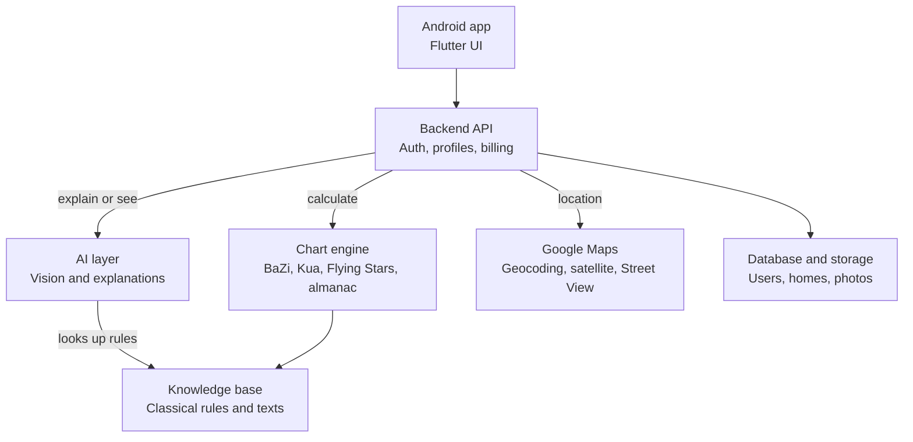
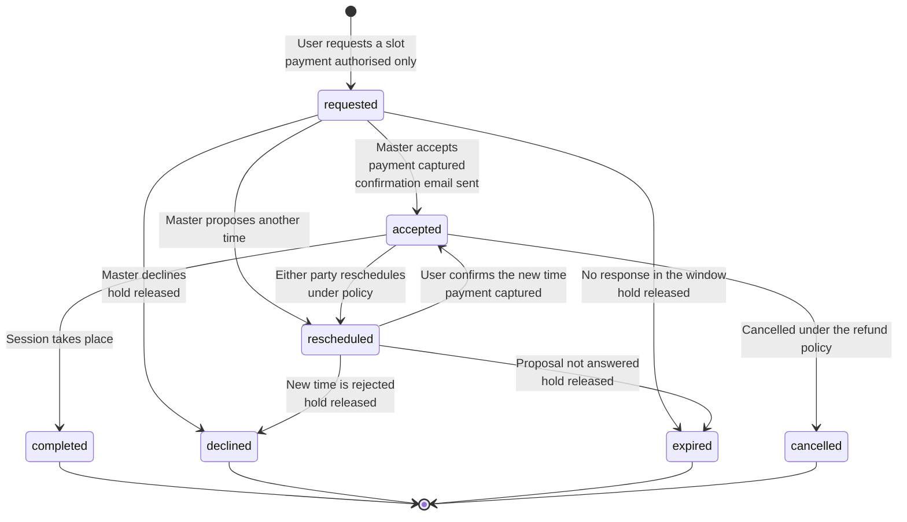

# Ultimate Feng Shui App: Product and Technical Plan

Every feature of a personal feng shui and destiny app, how each one works, the technology behind it, how it makes money, and a phased path to launch on Android.

This document is the developer-ready specification for GitHub user **bhemfine** to build from. Product intent is taken from the agreed plan. Where this document adds user stories, screens, APIs, data fields, diagrams and acceptance criteria, those are implementation details to help you build, not a change to the product. Tech stack and vendor choices are **recommendations** unless stated otherwise. Do not treat any price, commission rate, user volume or running cost as decided; those are open and should be tested after launch. The only known fee in this plan is the Google Play developer account fee of **USD 25** (one-time).

**Working title:** Ultimate Feng Shui App (final name is an open decision).  
**First market:** Singapore (and Malaysia), English and Chinese.  
**Platform:** Android first, iOS later from the same code.

## Table of contents

1. [Vision](#1-vision)
2. [How the system fits together](#2-how-the-system-fits-together)
3. [Tech stack](#3-tech-stack)
4. [Module 1: Personal profile and chart engine](#4-module-1-personal-profile-and-chart-engine)
5. [Module 2: Home and floor plan analyser](#5-module-2-home-and-floor-plan-analyser)
6. [Module 3: House hunting with Google Maps](#6-module-3-house-hunting-with-google-maps)
7. [Module 4: Relationships and compatibility](#7-module-4-relationships-and-compatibility)
8. [Module 5: Daily, monthly and yearly forecasts](#8-module-5-daily-monthly-and-yearly-forecasts)
9. [Module 6: Ask the Master](#9-module-6-ask-the-master)
10. [Module 7: Palm and face reading](#10-module-7-palm-and-face-reading)
11. [Module 8: Tarot, horoscope and I Ching](#11-module-8-tarot-horoscope-and-i-ching)
12. [Module 9: Crystals, rituals and remedies](#12-module-9-crystals-rituals-and-remedies)
13. [Module 10: Master teleconsulting marketplace](#13-module-10-master-teleconsulting-marketplace)
14. [Where AI is used and where it is not](#14-where-ai-is-used-and-where-it-is-not)
15. [Data model](#15-data-model)
16. [Monetisation](#16-monetisation)
17. [Privacy, safety and Play Store rules](#17-privacy-safety-and-play-store-rules)
18. [Roadmap](#18-roadmap)
19. [Risks and open decisions](#19-risks-and-open-decisions)
20. [MVP (Phase 1) build checklist](#20-mvp-phase-1-build-checklist)

---

## 1. Vision

One app that knows you, your family and your home, and turns classical Chinese metaphysics into clear, personal, daily advice. Feng shui and BaZi are the credible core; palm reading, tarot, horoscopes, crystals and rituals are add-on modules that make it fun and sticky.

> **Core principle:** Charts and rules are calculated by exact code, never guessed by AI. AI only reads photos and explains results in plain language, and every reading cites the rule it is based on.

| | |
| --- | --- |
| **First market** | Singapore and Malaysia, English and Chinese |
| **Platform** | Android first, iOS later from the same code |
| **Users** | Home buyers, renovators, couples, and anyone who checks their luck daily |
| **Default schools** | Flying Stars (Xuan Kong) and Eight Mansions (Ba Zhai) for homes, Four Pillars (BaZi) for people |

---

## 2. How the system fits together

The app never talks to AI or Maps directly. Everything goes through the backend, which keeps API keys safe, controls costs, and lets paid features be switched on per user.

**Recommended request flow**

1. The Flutter app sends authenticated HTTPS requests to the backend API only.
2. The API checks the user's plan (free or paid) and rate limits, then calls the chart engine, knowledge base, AI layer, Maps, or storage as needed.
3. The chart engine and knowledge base are deterministic and versioned, so the same inputs always produce the same chart.
4. AI is called only for vision (photos, floor plans, Street View) and for plain-language write-ups. Explanations must include the rule or source used.
5. Results are stored so later screens can load instantly without recalculating or re-calling AI.

---

## 3. Tech stack

These are recommended choices, not locked decisions. Swap a vendor only if it still meets the "why" column.

| Layer | Choice (recommended) | Why |
| --- | --- | --- |
| Mobile app | Flutter | One codebase for Android and iOS, smooth animations for tarot and compass |
| Backend | Node.js or Python (FastAPI) | Python has strong libraries for astronomy and image work |
| Database | PostgreSQL via Supabase | Accounts, storage and row-level security in one service |
| Calendar maths | Swiss Ephemeris plus a lunar calendar library | Exact solar terms, true solar time and lunar dates |
| AI models | A vision-capable large language model | Reads palms, floor plans and photos, and writes readings |
| Knowledge search | Vector search (pgvector) | Lets the AI quote the right classical rule |
| Maps | Google Maps Geocoding, Static Maps, Street View, Places | Address lookup, facing and surroundings |
| Payments | Google Play Billing via RevenueCat | Subscriptions and one-off reports |
| Push alerts | Firebase Cloud Messaging | Daily card and clash warnings |
| Analytics | Firebase Analytics or PostHog | See which features people use and pay for |

Module 10 (master teleconsulting) adds further recommended vendors, listed in that module: video (Agora, Twilio Video, Daily.co or Stream), payouts (Stripe Connect), chat (Stream Chat or Firebase), and transactional email (SendGrid, Postmark or Resend). Check Google Play's current policy before taking consultation payments outside Play Billing.

**Recommended supporting practices**

- API version prefix: `/v1/`.
- Auth: email/password and/or social login through the backend (recommended: Supabase Auth or equivalent JWT).
- Secrets (Maps, AI, Stripe, Play, email) live only on the server.
- Chart engine published as a versioned library with golden-test charts.
- Environments: development, staging, production.

---

## 4. Module 1: Personal profile and chart engine

The foundation. Users enter birth date, time and place for themselves and family members, and every other feature personalises from it.

| | |
| --- | --- |
| **Outputs** | BaZi Four Pillars, Day Master and element balance, luck pillars by decade, Kua number and four good and four bad directions, Zi Wei Dou Shu chart, Chinese zodiac, Western sun, moon and rising signs |
| **Inputs** | Birth date, exact time (or unknown), birthplace, gender (needed for Kua and luck pillar direction) |
| **AI used** | No for calculation; yes for the plain-language personality summary |

### How it works

1. **Convert birthplace to coordinates and time zone.** Geocoding gives longitude, which corrects clock time to true solar time.
2. **Find the solar year and month.** BaZi years start at Li Chun (around 4 February) and months at solar terms, not lunar new year, so the engine computes exact solar term moments with Swiss Ephemeris.
3. **Derive the four pillars.** Heavenly Stem and Earthly Branch for year, month, day and hour from the sexagenary cycle.
4. **Score element strength.** Count stems, hidden stems and seasonal strength to rate Wood, Fire, Earth, Metal and Water, and pick favourable elements.
5. **Calculate Kua and Zi Wei.** Kua from birth year and gender; Zi Wei from lunar date and hour using fixed star placement tables.
6. **Save and reuse.** Results are stored so every other module reads them instantly with no recalculation.

If birth time is unknown, still calculate year, month and day pillars, Kua and zodiac. Mark hour-dependent results (hour pillar, some Zi Wei palaces, Western rising sign) as unavailable rather than guessing.

### User stories

- As a new user, I want to create an account and enter my birth date, time, place and gender, so that the app can build my personal charts.
- As a user, I want to add family members (spouse, child and others) with their own birth details, so that home and compatibility features can include them.
- As a user, I want to say my birth time is unknown, so that the app still gives me the charts it can and does not invent an hour.
- As a user, I want to see my BaZi pillars, Day Master, element balance, luck pillars, Kua number and good and bad directions, Zi Wei chart, Chinese zodiac, and Western sun, moon and rising signs, so that I understand my profile in one place.
- As a user, I want a short plain-language personality summary that cites the rules used, so that the chart is easy to understand.
- As a user, I want to edit birth details and have charts recalculated, so that a typo does not stick forever.

### Key screens

- Onboarding / sign-in and sign-up.
- Add or edit person: name, relationship to the account, birth date, birth time or "time unknown", birthplace search, gender.
- Chart overview: Four Pillars, Day Master, element balance, favourable elements.
- Luck pillars by decade.
- Kua number and the four good and four bad directions (compass graphic).
- Zi Wei Dou Shu palace chart.
- Zodiac and Western natal summary (sun, moon, rising).
- Plain-language personality summary, with cited rules.
- Family / people list.

### API endpoints

| Method | Path | Purpose |
| --- | --- | --- |
| `POST` | `/v1/auth/register` | Create an account |
| `POST` | `/v1/auth/login` | Sign in and return a session token |
| `POST` | `/v1/auth/logout` | End the session |
| `GET` | `/v1/me` | Get the signed-in account and plan |
| `PATCH` | `/v1/me` | Update language, notifications and profile |
| `DELETE` | `/v1/me` | Delete the account and personal data (Play Store requirement) |
| `GET` | `/v1/people` | List people linked to the account |
| `POST` | `/v1/people` | Add a person and trigger chart calculation |
| `GET` | `/v1/people/{personId}` | Get a person and their latest charts |
| `PATCH` | `/v1/people/{personId}` | Edit birth details and recalculate charts |
| `DELETE` | `/v1/people/{personId}` | Remove a person and their charts |
| `POST` | `/v1/geo/lookup` | Geocode a birthplace to coordinates and time zone |
| `POST` | `/v1/people/{personId}/charts/calculate` | Recalculate and store all charts |
| `GET` | `/v1/people/{personId}/charts` | Fetch stored chart results |
| `POST` | `/v1/people/{personId}/summary` | Generate the AI personality summary from stored charts (not from a guessed chart) |

### Data entities

- `users`, `people`, `charts` (see [Data model](#15-data-model)).
- Chart rows should store engine version and calculation time so results can be recomputed after an engine fix.

### Acceptance criteria

- The same birth date, time, place and gender always produce the same BaZi, Kua, Zi Wei and Western natal results.
- Year and month pillars use solar terms (Li Chun and month terms), not lunar new year.
- Clock time is converted to true solar time using birthplace longitude before the hour pillar is calculated.
- Gender is required before Kua and luck-pillar direction are shown.
- Unknown birth time does not invent an hour pillar; hour-dependent outputs are marked unavailable.
- Charts are saved and later screens load the stored result without recalculating.
- Calculation is done by the chart engine, not by AI. AI is used only for the personality summary and must cite the rule or chart factor it is based on.
- Golden tests compare engine output to a set of established known charts before release.

---

## 5. Module 2: Home and floor plan analyser

Upload a floor plan or photos, set the facing direction, and get a room-by-room plan of what to place, move or fix.

### How it works

1. **Upload the plan.** A photo or PDF of the floor plan, such as an HDB or condo brochure.
2. **Detect rooms.** A vision model labels rooms, doors and windows and returns their outlines; the user corrects anything wrong by dragging.
3. **Set facing.** The user stands at the main door and the phone compass reads the bearing, or they enter it manually. Tilt and magnetic interference warnings are shown.
4. **Overlay grids.** The engine divides the plan into nine palaces and overlays the Bagua, Eight Mansions sectors and the Flying Stars chart for the building's period and facing.
5. **Match to the household.** Each person's Kua directions are compared with bedroom, bed and desk positions.
6. **Generate advice.** Rules produce findings, such as the 2 and 5 sickness stars in the master bedroom this year; AI writes them up with a cure, like metal objects or a brass wu lou.

Also included:

- Annual and monthly star refresh, with a push alert when a bad star moves into a key room
- Furniture placement for bed, desk, stove, sofa, mirrors and altar
- Photo scan for problems like a door facing a staircase, a beam over the bed, or a toilet in the centre
- Shopping list of cures and where to put each one
- Renovation date picker linked to the almanac in Module 5

**Phase note:** Phase 1 ships the analyser with **manual** room marking. AI room detection is Phase 2. The facing compass, grid overlay, household match and rule-based findings should work in Phase 1.

### User stories

- As a home owner or renovator, I want to upload a floor plan photo or PDF, so that the app can work from my actual layout.
- As a user, I want to mark or correct rooms, doors and windows, so that advice is based on a layout I agree with.
- As a user, I want to set facing with the phone compass at the main door, or type it in, and be warned about tilt or magnetic interference, so that the grid is not based on a bad reading.
- As a user, I want to see Bagua, Eight Mansions and Flying Stars overlaid on my plan, so that I know what each area means.
- As a household, I want bedroom, bed and desk positions checked against each person's Kua, so that we know who is well placed.
- As a user, I want room-by-room advice on what to place, move or fix, including furniture placement and a shopping list of cures, so that I know what to do next.
- As a user, I want to scan a room photo for common problems (door facing a staircase, beam over the bed, toilet in the centre), so that I can catch issues not obvious on the plan.
- As a user, I want a renovation date picker tied to the almanac, so that I can pick a suitable start date.
- As a user, I want a push alert when a bad star moves into a key room, so that I can place a cure in time.

### Key screens

- Home list and add-home form (name, address, property type, period or completion year).
- Floor plan upload (photo or PDF).
- Room editor: auto-detected or manual outlines, drag to correct labels (living room, bedroom, kitchen, toilet, and so on).
- Facing capture: compass with tilt and interference warnings, plus manual degrees entry.
- Plan overlay: nine palaces, Bagua, Eight Mansions, Flying Stars (period and annual or monthly).
- Findings list, grouped by room, with cited rules and suggested cures.
- Furniture placement guide (bed, desk, stove, sofa, mirrors, altar).
- Photo-scan capture and results.
- Cure shopping list, with optional shop links (Module 9).
- Renovation date picker (reuses Module 5).

### API endpoints

| Method | Path | Purpose |
| --- | --- | --- |
| `GET` | `/v1/homes` | List the user's homes |
| `POST` | `/v1/homes` | Create a home record |
| `GET` | `/v1/homes/{homeId}` | Get home, rooms, facing and latest analysis |
| `PATCH` | `/v1/homes/{homeId}` | Update address, period, completion year or notes |
| `DELETE` | `/v1/homes/{homeId}` | Remove a home and its findings |
| `POST` | `/v1/homes/{homeId}/floor-plan` | Upload a floor plan photo or PDF |
| `POST` | `/v1/homes/{homeId}/detect-rooms` | Run vision room detection (Phase 2); return outlines for the user to confirm |
| `PUT` | `/v1/homes/{homeId}/rooms` | Save manual or corrected room outlines and labels |
| `PUT` | `/v1/homes/{homeId}/facing` | Save compass or manual facing, with quality flags |
| `POST` | `/v1/homes/{homeId}/analyse` | Run Flying Stars, Bagua and Eight Mansions, match to household Kua, store findings |
| `GET` | `/v1/homes/{homeId}/findings` | List issues and cures by room and year |
| `POST` | `/v1/homes/{homeId}/photos/scan` | Scan a room photo for common form problems |
| `GET` | `/v1/homes/{homeId}/cures` | Shopping list of recommended cures and placements |
| `GET` | `/v1/homes/{homeId}/renovation-dates` | Almanac-backed renovation date suggestions |

### Data entities

- `homes`, `rooms`, `home_findings` (see [Data model](#15-data-model)).
- Floor plan and room photos go in object storage, with a retention flag.

### Acceptance criteria

- Users can upload a photo or PDF floor plan, including typical HDB or condo brochure plans.
- Users can mark rooms manually (Phase 1) and later accept or drag-correct AI outlines (Phase 2).
- Facing can be set from the compass or typed in. Tilt and magnetic interference warnings are shown.
- The plan is divided into nine palaces; Bagua, Eight Mansions and Flying Stars (for the building's period and facing) are overlaid.
- Each household member's Kua is compared with bedroom, bed and desk positions.
- Findings come from rules first (for example, 2 and 5 sickness stars in the master bedroom this year). AI only writes the explanation and names the cure and the rule.
- Furniture advice covers bed, desk, stove, sofa, mirrors and altar.
- Photo scan can flag a door facing a staircase, a beam over the bed, or a toilet in the centre.
- A cure shopping list states what to get and where to put it.
- Renovation dates are taken from the Module 5 almanac, not invented by AI.
- Annual and monthly star refresh can trigger a push alert when a bad star moves into a key room.

---

## 6. Module 3: House hunting with Google Maps

Drop a pin or paste a listing address and get a feng shui score for the home and for each household member.

### How it works

1. **Locate.** The Geocoding API turns the address into coordinates; the user picks the block and unit.
2. **Find facing.** Building footprint and satellite imagery suggest the facing; the user confirms it with the compass on site.
3. **Scan surroundings.** Places API finds hospitals, temples, cemeteries, petrol stations, substations and water within set distances. Road geometry checks for T-junctions or roads aimed at the door.
4. **Read the view.** Street View and satellite images are passed to a vision model to spot sharp corners, tall buildings in front, open space and hills behind.
5. **Score the home.** Flying Stars chart for its period, facing and completion year, plus Eight Mansions fit for each spouse's Kua.
6. **Report.** A score, who it suits, what can be cured, and a side-by-side comparison of shortlisted homes.

> **Singapore specifics to build in:** HDB and condo unit floors and their element, block facing from the unit number stack, MRT lines and expressways, and the move-in date picker.

All Maps and Street View calls go through the backend. Facing suggested from imagery is a hint only; the user should confirm it on site.

### User stories

- As a home buyer, I want to paste an address or drop a pin and pick the block and unit, so that I can score a listing before I view it.
- As a buyer, I want a suggested facing from the building footprint and satellite view, and a way to confirm it with the compass on site, so that the chart is not based on a guessed door.
- As a buyer, I want nearby hospitals, temples, cemeteries, petrol stations, substations, water, T-junctions and roads aimed at the door flagged, so that I can see external sha qi.
- As a buyer, I want Street View and satellite analysis of sharp corners, tall buildings in front, and open space or hills behind, so that form school is included.
- As a couple, I want a score for the home and a fit for each spouse's Kua, so that we know who benefits and what can be cured.
- As a buyer, I want to compare shortlisted homes side by side, so that I can choose more clearly.
- As a Singapore buyer, I want unit floor element, block facing from the stack, and nearby MRT lines or expressways included, so that the report matches local housing.
- As a buyer, I want a pre-purchase report and a move-in date picker, so that I can act on the result.

### Key screens

- New listing: address search, map pin, block and unit picker.
- Facing suggestion and on-site confirm.
- Surroundings map (Places and road flags).
- Street View / satellite findings.
- Score report: overall score, Flying Stars, Eight Mansions fit per household member, what can be cured.
- Shortlist comparison (two or more homes).
- Pre-purchase report view and share or export (PDF is a paid one-off report in monetisation).
- Move-in date picker.

### API endpoints

| Method | Path | Purpose |
| --- | --- | --- |
| `POST` | `/v1/listings/locate` | Geocode an address or pin; return candidates for block and unit |
| `POST` | `/v1/listings` | Save a shortlisted listing |
| `GET` | `/v1/listings` | List shortlisted listings |
| `GET` | `/v1/listings/{listingId}` | Get a listing and its latest score |
| `POST` | `/v1/listings/{listingId}/facing/suggest` | Suggest facing from footprint and satellite imagery |
| `PUT` | `/v1/listings/{listingId}/facing` | Confirm facing (manual or compass) |
| `POST` | `/v1/listings/{listingId}/surroundings` | Query Places and road geometry for external features |
| `POST` | `/v1/listings/{listingId}/view-analysis` | Analyse Street View and satellite images with the vision model |
| `POST` | `/v1/listings/{listingId}/score` | Build Flying Stars and Eight Mansions scores for the household |
| `GET` | `/v1/listings/compare` | Side-by-side comparison of selected listing IDs |
| `POST` | `/v1/reports/pre-purchase` | Generate a pre-purchase house check report |
| `GET` | `/v1/listings/{listingId}/move-in-dates` | Almanac-backed move-in date suggestions |

### Data entities

- `listings`, plus reuse of `homes`, `home_findings`, `people`, `charts` and `purchases` for reports (see [Data model](#15-data-model)).

### Acceptance criteria

- An address or dropped pin is geocoded; the user can pick block and unit.
- Suggested facing is shown as a suggestion and can be confirmed or overwritten on site.
- Surroundings scan covers hospitals, temples, cemeteries, petrol stations, substations and water within configured distances, plus T-junctions or roads aimed at the door.
- Street View and satellite images are analysed for sharp corners, tall buildings in front, open space and hills behind.
- The home score uses the Flying Stars chart for period, facing and completion year, and Eight Mansions fit for each spouse's (and other household members') Kua.
- The report states the score, who it suits, and what can be cured.
- Two or more shortlisted homes can be compared side by side.
- Singapore logic includes HDB and condo unit floors and their element, block facing from the unit number stack, MRT lines and expressways, and a move-in date picker.
- The app does not call Google Maps APIs directly; the backend does.

---

## 7. Module 4: Relationships and compatibility

| | |
| --- | --- |
| **Who** | Partner, crush, spouse, business partner, boss, child, or a friend |
| **Methods** | BaZi day master interaction, clashes and combinations between branches, spouse palace, zodiac harmony, Zi Wei marriage palace, Western synastry |
| **Output** | Overall fit, strengths, friction points, communication tips, and good years to marry or have children |
| **Singles** | Peach blossom timing, which months romance luck is strongest |

Both charts come from the profile engine. Rules score each pairing area, and AI turns the scores into a warm, balanced write-up that avoids fatalistic language like "you are doomed".

### User stories

- As a user, I want to run compatibility with a partner, crush, spouse, business partner, boss, child or friend, so that I can understand the relationship, not only romance.
- As a user, I want scores from BaZi (day master, clashes and combinations, spouse palace), zodiac harmony, Zi Wei marriage palace and Western synastry, so that I can see more than a single number.
- As a user, I want a write-up of overall fit, strengths, friction points, communication tips, and good years to marry or have children, written in warm, non-fatalistic language.
- As a single, I want peach blossom timing and the months when romance luck is strongest, based on my own chart.

### Key screens

- Pick two people (existing profiles or a new person).
- Relationship type selector (partner, crush, spouse, business partner, boss, child, friend).
- Compatibility report: overall fit, area scores, strengths, friction, communication tips, favourable years.
- Peach blossom / romance luck calendar for singles.
- Saved reports list.

### API endpoints

| Method | Path | Purpose |
| --- | --- | --- |
| `POST` | `/v1/compatibility` | Score two people with the rule engine and store a report |
| `GET` | `/v1/compatibility` | List saved compatibility reports |
| `GET` | `/v1/compatibility/{reportId}` | Get scores and the write-up |
| `POST` | `/v1/compatibility/{reportId}/writeup` | Generate the AI write-up from stored scores |
| `GET` | `/v1/people/{personId}/peach-blossom` | Peach blossom timing and stronger romance months |

### Data entities

- `compatibility_reports`, reusing `people`, `charts` and `readings` (see [Data model](#15-data-model)).

### Acceptance criteria

- Both charts are produced by the profile engine; the compatibility module does not invent pillars.
- Rule scores are calculated for day master interaction, branch clashes and combinations, spouse palace, zodiac harmony, Zi Wei marriage palace and Western synastry.
- The report includes overall fit, strengths, friction points, communication tips, and good years to marry or have children where the method supports it.
- The AI write-up is generated from those scores, cites the methods used, and avoids fatalistic wording such as "you are doomed".
- Singles can see peach blossom timing and months of stronger romance luck.
- Relationship type is stored so business, family and romance readings stay distinct.

---

## 8. Module 5: Daily, monthly and yearly forecasts

- Daily card: lucky colour, direction and hours, a short theme, and things good to do or avoid
- Monthly outlook: how the month's pillar interacts with your chart for career, money, health and love
- Yearly outlook: the year's pillar, your luck pillar, Tai Sui clashes and the Flying Stars for your home
- Auspicious date finder for weddings, moving, signing, launches, surgery and haircuts
- Push alerts for clash days and important solar terms

### How it works

1. **Load the day.** The engine calculates the day's stem, branch, Twelve Officers and 28 Mansions from the Tong Shu almanac rules.
2. **Compare to you.** Checks clashes, combinations and favourable elements against your BaZi.
3. **Pick do and avoid.** Almanac activity tables filtered by your personal score.
4. **Write it up.** Generated once a night for each user in a batch, so AI cost stays low and the card opens instantly.

### User stories

- As a daily user, I want a card with lucky colour, direction and hours, a short theme, and things that are good to do or avoid, personalised to my chart, not a generic zodiac horoscope.
- As a user, I want monthly and yearly outlooks covering career, money, health and love, plus Tai Sui and my home's Flying Stars for the year, so that I can plan ahead.
- As a user, I want to search auspicious dates for weddings, moving, signing, launches, surgery and haircuts, filtered by my chart.
- As a user, I want push alerts on clash days and important solar terms, so that I can be careful or prepared without opening the app.

### Key screens

- Home / today: daily card.
- Monthly outlook.
- Yearly outlook (optional PDF export is a paid one-off report).
- Auspicious date finder: activity type, date range, results with reasons.
- Notification settings for clash days and solar terms.

### API endpoints

| Method | Path | Purpose |
| --- | --- | --- |
| `GET` | `/v1/forecasts/daily` | Get today's stored daily card for the signed-in user (or a named person) |
| `GET` | `/v1/forecasts/monthly` | Get the monthly outlook |
| `GET` | `/v1/forecasts/yearly` | Get the yearly outlook, including Tai Sui and home Flying Stars when a home is linked |
| `POST` | `/v1/dates/search` | Find auspicious dates for a chosen activity and date range |
| `POST` | `/v1/devices/push-token` | Register a device for Firebase Cloud Messaging |
| `PATCH` | `/v1/me/notifications` | Update which alerts the user wants |
| `POST` | `/v1/internal/jobs/daily-cards` | Nightly batch: calculate almanac, personalise, write and store cards |

The internal job endpoint is for a scheduled worker with a service credential, not for the mobile app.

### Data entities

- `readings` (daily, monthly, yearly), plus almanac lookup data and `push_devices` (see [Data model](#15-data-model)).

### Acceptance criteria

- The daily card is based on the day's stem and branch, Twelve Officers and 28 Mansions, then filtered by the user's BaZi (clashes, combinations, favourable elements).
- The card shows lucky colour, direction and hours, a short theme, and do / avoid items.
- Cards are generated in a nightly batch and open instantly from storage, not by calling AI on each open.
- Monthly outlook explains how the month's pillar interacts with the user's chart for career, money, health and love.
- Yearly outlook includes the year's pillar, the user's luck pillar, Tai Sui clashes, and Flying Stars for the linked home.
- The date finder supports weddings, moving, signing, launches, surgery and haircuts.
- Push alerts can be sent for clash days and important solar terms.
- Almanac and clash logic are rule-based. AI only writes the prose and cites the rule.

---

## 9. Module 6: Ask the Master

A chat that knows your charts, your home and your family. Ask anything, like whether to take a job offer, which month to launch, or where to put a fish tank.

### How it works

1. **Gather context.** Your stored charts, home analysis and today's almanac are attached to the question.
2. **Look up rules.** The question is matched against the knowledge base of classical texts and rule sets, such as the GitHub skill repos and public-domain classics.
3. **Answer with sources.** The AI answers only from the calculated data and retrieved rules, and names the rule it used.
4. **Stay safe.** Health, legal and investment questions get guidance plus a note to see a professional.

Use reference skill repos only in line with their licences. Some have no stated licence; those may be studied but should not be copied into a commercial app without permission. Prefer public-domain classics and MIT-licensed material.

### User stories

- As a user, I want to ask a free-form question and have the chat already know my charts, home and family, so that I do not have to re-enter context.
- As a user, I want answers grounded in calculated data and retrieved rules, with the rule named, so that I can trust the advice more than a generic chatbot.
- As a user, I want a clear note to see a professional when I ask about health, legal or investment matters.

### Key screens

- Chat list and new chat.
- Conversation view with source or rule citations under answers.
- Context chips (which person, which home, today's almanac).
- Safety disclaimer on sensitive topics.
- Usage or remaining-question indicator if the free tier is limited (exact limit is an open pricing decision).

### API endpoints

| Method | Path | Purpose |
| --- | --- | --- |
| `GET` | `/v1/chats` | List Ask the Master conversations |
| `POST` | `/v1/chats` | Start a conversation, optionally scoped to a person and home |
| `GET` | `/v1/chats/{chatId}` | Get messages and citations |
| `POST` | `/v1/chats/{chatId}/messages` | Send a question; attach stored charts, home findings and today's almanac; retrieve rules; return an answer with sources |
| `DELETE` | `/v1/chats/{chatId}` | Delete a conversation |

### Data entities

- `chats`, `chat_messages`, `knowledge_documents` (see [Data model](#15-data-model)).

### Acceptance criteria

- Each question is answered with the user's stored charts, home analysis and today's almanac attached as context.
- The model searches the knowledge base and must name the rule or text used.
- The model must not invent chart values; it only explains calculated results and retrieved rules.
- Health, legal and investment questions include guidance plus a note to see a professional.
- Conversation history is stored and can be reopened or deleted.
- Free versus unlimited access follows the user's plan (unlimited Ask the Master is a premium feature in the monetisation table). Do not hard-code a price.

---

## 10. Module 7: Palm and face reading

| | |
| --- | --- |
| **Palm** | Photo of the dominant hand; a vision model traces heart, head, life and fate lines, mounts and hand shape, then rule tables interpret them |
| **Face** | Selfie; face landmarks map the twelve palaces and three zones of Chinese face reading |
| **Capture guide** | On-screen outline, lighting check and retake prompts for a usable photo |
| **Privacy** | Photos are processed and deleted by default unless the user chooses to save them |

### User stories

- As a user, I want to photograph my dominant hand with an on-screen outline and lighting check, so that the reading is based on a usable photo.
- As a user, I want the heart, head, life and fate lines, mounts and hand shape traced and interpreted from rule tables, so that the result is consistent.
- As a user, I want to take a selfie for Chinese face reading (twelve palaces and three zones), so that I can see a mian xiang reading.
- As a user, I want my photo deleted after processing unless I choose to save it, so that my biometrics are not kept by default.

### Key screens

- Palm capture guide (outline, lighting, retake).
- Palm overlay and reading (lines, mounts, shape, write-up).
- Face capture guide.
- Face palace overlay and reading.
- Save-photo confirmation (off by default).
- Saved readings journal.

### API endpoints

| Method | Path | Purpose |
| --- | --- | --- |
| `POST` | `/v1/readings/palm` | Upload a palm photo, run vision tracing, apply rule tables, return a reading |
| `POST` | `/v1/readings/face` | Upload a selfie, map landmarks to palaces and zones, return a reading |
| `GET` | `/v1/readings` | List palm and face readings for the user |
| `GET` | `/v1/readings/{readingId}` | Get one reading |
| `POST` | `/v1/readings/{readingId}/save-photo` | Explicitly keep the source photo |
| `DELETE` | `/v1/readings/{readingId}` | Delete a reading and any saved photo |

### Data entities

- `readings` of type `palm` or `face`, plus short-lived objects in storage (see [Data model](#15-data-model)).

### Acceptance criteria

- Capture UI shows an outline, checks lighting, and prompts a retake when the photo is not usable.
- Palm readings trace heart, head, life and fate lines, mounts and hand shape, then interpret them with rule tables, not free invention.
- Face readings map landmarks to the twelve palaces and three zones of Chinese face reading.
- Photos are processed and then deleted by default unless the user opts in to save them.
- AI is used to see the image; interpretation is grounded in rule tables and cites them.
- Birth and biometric photos are encrypted at rest while they exist.

---

## 11. Module 8: Tarot, horoscope and I Ching

- Tarot: full 78-card deck, daily card, three-card and Celtic Cross spreads, animated shuffle, and a saved reading journal
- Western astrology: natal chart, daily and monthly transits, and synastry, calculated with Swiss Ephemeris
- I Ching: virtual three-coin toss producing a hexagram and changing lines, with the classic text and a modern explanation
- Card draws and coin tosses use a proper random generator; AI only writes the interpretation

The free tier includes one tarot draw a day (see Monetisation). Do not hard-code a paid price.

### User stories

- As a user, I want to draw a daily tarot card, a three-card spread or a Celtic Cross from a full 78-card deck, with an animated shuffle, and save the reading in a journal.
- As a user, I want a Western natal chart plus daily and monthly transits, and synastry with another person, calculated with Swiss Ephemeris.
- As a user, I want a three-coin I Ching toss that shows the hexagram, changing lines, the classic text and a modern explanation.

### Key screens

- Tarot home: daily card, spread picker, shuffle animation, card meanings, journal.
- Western natal chart wheel and aspect list (reuses birth data from Module 1).
- Transits: daily and monthly.
- Synastry (can link from Module 4).
- I Ching: toss animation, hexagram, changing lines, classic text, modern explanation.
- Reading journal.

### API endpoints

| Method | Path | Purpose |
| --- | --- | --- |
| `POST` | `/v1/tarot/draw` | Draw cards with a proper random generator for a chosen spread; store the draw |
| `GET` | `/v1/tarot/journal` | List saved tarot readings |
| `GET` | `/v1/tarot/{readingId}` | Get one draw and its interpretation |
| `POST` | `/v1/tarot/{readingId}/interpret` | Write the AI interpretation of an already drawn spread |
| `GET` | `/v1/astrology/natal/{personId}` | Get the stored Western natal chart |
| `GET` | `/v1/astrology/transits` | Daily or monthly transits for a person |
| `POST` | `/v1/astrology/synastry` | Western synastry for two people |
| `POST` | `/v1/iching/cast` | Perform a three-coin toss, store hexagram and changing lines |
| `GET` | `/v1/iching/{readingId}` | Get the cast, classic text and modern explanation |

### Data entities

- `readings` of types `tarot`, `western_natal`, `transit`, `synastry`, `iching` (see [Data model](#15-data-model)).

### Acceptance criteria

- Tarot uses a full 78-card deck and supports daily card, three-card and Celtic Cross spreads, with a shuffle animation and a journal.
- Western natal, transits and synastry are calculated with Swiss Ephemeris from stored birth data.
- I Ching uses a virtual three-coin toss, then shows hexagram, changing lines, classic text and a modern explanation.
- All draws and tosses use a proper cryptographic or well-seeded random generator on the server (or a verifiable equivalent). AI must not choose the cards or coins.
- AI only writes interpretations of the already generated result.

---

## 12. Module 9: Crystals, rituals and remedies

| | |
| --- | --- |
| **Crystal advice** | Stones chosen by your missing elements, this year's stars and your goal, like citrine for wealth or rose quartz for love, with placement and cleansing guidance |
| **Rituals and remedies** | Salt water cures, cleansing baths, incense and essential oil blends, and new and full moon rituals matched to your element |
| **Safety** | Nothing to drink or apply to skin without clear warnings; no medical claims |
| **Shop** | Each recommendation links to an affiliate store or your own product range |

Whether the shop is affiliate-only or also sells your own stock is an open decision.

### User stories

- As a user, I want crystal recommendations based on my missing elements, this year's Flying Stars and a goal I choose (such as wealth, love or protection), plus where to place them and how to cleanse them.
- As a user, I want ritual and remedy recipes (salt water cures, cleansing baths, incense and essential oil blends, new and full moon rituals) matched to my element.
- As a user, I want clear warnings before anything I might drink or put on my skin, and no medical claims.
- As a user, I want an optional link to buy a recommended item, without being forced to purchase.

### Key screens

- Goal picker (wealth, love, protection, and so on).
- Crystal recommendations with placement and cleansing notes.
- Ritual and remedy recipes, each with safety warnings where needed.
- Shop item page or outbound affiliate link.
- Saved recommendations.

### API endpoints

| Method | Path | Purpose |
| --- | --- | --- |
| `GET` | `/v1/recommendations/crystals` | Recommend stones from element balance, annual stars and a stated goal |
| `GET` | `/v1/recommendations/rituals` | List matched rituals and remedies |
| `GET` | `/v1/shop/items` | Catalogue of crystals, cures and kits (affiliate or own stock) |
| `GET` | `/v1/shop/items/{itemId}` | Item detail and buy link |
| `POST` | `/v1/shop/click` | Record an affiliate or shop click (for later commission tracking) |

Checkout for own-stock items can be added later; this module only requires recommendations and a buy link. Master prescriptions in Module 10 reuse the same catalogue.

### Data entities

- `products`, `recommendations` (see [Data model](#15-data-model)).

### Acceptance criteria

- Crystal picks are based on the user's missing elements, the year's stars and the chosen goal, and include placement and cleansing guidance.
- Rituals include salt water cures, cleansing baths, incense and essential oil blends, and new and full moon rituals matched to the user's element.
- Anything to drink or apply to skin shows a clear warning. There are no medical claims.
- Each recommendation can link to an affiliate store or your own product. Purchase is optional.
- Prescriptions issued by masters (Module 10) can point at the same product catalogue.

---

## 13. Module 10: Master teleconsulting marketplace

Works like a teledoctor app. Users book verified feng shui and BaZi masters for video, voice or chat consultations, and masters can prescribe remedies like talismans, crystals and ritual kits that the user is free to buy or skip. The master sees the user's charts and home analysis, with the user's consent, so sessions start with full context.

### How it works

1. **Master onboarding.** Masters apply with their lineage, years of practice, specialities, languages, sample readings and ID. Your team vets them, and they get a verified badge.
2. **Profile and pricing.** Each master sets prices per session type (15, 30 or 60 minutes, a home audit, a date selection) and their weekly availability.
3. **Discovery.** Users browse by speciality, such as home, business, marriage or baby naming, plus language, price and rating. The app also suggests a master when a reading flags a serious issue.
4. **Booking request.** The user picks a slot from the master's calendar, adds a short note on their concern, and pays. The payment is only authorised, not charged yet.
5. **Master accepts or declines.** The master gets a push alert and email, reviews the request and the shared charts, and accepts, declines or proposes another time. Requests not answered within a set window, such as 24 hours, expire automatically.
6. **Confirmation.** Once accepted, the payment is captured and the user gets a confirmation email and push alert with the date, time, master, joining link and an add-to-calendar file. If declined or expired, the hold is released and the app suggests similar masters.
7. **Reminders.** Email and push reminders go to both sides 24 hours and 15 minutes before the session, with reschedule and cancellation links that follow the refund policy.
8. **Context sharing.** With one tap the user shares their BaZi, Kua, floor plan and Flying Stars chart with the master before the call.
9. **The session.** In-app video and voice, with screen sharing so the master can mark up the floor plan live. Instant chat questions can be sold per message or per minute.
10. **Prescription.** After the call the master issues a remedy prescription, listing each item (talisman, crystal, ritual kit, incense, wu lou), why it helps, where to place it and when. It saves to the user's profile and home like a medical record.
11. **Optional purchase.** Each prescribed item has a Buy button from the app shop or the master's own store. Nothing is added to a cart automatically and the user can ignore any item; the master earns a commission on what is bought.
12. **Follow-up.** The master adds a session summary, the user leaves a rating, and the app can remind the user when a remedy should be refreshed or moved, such as at the new year.
13. **Payout.** The app keeps a commission and pays the master out on a set schedule.

Session prices, commission rates, featured-placement fees and payout cadence are **not** fixed in this plan. Implement them as configurable values.

### Technology (recommended)

| Part | Technology |
| --- | --- |
| Video and voice calls | Agora, Twilio Video, Daily.co or Stream |
| Booking calendar | Own scheduling tables with time zone handling and reminders |
| Payments and payouts | Stripe Connect, which supports Singapore and splits commission automatically |
| Chat | Stream Chat or Firebase for text and image messages |
| Master web dashboard | A simple web portal for schedule, earnings, client charts and notes |
| Reviews and trust | Verified-booking reviews, response rate and repeat-client rate on each profile |
| Booking states | Requested, accepted, declined, expired, rescheduled, completed and cancelled, each triggering the right notice |
| Payment hold | Stripe authorise on request and capture on accept, so declined bookings are never charged |
| Emails | Transactional email through SendGrid, Postmark or Resend, with branded templates and calendar invites |
| Prescriptions | A prescriptions table linking session, master, items, notes and purchase status |

### Booking states

Each state change must send the matching push and email notices:

| New state | What happens |
| --- | --- |
| `requested` | Master receives a push alert and email to review the request and any shared charts |
| `accepted` | Payment is captured. User receives a confirmation email and push with date, time, master name, joining link, and an add-to-calendar file (.ics) |
| `declined` | Payment hold is released. User is notified and shown similar masters |
| `expired` | Payment hold is released after the unanswered window (recommended default: 24 hours; make this configurable). User is notified and shown similar masters |
| `rescheduled` | Both sides are notified of the proposed or confirmed new time |
| `completed` | Master can write a prescription and summary; user can rate the session |
| `cancelled` | Refund or capture follows the published refund policy; both sides are notified |

Reminders (email and push to both sides) go out 24 hours and 15 minutes before an accepted session, and include reschedule and cancellation links.

### Marketplace earnings (product rules, not prices)

- Commission per session, plus featured placement that masters pay for
- Commission on prescribed remedies the user chooses to buy
- Subscribers get a discount or a free short consult each year
- Packages bundle a pre-purchase house check report with a master's review
- Masters can sell their own courses or yearly outlook talks to app users

Rates and package prices are open decisions. Store them as configuration, not hard-coded constants.

> **Watch for:** Google Play lets apps take payment for real-world services like live human consultations outside Play Billing, which avoids Play's cut, but check the current policy when building. Also set clear rules for refunds, no-shows, master conduct and no guaranteed-outcome promises. Prescriptions should never be framed as medical treatment, and masters must not pressure users to buy, so prices are shown upfront and purchase is always optional.

### User stories

- As a master, I want to apply with lineage, years of practice, specialities, languages, sample readings and ID, so that I can be vetted and receive a verified badge.
- As a verified master, I want to set prices for session types (15, 30 or 60 minutes, a home audit, a date selection) and my weekly availability, so that users can request slots I can actually take.
- As a user, I want to browse masters by speciality (home, business, marriage or baby naming), language, price and rating, and be suggested a master when a reading flags a serious issue.
- As a user, I want to request a slot, add a short note, and have my card authorised but not charged until the master accepts.
- As a master, I want a push and email for each request, and to accept, decline or propose another time after reviewing the request and shared charts.
- As a user, I want a confirmation email and push, with date, time, master, joining link and a calendar file, as soon as the master accepts.
- As a user, I want the hold released and similar masters suggested if the request is declined or expires.
- As both sides, I want reminders 24 hours and 15 minutes before the session, with reschedule and cancellation links that follow the refund policy.
- As a user, I want one-tap sharing of my BaZi, Kua, floor plan and Flying Stars with the master, only with my consent.
- As both sides, I want in-app video and voice with screen sharing so the master can mark up the floor plan live, plus optional paid instant chat.
- As a master, I want to issue a prescription of talismans, crystals, ritual kits, incense or wu lou, each with why it helps, where to place it and when, saved to the user's profile and home.
- As a user, I want a Buy button on each prescribed item and nothing added to my cart automatically, so I can buy only what I choose, or nothing at all.
- As a user, I want to rate the session after a summary is added, and be reminded when a remedy should be refreshed or moved, such as at the new year.
- As a master, I want payouts on a set schedule, minus the app's commission, and a web dashboard for schedule, earnings, client charts and notes.

### Key screens

**User app**

- Master discovery and filters; suggested masters.
- Master profile (badge, specialities, languages, ratings, response rate, repeat-client rate, session types and prices shown upfront).
- Booking request: slot picker, concern note, consent to share charts, payment authorisation.
- Booking status (requested, accepted, declined, expired, rescheduled, completed, cancelled).
- Confirmation view and calendar add.
- Pre-session context sharing toggle.
- In-call video / voice, screen share and floor-plan markup, chat.
- Prescription view with optional per-item Buy buttons (never an auto-filled cart).
- Rating and review (only after a verified completed booking).
- Session history.

**Master mobile or web dashboard**

- Application / onboarding.
- Profile, session types, prices and weekly availability.
- Incoming requests: accept, decline, propose another time, view shared charts.
- Schedule, session room, live floor-plan markup.
- Write prescription and session summary.
- Earnings, payout history, reviews.

**Internal admin (vetting)**

- Application queue, ID review, approve or reject, verified badge control, conduct flags.

### API endpoints

| Method | Path | Purpose |
| --- | --- | --- |
| `POST` | `/v1/masters/applications` | Submit a master application (lineage, practice years, specialities, languages, samples, ID upload) |
| `GET` | `/v1/admin/masters/applications` | List applications for vetting (admin) |
| `POST` | `/v1/admin/masters/applications/{applicationId}/decide` | Approve (verified badge) or reject (admin) |
| `GET` | `/v1/masters` | Discover masters with filters (speciality, language, price, rating) |
| `GET` | `/v1/masters/{masterId}` | Public profile, session types, ratings and trust stats |
| `GET` | `/v1/masters/{masterId}/availability` | Bookable slots in the user's time zone |
| `PATCH` | `/v1/masters/me` | Master updates profile and session pricing |
| `PUT` | `/v1/masters/me/availability` | Master sets weekly availability |
| `GET` | `/v1/masters/suggestions` | Suggest a master when a reading flags a serious issue |
| `POST` | `/v1/bookings` | Create a booking in `requested`; authorise (do not capture) payment |
| `GET` | `/v1/bookings` | List the caller's bookings |
| `GET` | `/v1/bookings/{bookingId}` | Get booking state, slot, joining details |
| `POST` | `/v1/bookings/{bookingId}/accept` | Master accepts; capture payment; send confirmation email, push and .ics |
| `POST` | `/v1/bookings/{bookingId}/decline` | Master declines; release hold; notify and suggest similar masters |
| `POST` | `/v1/bookings/{bookingId}/propose-time` | Master proposes another time; state becomes `rescheduled` until confirmed |
| `POST` | `/v1/bookings/{bookingId}/reschedule` | Confirm a new time, or reschedule an accepted booking under policy |
| `POST` | `/v1/bookings/{bookingId}/cancel` | Cancel under the refund policy |
| `POST` | `/v1/bookings/{bookingId}/complete` | Mark the session completed |
| `POST` | `/v1/internal/jobs/expire-bookings` | Expire unanswered requests and release holds |
| `POST` | `/v1/internal/jobs/session-reminders` | Send 24-hour and 15-minute reminders |
| `POST` | `/v1/bookings/{bookingId}/share-context` | User consent to share BaZi, Kua, floor plan and Flying Stars |
| `POST` | `/v1/bookings/{bookingId}/call-token` | Issue a video or voice room token |
| `POST` | `/v1/bookings/{bookingId}/markup` | Save live floor-plan markup |
| `POST` | `/v1/prescriptions` | Master issues a prescription linked to a completed (or just-finished) session |
| `GET` | `/v1/prescriptions/{prescriptionId}` | Get prescription items, notes and purchase status |
| `POST` | `/v1/prescriptions/{prescriptionId}/items/{itemId}/purchase` | Optional buy of one item (app shop or master store); nothing is auto-added |
| `POST` | `/v1/bookings/{bookingId}/summary` | Master writes the session summary |
| `POST` | `/v1/bookings/{bookingId}/reviews` | User rates a verified completed booking |
| `GET` | `/v1/masters/me/earnings` | Master earnings and payout history |
| `POST` | `/v1/internal/jobs/payouts` | Run the scheduled master payout |

Chat-per-message or per-minute billing, if enabled, should use separate chat-session endpoints under the same booking or a lightweight chat thread, with prices configured rather than hard-coded.

### Confirmation email (accepted bookings)

Send a branded transactional email to the user when a booking becomes `accepted`. Include at least:

- Session date and time, with time zone (for Singapore users, show Asia/Singapore)
- Master name
- Session type and duration
- In-app or deep-link joining link
- An add-to-calendar file (.ics)
- Links to reschedule or cancel, following the refund policy

Also send the matching push alert. Email the master a confirmation of the accepted slot. Use the same email provider for decline, expiry, reschedule, cancellation and reminder messages.

### Data entities

- `masters`, `master_applications`, `master_availability`, `bookings`, `prescriptions`, `prescription_items`, `reviews`, `payouts` (see [Data model](#15-data-model)).

### Acceptance criteria

- A master cannot appear as bookable until an admin has vetted the application and granted a verified badge.
- Users can filter by speciality, language, price and rating, and can receive a suggestion when a reading flags a serious issue.
- Booking a slot authorises payment only. The charge is captured only on accept. Declined and expired requests never charge the user.
- Masters can accept, decline or propose another time. Unanswered requests expire after a configurable window (example from the plan: 24 hours).
- On accept, the user gets a confirmation email and push with date, time, master, joining link and an .ics calendar file.
- On decline or expiry, the hold is released and similar masters are suggested.
- Reminders go to both sides by email and push 24 hours and 15 minutes before the session, with reschedule and cancellation links that follow the refund policy.
- Booking state is one of: `requested`, `accepted`, `declined`, `expired`, `rescheduled`, `completed`, `cancelled`. Each change sends the correct notice.
- Charts and home analysis are visible to the master only after the user consents to share.
- Sessions support in-app video and voice, screen sharing, and live floor-plan markup.
- After the session, the master can issue a prescription (talisman, crystal, ritual kit, incense, wu lou) with reason, placement and timing, saved to the user's profile and home.
- Each prescribed item has its own Buy button. Nothing is added to a cart automatically. The user can buy none, some or all items. The master can earn a commission on purchased items.
- Prescriptions are not framed as medical treatment. Masters must not pressure users to buy. Prices are shown upfront.
- The user can leave a rating only for a verified completed booking. Profiles show verified-booking reviews, response rate and repeat-client rate.
- The app can remind the user when a remedy should be refreshed or moved, such as at the new year.
- Masters are paid out on a set schedule via Stripe Connect (recommended), after the app's commission.
- Refund, no-show, conduct and no-guaranteed-outcome rules are documented in-app. Recheck Google Play policy before collecting consultation payments outside Play Billing.

---

## 14. Where AI is used and where it is not

**Plain code, no AI**

- BaZi, Kua, Zi Wei and zodiac charts
- Flying Stars and Bagua grids
- Almanac good and bad days
- Compatibility scores
- Tarot draws and I Ching tosses

**AI needed**

- Reading palms, faces and photos
- Detecting rooms on floor plans
- Judging surroundings from Street View
- Writing personal readings
- Ask the Master chat

Keeping the core in code makes results consistent, testable and free to run, and keeps AI spend tied to features people pay for.

---

## 15. Data model

The original tables, with main columns filled in for builders, plus the extra tables the modules need. Types are recommended PostgreSQL types. Use UUID primary keys unless you have a reason not to. All personal tables should be owned by a `user_id` (or a master or admin role) and protected with row-level security.

### Original tables, expanded

#### `users`

Account, plan, language, notification settings.

| Column | Type (recommended) | Notes |
| --- | --- | --- |
| `id` | uuid | Primary key |
| `email` | text | Unique, used for login and transactional email |
| `auth_id` | uuid | Link to the auth provider |
| `display_name` | text | |
| `plan` | text | e.g. `free` or `premium`; do not store a price here |
| `language` | text | e.g. `en`, `zh` |
| `notification_settings` | jsonb | Daily card, clash days, solar terms, booking alerts |
| `created_at` | timestamptz | |
| `updated_at` | timestamptz | |
| `deleted_at` | timestamptz | Soft delete while account deletion is processed |

#### `people`

Birth details for the user and family, linked to a user.

| Column | Type (recommended) | Notes |
| --- | --- | --- |
| `id` | uuid | Primary key |
| `user_id` | uuid | Owner account |
| `relationship` | text | `self`, `spouse`, `child`, or other |
| `name` | text | |
| `birth_date` | date | Required |
| `birth_time` | time | Null if unknown |
| `birth_time_unknown` | boolean | Hour-dependent results stay unavailable |
| `birthplace_name` | text | |
| `birthplace_lat` | numeric | For true solar time |
| `birthplace_lng` | numeric | |
| `timezone` | text | IANA time zone |
| `gender` | text | Required for Kua and luck pillar direction |
| `created_at` | timestamptz | |
| `updated_at` | timestamptz | |

#### `charts`

Calculated BaZi, Kua, Zi Wei and natal results per person.

| Column | Type (recommended) | Notes |
| --- | --- | --- |
| `id` | uuid | Primary key |
| `person_id` | uuid | |
| `engine_version` | text | So results can be recomputed after a fix |
| `bazi` | jsonb | Year, month, day, hour stems and branches; Day Master |
| `element_balance` | jsonb | Wood, Fire, Earth, Metal, Water scores and favourable elements |
| `luck_pillars` | jsonb | Decade pillars and direction |
| `kua_number` | integer | |
| `kua_group` | text | East or West group, if used |
| `kua_good_directions` | jsonb | Four good directions |
| `kua_bad_directions` | jsonb | Four bad directions |
| `ziwei` | jsonb | Palace and star placement |
| `chinese_zodiac` | text | |
| `western_natal` | jsonb | Sun, moon, rising and full natal if calculated |
| `calculated_at` | timestamptz | |
| `true_solar_time` | time | Stored for audit when birth time is known |

#### `homes`

Address, coordinates, facing, period, floor plan and rooms.

| Column | Type (recommended) | Notes |
| --- | --- | --- |
| `id` | uuid | Primary key |
| `user_id` | uuid | |
| `name` | text | |
| `address` | text | |
| `lat` | numeric | |
| `lng` | numeric | |
| `property_type` | text | e.g. HDB, condo, landed |
| `unit_floor` | integer | Singapore floor-element logic |
| `unit_number` | text | For block / stack facing hints |
| `facing_degrees` | numeric | Confirmed facing |
| `facing_source` | text | `compass`, `manual`, or `suggested` |
| `facing_quality` | jsonb | Tilt or magnetic interference flags |
| `period` | integer | Xuan Kong period |
| `completion_year` | integer | |
| `floor_plan_url` | text | Object storage |
| `created_at` | timestamptz | |
| `updated_at` | timestamptz | |

Rooms are stored in a child table so outlines can be edited independently:

#### `rooms`

| Column | Type (recommended) | Notes |
| --- | --- | --- |
| `id` | uuid | Primary key |
| `home_id` | uuid | |
| `label` | text | Living room, master bedroom, kitchen, toilet, and so on |
| `outline` | jsonb | Polygon on the floor plan |
| `doors` | jsonb | Optional door segments |
| `windows` | jsonb | Optional window segments |
| `source` | text | `manual` or `detected` |
| `updated_at` | timestamptz | |

#### `home_findings`

Each issue and cure found for a home, by room and year.

| Column | Type (recommended) | Notes |
| --- | --- | --- |
| `id` | uuid | Primary key |
| `home_id` | uuid | |
| `room_id` | uuid | Nullable if the finding is house-wide |
| `year` | integer | Annual star year |
| `month` | integer | Nullable for annual-only findings |
| `category` | text | e.g. flying_star, form, kua_fit, furniture |
| `issue` | text | |
| `stars` | jsonb | e.g. 2 and 5 sickness stars |
| `cure` | text | e.g. metal objects, brass wu lou |
| `rule_cite` | text | Rule the finding is based on |
| `writeup` | text | Optional AI prose |
| `created_at` | timestamptz | |

#### `readings`

Daily cards, forecasts, tarot, palm and compatibility results.

| Column | Type (recommended) | Notes |
| --- | --- | --- |
| `id` | uuid | Primary key |
| `user_id` | uuid | |
| `person_id` | uuid | Subject of the reading, when applicable |
| `type` | text | `daily_card`, `monthly`, `yearly`, `tarot`, `palm`, `face`, `compatibility`, `iching`, `horoscope`, `transit` |
| `title` | text | |
| `content` | jsonb | Structured result (scores, cards, lines, do/avoid, and so on) |
| `writeup` | text | Optional AI prose |
| `rule_cites` | jsonb | Rules or texts cited |
| `photo_url` | text | Only if the user chose to save a palm or face photo |
| `photo_delete_after` | timestamptz | Default: delete soon after processing |
| `period_start` | date | For daily, monthly, yearly |
| `period_end` | date | |
| `created_at` | timestamptz | |

Compatibility can also use a dedicated table (below) and still store a `readings` row for the journal.

#### `chats`

Ask the Master conversation history.

| Column | Type (recommended) | Notes |
| --- | --- | --- |
| `id` | uuid | Primary key |
| `user_id` | uuid | |
| `person_id` | uuid | Optional focus person |
| `home_id` | uuid | Optional focus home |
| `created_at` | timestamptz | |
| `updated_at` | timestamptz | |

#### `chat_messages`

| Column | Type (recommended) | Notes |
| --- | --- | --- |
| `id` | uuid | Primary key |
| `chat_id` | uuid | |
| `role` | text | `user` or `assistant` |
| `body` | text | |
| `citations` | jsonb | Retrieved rules or texts |
| `created_at` | timestamptz | |

#### `purchases`

Subscriptions and one-off reports bought.

| Column | Type (recommended) | Notes |
| --- | --- | --- |
| `id` | uuid | Primary key |
| `user_id` | uuid | |
| `kind` | text | `subscription`, `report`, `shop`, `consult`, `chat` |
| `sku` | text | Store product id |
| `provider` | text | e.g. `revenuecat`, `stripe` |
| `provider_ref` | text | External payment or entitlement id |
| `status` | text | e.g. `authorised`, `captured`, `released`, `refunded`, `failed` |
| `amount_cents` | integer | Store the charged amount when known; do not hard-code catalogue prices in code |
| `currency` | text | |
| `metadata` | jsonb | Linked report, booking or item ids |
| `created_at` | timestamptz | |

### Additional tables the modules need

#### `listings`

Shortlisted homes for Module 3.

| Column | Type (recommended) | Notes |
| --- | --- | --- |
| `id` | uuid | Primary key |
| `user_id` | uuid | |
| `address` | text | |
| `lat`, `lng` | numeric | |
| `block` | text | |
| `unit` | text | |
| `unit_floor` | integer | |
| `facing_degrees` | numeric | |
| `facing_confirmed` | boolean | |
| `completion_year` | integer | |
| `period` | integer | |
| `surroundings` | jsonb | Places and road flags |
| `view_analysis` | jsonb | Street View / satellite findings |
| `score` | jsonb | Overall score and per-person Kua fit |
| `created_at` | timestamptz | |

#### `compatibility_reports`

| Column | Type (recommended) | Notes |
| --- | --- | --- |
| `id` | uuid | Primary key |
| `user_id` | uuid | |
| `person_a_id` | uuid | |
| `person_b_id` | uuid | |
| `relationship_type` | text | Partner, crush, spouse, business partner, boss, child, friend |
| `scores` | jsonb | Per-method scores from the rule engine |
| `writeup` | text | AI prose, non-fatalistic |
| `created_at` | timestamptz | |

#### `knowledge_documents`

Classical rules and texts for retrieval.

| Column | Type (recommended) | Notes |
| --- | --- | --- |
| `id` | uuid | Primary key |
| `title` | text | |
| `source` | text | Licence and origin |
| `licence` | text | Required before use in a commercial app |
| `body` | text | |
| `embedding` | vector | pgvector, recommended |
| `created_at` | timestamptz | |

#### `products`

Shop catalogue for crystals, cures, talismans, kits (Module 9 and prescriptions).

| Column | Type (recommended) | Notes |
| --- | --- | --- |
| `id` | uuid | Primary key |
| `name` | text | |
| `kind` | text | `crystal`, `talisman`, `ritual_kit`, `incense`, `wu_lou`, other |
| `description` | text | No medical claims |
| `safety_warning` | text | Required if ingested or applied to skin |
| `buy_url` | text | Affiliate or own-store link |
| `master_id` | uuid | Nullable; master's own store item |
| `active` | boolean | |

#### `masters`

| Column | Type (recommended) | Notes |
| --- | --- | --- |
| `id` | uuid | Primary key |
| `user_id` | uuid | Login for the master |
| `display_name` | text | |
| `lineage` | text | |
| `years_of_practice` | integer | |
| `specialities` | jsonb | Home, business, marriage, baby naming, and so on |
| `languages` | jsonb | |
| `verified` | boolean | Set only after vetting |
| `bio` | text | |
| `session_types` | jsonb | 15 / 30 / 60 minutes, home audit, date selection, and prices set by the master |
| `stripe_account_id` | text | Stripe Connect account |
| `response_rate` | numeric | Shown on the profile |
| `repeat_client_rate` | numeric | Shown on the profile |
| `featured` | boolean | Paid placement; fee is configurable |
| `created_at` | timestamptz | |

#### `master_applications`

| Column | Type (recommended) | Notes |
| --- | --- | --- |
| `id` | uuid | Primary key |
| `master_id` | uuid | |
| `sample_urls` | jsonb | Sample readings |
| `id_document_url` | text | Encrypted storage; restricted access |
| `status` | text | `pending`, `approved`, `rejected` |
| `reviewer_notes` | text | |
| `decided_at` | timestamptz | |

#### `master_availability`

| Column | Type (recommended) | Notes |
| --- | --- | --- |
| `id` | uuid | Primary key |
| `master_id` | uuid | |
| `timezone` | text | |
| `weekly_rules` | jsonb | Weekly hours |
| `exceptions` | jsonb | Days off or extra slots |

#### `bookings`

| Column | Type (recommended) | Notes |
| --- | --- | --- |
| `id` | uuid | Primary key |
| `user_id` | uuid | |
| `master_id` | uuid | |
| `session_type` | text | |
| `starts_at` | timestamptz | Stored in UTC; display in the user's and master's zones |
| `ends_at` | timestamptz | |
| `status` | text | `requested`, `accepted`, `declined`, `expired`, `rescheduled`, `completed`, `cancelled` |
| `concern_note` | text | |
| `context_shared` | boolean | User consent for charts and home |
| `payment_id` | uuid | Link to `purchases` |
| `join_url` | text | Filled on accept |
| `proposed_starts_at` | timestamptz | When a new time is proposed |
| `cancel_reason` | text | |
| `created_at` | timestamptz | |
| `updated_at` | timestamptz | |
| `expires_at` | timestamptz | Request window, e.g. 24 hours after request |

#### `prescriptions`

A prescriptions table linking session, master, items, notes and purchase status.

| Column | Type (recommended) | Notes |
| --- | --- | --- |
| `id` | uuid | Primary key |
| `booking_id` | uuid | The session |
| `master_id` | uuid | |
| `user_id` | uuid | |
| `home_id` | uuid | Optional link to the user's home record |
| `notes` | text | Session-level notes; not medical treatment |
| `created_at` | timestamptz | |

#### `prescription_items`

| Column | Type (recommended) | Notes |
| --- | --- | --- |
| `id` | uuid | Primary key |
| `prescription_id` | uuid | |
| `product_id` | uuid | Optional catalogue link |
| `name` | text | Talisman, crystal, ritual kit, incense, wu lou, and so on |
| `reason` | text | Why it helps |
| `placement` | text | Where to place it |
| `timing` | text | When to use or refresh it |
| `purchase_status` | text | `not_bought` (default), `bought`, `skipped` |
| `purchase_id` | uuid | Set only if the user chooses to buy |

Nothing is inserted into a cart when the prescription is created.

#### `reviews`

| Column | Type (recommended) | Notes |
| --- | --- | --- |
| `id` | uuid | Primary key |
| `booking_id` | uuid | Unique; only completed verified bookings |
| `user_id` | uuid | |
| `master_id` | uuid | |
| `rating` | integer | |
| `comment` | text | |
| `created_at` | timestamptz | |

#### `payouts`

| Column | Type (recommended) | Notes |
| --- | --- | --- |
| `id` | uuid | Primary key |
| `master_id` | uuid | |
| `period_start` | date | |
| `period_end` | date | |
| `gross_cents` | integer | |
| `commission_cents` | integer | App share; rate is configurable |
| `net_cents` | integer | |
| `status` | text | |
| `provider_ref` | text | Stripe transfer id |
| `created_at` | timestamptz | |

#### Other useful tables

| Table | Holds |
| --- | --- |
| `push_devices` | User or master device tokens for Firebase Cloud Messaging |
| `email_log` | Transactional emails sent (confirmation, reminders, decline, expiry) |
| `floor_plan_markups` | Live markup from a session, linked to `booking_id` and `home_id` |

---

## 16. Monetisation

| Stream | What is sold |
| --- | --- |
| Free tier | Profile, basic BaZi chart, daily card, one tarot draw a day |
| Premium subscription | Full forecasts, home analyser, compatibility, unlimited Ask the Master, ad-free |
| One-off reports | Pre-purchase house check, couple report, yearly outlook PDF, baby or business name analysis |
| Shop | Crystals and cures through affiliate links or your own stock |
| Master teleconsulting | Video, voice and chat sessions with verified masters; the app takes a commission and sells featured placement |
| Ads | Light ads on the free tier only |

Price points should be tested after launch. Running costs scale with users and come mainly from AI calls, Maps API calls and hosting, so heavy AI features sit behind the paid tier.

Do not hard-code subscription, report, consultation or shop prices in this specification. Implement catalogue prices, commissions, featured-placement fees, subscriber consult discounts and payout schedules as configuration that can be changed without an app release.

Subscriptions and one-off digital reports are expected to use Google Play Billing (recommended: RevenueCat). Live human consultations may be payable outside Play Billing if current Play policy still treats them as real-world services; recheck the policy before building. Shop fulfilment may be affiliate (outbound) or your own checkout, depending on the open decision in [Risks and open decisions](#19-risks-and-open-decisions).

---

## 17. Privacy, safety and Play Store rules

- Birth data and photos encrypted at rest; photos deleted after processing unless saved
- Clear privacy policy and in-app account deletion, both required by Google Play
- Comply with Singapore's Personal Data Protection Act (PDPA)
- Entertainment and guidance disclaimer on health, money and legal topics
- No medical, financial or guaranteed-outcome claims in readings or store listing
- New personal developer accounts must run a closed test with testers before going public

**Google Play developer account:** a one-time fee of **USD 25**. This is the only fixed cost named in this plan.

**Builder notes**

- Publish a privacy policy URL before the closed test.
- In-app account deletion must remove or anonymise birth data, photos, chats, bookings that are no longer legally required, and stored charts.
- Collect only the birth and location data needed to calculate charts and score homes.
- Masters' ID documents are highly restricted and should not be visible to ordinary users or other masters.
- Every sensitive reading screen and the Play Store listing should carry the entertainment and guidance disclaimer.
- Prescriptions and rituals must not be presented as medical treatment.

---

## 18. Roadmap

1. **Phase 0: Foundations.** Brand and name, Google Play developer account, design of key screens, chart engine built and tested against known charts.
2. **Phase 1: First version.** Profile and BaZi chart, Kua directions, daily card, floor plan analyser with manual room marking, basic subscription. Closed test on Android.
3. **Phase 2: Public launch.** AI room detection, monthly and yearly forecasts, compatibility, Ask the Master, push alerts.
4. **Phase 3: House hunting.** Google Maps scoring, Street View analysis, home comparison, pre-purchase report.
5. **Phase 4: Spiritual modules.** Palm and face reading, tarot, Western astrology, I Ching, crystals and rituals, shop.
6. **Phase 5: Master marketplace.** Recruit and vet a first group of masters, launch booking, payments, video calls and the master dashboard. A soft launch with a few masters can start earlier, booked manually.
7. **Phase 6: Growth.** iOS, Chinese language, referral rewards, master courses.

A recommended detailed checklist for Phase 0 and Phase 1 is in [MVP (Phase 1) build checklist](#20-mvp-phase-1-build-checklist).

---

## 19. Risks and open decisions

### Risks

- Calculation errors destroy trust, so test against established charts
- Schools disagree, so state the method used
- Compass readings indoors can be wrong
- AI costs can climb with heavy free users
- Licences on some reference repos

### Decisions for you

- App name and brand style
- English only, or Chinese from day one
- Which features are free
- Own crystal products or affiliate only
- Whether to partner with a real master for credibility

The monetisation table already recommends a free-tier set (profile, basic BaZi chart, daily card, one tarot draw a day) and a premium set. Treat that split as a starting recommendation until the "which features are free" decision is confirmed.

**Builder notes on risks**

- Keep a versioned golden-test suite for the chart engine and refuse to ship engine changes that fail it.
- Show the school and method on every home and people reading (default: Flying Stars and Eight Mansions for homes, BaZi for people).
- Surface compass tilt and magnetic interference warnings, and always allow manual facing entry.
- Put heavy AI features behind the paid tier and batch work (as with the nightly daily card) to control cost.
- Record the licence of every knowledge-base text. Do not copy unlicensed GitHub skill code into the commercial app.

---

## 20. MVP (Phase 1) build checklist

Phase 1, plus the Phase 0 foundations it depends on: a closed-test Android app with profile and BaZi chart, Kua directions, daily card, floor plan analyser with **manual** room marking, and basic subscription. Items below are for that scope only. Later phases are listed so work is not pulled forward by accident.

### Phase 0: Foundations

- [ ] Decide or set a temporary app name and a simple brand style (final name is still an open decision).
- [ ] Create the Google Play developer account (one-time **USD 25**).
- [ ] Write a privacy policy and the entertainment / guidance disclaimer.
- [ ] Design key screens: sign-in, add person, chart overview, Kua directions, daily card, floor plan upload, manual room editor, facing compass, findings, paywall.
- [ ] Scaffold the recommended Flutter Android app and the backend API (`/v1/`), with staging and production environments.
- [ ] Provision PostgreSQL (recommended: Supabase), object storage, and auth.
- [ ] Build the chart engine with Swiss Ephemeris and a lunar calendar library: true solar time, solar terms (Li Chun and month terms), Four Pillars, element strength, Kua.
- [ ] Add golden tests against a set of established known charts; do not ship until they pass.
- [ ] State the method used on chart screens (BaZi for people; Flying Stars and Eight Mansions when the home analyser runs).

### Phase 1: App features

- [ ] Account registration, login, logout, and in-app account deletion.
- [ ] Add, edit and list people (birth date, time or unknown, birthplace geocoding, gender).
- [ ] Calculate and store BaZi Four Pillars, Day Master, element balance, luck pillars, and Kua number with four good and four bad directions.
- [ ] Chart and Kua screens load stored results without recalculating each time.
- [ ] Unknown birth time does not invent an hour pillar.
- [ ] Daily card: rule-based lucky colour, direction and hours, short theme, and do / avoid, personalised to the user's BaZi from Tong Shu rules (stem, branch, Twelve Officers, 28 Mansions). Generate in a nightly batch so the card opens instantly.
- [ ] Optional AI write-up for the daily card and a short personality summary, each citing the rule used. If AI is not ready for the closed test, ship a template write-up from the same rule outputs.
- [ ] Create a home, upload a floor plan photo or PDF, mark rooms / doors / windows **manually**, set facing with compass or manual entry, show tilt and interference warnings.
- [ ] Overlay nine palaces, Bagua, Eight Mansions and Flying Stars for the building's period and facing.
- [ ] Match household Kua directions to bedroom, bed and desk positions.
- [ ] Generate rule-based findings and cures (for example, 2 and 5 stars in the master bedroom) and list a simple cure shopping list. AI room detection and photo scan wait until later phases.
- [ ] Basic subscription: Google Play Billing via RevenueCat (recommended), free versus premium entitlements, and a paywall. Gate premium features agreed for launch; use the monetisation table as the recommended split. Do not hard-code prices.
- [ ] Light in-app disclaimer on health, money and legal topics.
- [ ] Birth data encrypted at rest; PDPA-aware data handling.

### Closed test (required for new personal Play accounts)

- [ ] Set up a closed test track on Google Play and recruit testers for the required test period before any public listing.
- [ ] Provide a privacy policy URL and store listing that makes no medical, financial or guaranteed-outcome claims.
- [ ] Test on physical Android devices: chart accuracy, compass facing, floor plan markup, daily card, purchase and restore of the subscription, account deletion.

### Explicitly out of scope for Phase 1

- AI room detection, monthly and yearly forecasts, compatibility, Ask the Master, and push alerts (Phase 2).
- Google Maps house scoring, Street View analysis, home comparison, pre-purchase report (Phase 3).
- Palm and face reading, tarot, Western astrology, I Ching, crystals and rituals, shop (Phase 4).
- Master marketplace booking, payments, video calls and dashboard (Phase 5). A soft launch with a few masters can start earlier, booked **manually**, without the full marketplace.
- iOS, Chinese language, referral rewards, master courses (Phase 6), unless you decide Chinese is required from day one.

### Definition of done for the closed test

A tester can create an account, enter birth details, see a correct BaZi chart and Kua directions, open today's daily card, upload a floor plan, mark rooms by hand, set facing, see overlays and household-matched findings, and complete or restore a basic subscription, then delete their account. Chart results match the golden-test set.
